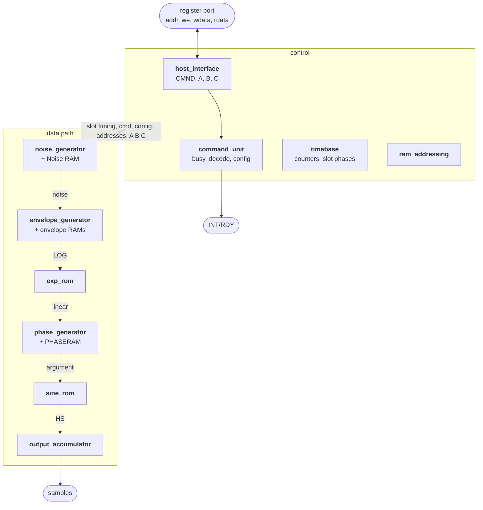
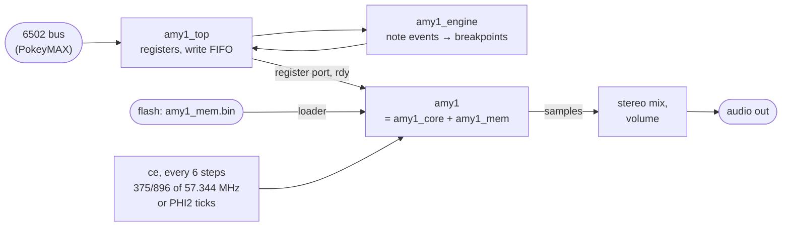
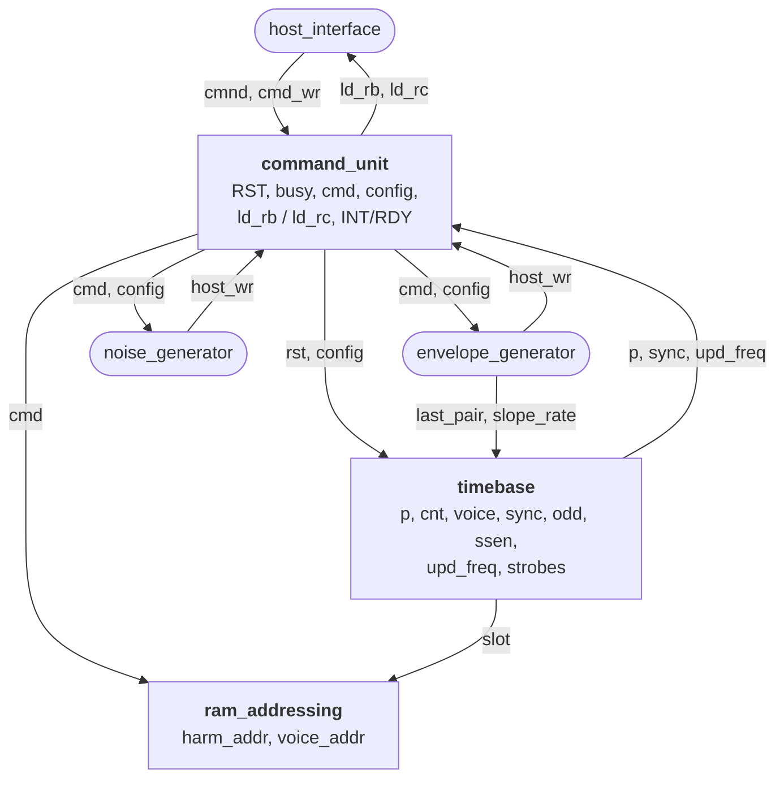
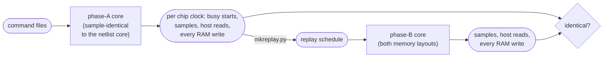

# AMY1 in VHDL

The AMY 1 is Atari's additive-synthesis sound chip of 1983–85: 64 sine harmonics shared out among 8
voices, each harmonic with its own amplitude envelope, each voice with a frequency envelope, plus two
noise generators. It never shipped. This package rebuilds it in VHDL from the chip's own SILOS netlist
(Dec 1985, "AMY1 version 3 including host sync modifications"), for the PokeyMAX (MAX 10 10M16).

It started as a netlist-exact translation, one statement per node. That was split into the netlist's
schematic blocks, each block was rewritten by hand to a spec (`AMY1_SPEC.md`), and the result was
regrouped into functional units with clean interfaces (phase A), still sample-identical to the
netlist core. Phase B (this package) drops the chip's pins and its six-step clock: the core is
plain synchronous RTL with one clock enable per chip clock (`ce`) and a register port. With the
host accesses replayed on the same chip clocks it is still identical to phase A in every sample and
every RAM write. The core is about a third of its original size.

## The chip at a glance



In every slot of four internal clocks (32 slots, 128 clocks per sample period with 64 harmonics), the
timebase visits two harmonics. For each:

1. The envelope generator reads the harmonic's state from its RAMs, steps the amplitude (or a voice's
   frequency) and writes it back. It turns the amplitude into a log value.
2. exp_rom makes the log value linear.
3. The phase generator turns frequency into phase and builds the sine argument.
4. sine_rom's value is added into the output accumulator.

At the spec's 8 MHz a sample period is 32 µs (31.25 kHz).

Around the chip, `amy1_top` is the PokeyMAX wrapper:



## Files

| file | what it is |
|---|---|
| `vhdl/amy1_top.vhd` | PokeyMAX wrapper: memory loader, `ce`, host write FIFO, stereo output, the note engine (`ENGINE`) |
| `vhdl/amy1_engine.vhd` | note engine: note events in, every harmonic breakpoint out (see below) |
| `vhdl/amy1.vhd` | the chip: `amy1_core` + the memories (`MEM_PACKED`), and `NOISE_FIX` |
| `vhdl/amy1_core.vhd` | the core: the ten units wired together |
| `vhdl/amy1_pkg.vhd` | types shared by the units: the decoded host command, the configuration |
| `vhdl/amy1_<unit>.vhd` (10 files) | the units, see "The core in units" |
| `vhdl/amy1_mem.bin` / `.hex` | the memory image to put in flash (1208 32-bit words, little endian in the .bin), logical addresses |
| `vhdl/amy1_mem_packed.vhd` | memory layout for the FPGA: 4 M9Ks, nothing in logic (architecture `packed`, the default) |
| `vhdl/amy1_mem.vhd` | the 12 RAMs/ROMs, one block each: the reference layout (architecture `rtl`) |
| `vhdl/amy1_mem_pkg.vhd` | memory types and the image layout (generated) |
| `vhdl/amy1_dpram_altera.vhd` / `amy1_dpram_sim.vhd` | true dual-port RAM for the ROM pairs: altsyncram for Quartus / behavioural for GHDL |
| `vhdl/tb_top.vhd`, `tb_amy1b.vhd`, `tb_engine.vhd` | testbenches: `amy1_top` at 57.344 MHz, the chip driven by a replay schedule, the engine alone |
| `AMY1_SPEC.md` | the behavioural spec: timing, formats, every unit, quirks and decisions |
| `INTERFACE_REVIEW.md` | the review behind the unit structure and interface, the decisions, phase B as built |
| `gen/` | the generators (`silos2v.py`, `vhdlgen.py`, `stepcut.py`) and their inputs |
| `tools/` | `mkreplay.py` (replay schedule), `timedev.py` and `pcmdev.py` (timing and audio deviation), `noisecheck.py` (noise against the bit-exact model), `logimage.py` (the image in logical order), `mkcmd.py` (command-file builder, the GENERATOR.PAS API) |
| `docs/amy_docs_ocr.txt` | OCR text of the original AMY documents (1983 spec binder, notes), for reference |
| `HANDOVER.md` | state of the work, decisions, contracts, how to test, open items |
| `test/` | command files, `run_phaseB.sh`, the phase-A reference (`phaseA_ref/`), noise and engine tests |
| `vbi/` | a VBI music player for the Atari that drives the engine |

To add it to a Quartus project, include `amy1_mem_pkg`, `amy1_dpram_altera`, `amy1_mem_packed` and
`amy1_mem`, then `amy1_pkg`, the ten unit files, `amy1_core`, `amy1`, `amy1_engine` and `amy1_top`.
The design files are strict VHDL-93; the testbenches need VHDL-2008. **The flash image changed:**
the envelope RAM sections are now in logical order, so program the new `amy1_mem.bin` with the new
bitstream (an old image still plays, but its few non-zero power-up voice values land on other
voices).

## The core in units

| file | what it does | LUTs / FFs |
|---|---|---|
| `amy1_host_interface.vhd` | the command register and registers A, B, C: a synchronous register port | 32 / 29 |
| `amy1_command_unit.vhd` | reset, command handshake and busy, decode into `cmd`, SCR and SOR (`config`), INT/RDY, read-back loads | 40 / 17 |
| `amy1_timebase.vhd` | clock, sample and voice counters, P0–P3, period end, voice and sample strobes | 51 / 38 |
| `amy1_ram_addressing.vhd` | harmonic and voice RAM addresses: the slot's, or the command's | 14 / 2 |
| `amy1_envelope_generator.vhd` | the 72 envelopes and their RAMs: step, write back, host writes, noise offset, LOG, read-back value | 261 / 100 |
| `amy1_noise_generator.vhd` | the two noise generators and the Noise RAM (all 32 rows with 40 harmonics too) | 72 / 81 |
| `amy1_exp_rom.vhd` | log-to-linear lookup | 76 / 93 |
| `amy1_phase_generator.vhd` | voice phase accumulators, harmonic sine arguments | 188 / 52 |
| `amy1_sine_rom.vhd` | quarter-wave sine lookup with interpolation | 38 / 67 |
| `amy1_output_accumulator.vhd` | sample accumulator and sample latch | 81 / 34 |
| **whole core** | | **815 / 514** |

Sizes are from Yosys (generic 4-LUT, flattened, memories outside), each unit synthesised alone. The whole
core is smaller than the sum because Yosys optimises across units. For comparison: stage 1 was 2,202 /
1,437, stage 2 970 / 558 and phase A 899 / 534. Each entity is `amy1_<name>`, so it doesn't clash with PokeyMAX's own
units (the SID has an envelope generator too).

How the control units connect:



The interfaces follow five rules, set out in `INTERFACE_REVIEW.md`:

1. Signals between units are valid for a whole chip clock.
2. They are active high.
3. Each memory has one owner. The envelope generator owns the envelope RAMs, because they hold the 72
   envelopes' state, and the noise generator owns the Noise RAM.
4. A command is decoded once, into `cmd`.
5. Groups of signals travel as records (`amy1_pkg`).

**The chip's interface** (`amy1.vhd`):

| port | |
|---|---|
| `clk`, `ce`, `reset` | `ce` = one AMY internal clock (4 MHz at the spec's 8 MHz CLOCK); every register updates on `clk` when `ce` is high. `ce` must be low on the clk before each `ce` (two clks with the packed memories). `reset` is synchronous, active high |
| `addr`, `we`, `wdata`, `rdata` | registers 0 command, 1 A, 2 B, 3 C. `we` writes at the `clk` edge; `rdata` is the addressed register (the command register reads FF) |
| `rdy` | INT/RDY. READY mode: high when no command is pending or running (it falls in the chip clock after a command write; the command is busy from the clock after that). INT mode: a pulse at the end of each command |
| `sample`, `sample_stb`, `sample_v0` | the 17-bit sum, two's complement; `sample_stb` is high for the one chip clock in which a new sample appears (count it at `ce`); `sample_v0` marks voice 0 in INDIVIDUAL mode |
| `load_*` | the memory image, while in reset |
| `aux_*` | the note engine's port on the VOICE M9K (packed layout only) |

The memory contract inside: the address presented in chip clock n has its data before the `ce` that
ends clock n, and a write enabled in clock n happens at that `ce`.

## How it was checked



**Stage 2.** Each hand-written block ran alongside its generated, netlist-exact version inside the
core, and every output was compared at every step. The full core was sample-identical to the netlist
core in quickclr_spec, rich_spec and the drum test, with `NOISE_FIX` on and off.

**Phase A.** The interfaces changed, so the check moved to what the core does rather than what its
blocks say to each other: host reads and every RAM write as well as the samples, against the stage-2
core. Identical, apart from the power-up write before the first clock (D3 in the spec).
`test/phaseA_ref/run_phaseA.sh` repeats it against the stored logs in `test/results/phaseA/`.

**Phase B: aligned replay.** Without the pins, the core cannot see the same bus cycles, and without
the synchroniser a command starts on a different clock. So the phase-A core logs, per chip clock, when
each command's busy starts and when its reset ends, and `tools/mkreplay.py` makes a schedule that
writes each command to the phase-B core two clocks before that (and A, B, C and the host reads on
their own clocks). `tb_amy1b` replays it. In quickclr_spec, rich_spec, the read-back test with host
reads, and the drum test with `NOISE_FIX` on and off, the samples, host reads and every RAM write
(clock, RAM, address, data) are identical, for the packed memories with `ce` every 3 and 4 clks and the
`rtl` memories every 2 and 4.

**Phase B: unaligned.** Through `amy1_top` (FIFO and RDY handshake), with phase A and with phase B
inside, `tools/timedev.py` reports how far each command's busy start moved, and compares the audio by
short-time spectrum (64-sample frames, magnitude only, so a phase shift doesn't count) and level:

| test | busy start, B − A | spectrum error, median / max | level, max \|ΔdB\| |
|---|---|---|---|
| quickclr_spec | −4 clocks (−75 .. −3) | 0.000 / 0.061 | 0.36 |
| quickclr_spec, 40 harmonics | −4 (−75 .. −3) | 0.029 / 0.039 | 0.20 |
| rich_spec, SUM and INDIVIDUAL | −4 (−75 .. −3) | 0.002 / 0.079 | 0.59 |
| rich_spec, INDIVIDUAL, voice 0 left, voice 1 right | −4 (−75 .. −3) | 0.001 / 0.091 | 0.34 |
| drums | −33 (−108 .. −3) | 4.0 / 30 | 29 |
| drums, SCR (end of NZINIT) written 100 clocks later, a diagnostic run (see below) | −8 | 0.24 / 0.52 | 1.4 |

Each command now runs 3–4 chip clocks earlier, and up to 140 inside a burst: the old wrapper needed at
least 12 chip clocks per command (a 4-clock pin write cycle and a fixed 6-clock wait before polling
RDY), and the tests write some bursts every 9.8 clocks, so its FIFO fell behind. The tonal tests agree closely. The drum test's noise is a different
realisation: NZINIT now ends one SYNC earlier, so the other generator runs first. The diagnostic
run writes that one SCR command 100 chip clocks later in the test's command file (nothing changes in
the design), so it lands on phase A's SYNC, and the noise comes back into line. Read-back through `amy1_top`: 45 of 48 values identical,
the other 3 amplitude reads of rising envelopes, taken at a different time. The note engine's system
test is identical to its model. `test/run_phaseB.sh` runs all of it.

To regenerate the flat generated core:

```
cd gen
python3 silos2v.py adjusted.mac synchro.net quickclr.pat amy1.v fixnoise fixnzinit   # amy1.v.json, .mem.json
python3 vhdlgen.py amy1.v.json amy1.v.mem.json synchro.net out/
```

The stage-2 split and co-simulation (`splitgen.py`, `stage2_wiring.py`, the per-block `ref/` files) are
in the previous package, `amy1_vhdl_stage2_complete.zip`.

## How the generated core was built (stage 1)

Two netlist transcription errors are corrected in generation by `silos2v.py` switches:

* `fixnoise`: the Noise RAM data pins are listed as NZIO2, NZIO1, NZIO1; the last is NZIO0.
* `fixnzinit`: the NOISE page re-derives NZINIT from NZINITN (XCMP209) under the same name as
  the SEQCONT DREG that makes NZINIT. The two drivers latch each other, so NZINIT never changes
  after power-up, the Noise RAM write strobe (WRNZN) never fires, and busy is never cleared:
  a Write Noise RAM command (`$80+addr` with SC1/NZINIT set) left INT/RDY low for good. The
  switch drops the copy, so NZINIT comes from the DREG only. Nothing else uses the duplicate;
  with NZINIT off (every program that never sets SC1) the core output is unchanged.

The hand-written blocks were checked against this generated core; `test/phaseA_ref/amy1_core_flat.vhd` is its output. `vhdlgen.py` writes the flat core
(`python3 vhdlgen.py amy1.v.json amy1.v.mem.json synchro.net out/`). Its step model is the one the
Verilog RTL uses, and that RTL was checked sample for sample against the switch-level simulation:

* There are six sequencer steps per internal chip clock: G1 PRECH, S2 CLK+PRECH, S3 CLK+T10,
  G2, S0 CLKN, S1 CLKN+T10. `step_en` advances one step.
* A net driven by a gate is a plain signal.
* Every other net (pass-transistor node, precharged node, bus, pad) is worked out from its
  network in each step: a path to a 0 source gives 0, otherwise a path to a 1 source gives 1,
  otherwise the net keeps its stored charge `<net>_reg`. So `<net>` is the next-state value
  and `<net>_reg` is the register: the next/reg style, one register per dynamic node.
* Memories read synchronously. The address in step k returns data in step k+1, so they map
  straight onto M9K ports clocked with `step_en` as the enable.

**Loop-free.** A two-phase NMOS chip is structurally full of loops: a CLK latch feeds a CLKN
latch, which feeds back into the CLK latch. In the real chip these loops are never closed in
the same step. `stepcut.py` finds, for every signal, the steps in which it can change, and
for every switch, the steps in which it can conduct. It then replaces a read with last step's
value wherever that provably gives the same result. That handles 344 reads exactly.

Three other kinds of cut are needed:

* 15 cross-coupled gate latches. Each is evaluated as its settled value from the previous
  state, which is exact.
* The 8 DB pad input buffers read the pad one step late. That is about 40 ns of input delay.
* 73 reads in the host register file and the bus read-back.

Yosys `check` finds no logic loops.

## Noise generators (and `NOISE_FIX`)

Two noise generators share the 64 x 3 Noise RAM: command address `$80+addr` (with SC1/NZINIT
set) writes row `addr/2` of generator `addr&1`, value = A register bits 2..0 (columns A, B, C).

| rows | A column | B column | C column |
|---|---|---|---|
| 0-14 | PRB A bit 14-row | PRB B bit 14-row | PRB C bit 14-row |
| 15-19 | (working rows, no need to load) | | |
| 20-31 | UD bit row-20 | B bit row-20 | S bit row-20 |

Each sample one generator (alternately) is processed row by row, so each updates every two
samples:

* A, B, C are 15-bit shift registers. The feedback is the XOR of rows 0, 3, 8, 14 (bits 14,
  11, 6, 0), which is a maximal-length LFSR (period 32767).
* UD += fa + fc - 2*fb, where fa, fb, fc are the three feedback bits (a step of -2..+2).
* B += UD (12 bits, wrapping).
* The output word (12 bits, signed) is the last bit of the B adder plus the last 11 bits shifted
  into a chain: during rows 20-31 a bit of B is shifted in only where S is 1, so S packs the
  chosen B bits towards the top; the lower bits come from shifts in rows 0-19 (wherever the
  C column is 1).
* A noise voice (voice type 1 = generator 0, 2 = generator 1) applies the output word to every
  harmonic except the voice's first: in effect a signed gain, from about +0.6 at -1024 through
  ~0 at 0 to about -1.4 at +1000 (measured on the chip model), so each harmonic is ring-modulated
  by the noise and spreads into a band roughly 100-400 Hz wide. Space a noise voice's harmonics
  150-300 Hz apart for a continuous noise band.

**40 harmonics.** The netlist processes one noise row per slot, and a 40-harmonic period has only 20
slots, so the UD, B and S rows were never processed and the noise voices didn't work there (Q6). With
40 harmonics the generator now counts its own rows across the period boundaries: a pass is still 32
slots (128 chip clocks), so each generator updates every 256 clocks in both modes and the noise is the
same process; each new word is held until the next sample period starts. Note that in 40-harmonic
mode the sample rate is 1.6 x higher, so every frequency word, and the noise band's place relative
to the harmonics, scales with it.

**The netlist as drawn never feeds the shift registers.** The selector between the shift path
(rows 0-15) and the arithmetic path (rows 16-31) is registered on NADR5 one row late, so the
feedback is written to row 16 and row 0 is rewritten by the arithmetic path with its own value.
A, B and C therefore fill with copies of their top bit within 15 updates (about 1 ms), UD then
steps by a constant and the "noise" is a slow deterministic ramp: 70-90% of the modulation
power below 50 Hz instead of a band up to several kHz. Whether the real chip had this fault or
it is a transcription error cannot be told from the netlist; the taps are clearly a maximal LFSR.

`amy1` has a generic `NOISE_FIX` (default true) that repairs it outside the generated core: the
write to row 0 of each generator is replaced by the XOR of rows 0, 3, 8, 14 written in that
generator's previous pass (exactly the bit the core's own taps produce). It is off while
NZINIT is set and for the first pass after it, and costs about 40 LEs. With `NOISE_FIX` false
the chip is the netlist as drawn. Only noise voices are affected.

Any non-zero PRB value works with the repair; UD and B may start at 0. S selects the character:
0xFFF or 0xF00 is the narrowest (most energy 50-800 Hz), 0x80F, 0x800 and 0x00F the brightest
(13-20% of the modulation above 3 kHz).

`test/noise/amynoise.py` is a bit-exact model of both generators (RAM state and output word,
checked against the Verilator RTL over 3408 passes from random states, with and without the
repair); `modstat.py` and `modspec.py` compare S settings.

## Verification (GHDL 4.1)

The rows before phase B are from earlier builds (pin-level, six steps per chip clock; `tb_amy1` and
the phase-A sources are in `test/phaseA_ref/`).

| run | reference | result |
|---|---|---|
| `tb_amy1`, quickclr_spec and rich_spec, bus timing as in GENERATOR.PAS | Verilator RTL (`vlat/`) | identical, every sample |
| `tb_top` at 57.344 MHz, 375/896 step enable, FIFO and RDY handshake | Verilator RTL with the same bus state machine (`valign/`) | identical, every sample |
| both, memories loaded from `amy1_mem.hex` through the load port / flash interface | same | identical |
| `tb_top` with USE_TICK, a tick every 16 clocks (both PHI2 edges) | Verilator, same commands | identical |
| `tb_top`, rich_spec in INDIVIDUAL mode, voice 0 left, voice 1 right | Verilator, same commands | identical; L = voice 0 only, R = voice 1 only |
| `tb_top` with the A/B/C write shortcut, rich_spec and the read-back test | the build before the shortcut | read-back identical; audio the same at gain 255/32 (correlation 0.998, residual under 10 counts) |
| NOISE in M9K 2, OCTSPL in LUTs: `tb_amy1` quickclr_spec and rich_spec (steps exactly 2 clocks apart) | Verilator RTL (`vlat/`) | identical, every sample |
| `tb_amy1`, NZINIT set, all 54 Noise RAM locations of both generators written with `$80+addr`, then noise played on harmonics 1-7 and 9-15 | Verilator RTL with the same fix | identical, every sample; RDY returns about 280 units (1.4 us) after each write, the first waits for the sample boundary (NZINIT syncs there) |
| `tb_amy1` and `tb_top`, quickclr_spec, core with `fixnzinit` | the core without it | identical |
| `tb_amy1`, noise voices on both generators loaded by command, 400 samples, `NOISE_FIX` true and false | Verilator RTL with and without the repair | identical, every sample |
| `tb_amy1` quickclr_spec with `NOISE_FIX` true | reference | identical |
| switch-level netlist (`silos2v.py` output) with the same gate removed, same Noise RAM stimulus | the unfixed netlist hangs at the first write | all 54 writes complete, NZINIT clears after `$31`, noise plays |
| same, `tb_amy1` with 6 of the 8 voices set to the noise types, and `tb_top` rich_spec and noise at 375/896 steps and with 2xPHI2 ticks | the reference memory layout `amy1_mem(rtl)` in the same testbenches | identical, every sample and PCM value |
| co-simulation, all twelve hand-written blocks against their stage-1 versions: quickclr_spec, rich_spec, the drum test, the read-back test | stage-1 blocks in the same core | every output identical at every compared step |
| `tb_amy1`, all twelve hand-written blocks: quickclr_spec, rich_spec, the drum test with `NOISE_FIX` on and off | the stage-1 core | identical, every sample |
| `tb_amy1`, phase-A core: quickclr_spec, rich_spec, the drum test with `NOISE_FIX` on and off, the read-back test with host reads | the stage-2 core | identical samples, host reads and RAM writes |
| `tb_amy1b`, phase-B core, aligned replay of the same five runs; packed memories at 3 and 4 clks per `ce`, `rtl` at 2 and 4; logical-address image | the phase-A core | identical samples, host reads and RAM writes |
| `tb_top`, phase B: quickclr_spec, rich_spec (SUM, INDIVIDUAL), read-back, drums | `amy1_top` with the phase-A chip | see "Phase B: unaligned" above |
| `tb_top`, phase B, `ENGINE` = true: 16 x 4, 8 x 8, 4 x PHI2, CLK / 8 | `engmodel.py` | every chip write identical; no jump followed by a write within a sample |
| `tb_top`, the drum test with 64 and with 40 harmonics, every Noise RAM write and noise word (`tools/noisecheck.py`) | `test/noise/amynoise.py`, the bit-exact model | 399 passes (all 32 rows each) and 386 words identical, both modes |
| `tb_top`, every command executes in phase B and phase A (after the 4 Nov reset fix), same order | the phase-A wrapper and chip | identical command sequences in all tests |
| 6 Nov: immediate frequency jumps: `run_phaseB.sh` with `test/q1check.py`; Warhawk frames 1-50 with the monitor; `dircheck.py` over the three tunes | phase A, and the design before | RAM writes equal phase A's apart from the added jump writes, one displaced envelope write and PHASERAM (phase offset); lost frequency jumps 2 before, 0 after; no wrong-way slopes in 528 s of music |
| 5 Nov: Q1 fix (immediate harmonic jumps): `run_phaseB.sh` with `test/q1check.py` on the aligned replays; Warhawk frames 1-50 and 790-845 through `amy1_top` + engine with a lost-jump / wrap monitor | phase A, and the design before the fix | RAM writes equal phase A's apart from the added jump writes; samples differ only in a 2-3 sample burst per test; wraps 5 and 7 before, 0 after |
| 5 Nov: packed memories with registered reads and PHASERAM in M9K 3: `run_phaseB.sh` in full, plus the aligned replay with `ce` every 4 clks | the 4 Nov package | every result identical; `amy1_top`'s PCM bit-identical in all ten `tb_top` runs |

## Size and timing (Yosys, generic 4-LUT, memories outside)

* 815 LUT4 and 514 FFs for the core (793 / 492 before the 40-harmonic noise fix; phase A: 899 and
  534; stage 2: 970 and 558; stage 1: 2,202 and 1,437). In Quartus the phase-B build before that fix
  used 88% of the 10M16.
* The longest path is 16 LUT levels (stage 1: 18).
* Every register is a `ce` register and `ce` is at least six clks apart, so every path has six clks.
  **No multicycle constraint is needed:** on the PokeyMAX (10M16) phase B closes timing at
  57.344 MHz without one, and runs on the hardware at 88% utilisation. (A multicycle of 6 setup /
  5 hold on paths between `ce` registers would be valid, if a slower part ever needs it.) The memory
  paths are the tightest: the packed M9Ks take the address on the clk after `ce`, and NOISE's data
  comes on the second, so with the default step rate there are 11 or more clks left.

## Clocking from PHI2

`USE_TICK = true`: pulse `CHIP_CLK_TICK` for one CLK on every PHI2 edge. Each pulse is one edge
of the AMY's CLOCK input, so the AMY runs at 2 x PHI2 (3.547 MHz PAL, 3.580 MHz NTSC), locked to
the Atari like POKEY. The wrapper makes 3 steps per pulse, `STEP_SPACING` (default 4) CLKs apart,
so `ce` is 24 CLKs apart.

**4 x PHI2** (the AMY at 7.09 MHz PAL): four `CHIP_CLK_TICK` pulses per PHI2 cycle,
`STEP_SPACING = 2` (`ce` every 16 CLKs), and with the engine
`ENGINE_UNIT_LOG2 = 15` (keeps its time unit at 9.2 ms). The tables change too: frequency
correction +133 (PAL) / +123 (NTSC), and slopes for the faster clock (`vbiplay_4xphi2.xex`,
`mkvbi.py ... clk4`). Checked (phase A): the noise test with a tick every 8 clocks and steps 2 apart is
identical, step for step, to a tick every 16 and steps 4 apart; the engine's full-system test
at that timing with the 4 x PHI2 tables is identical to its model (phase B too).

**CLK / 8, free running** (the AMY at 57.344 / 8 = 7.168 MHz, not locked to PHI2):
`USE_TICK = false`, `STEP_NUM = 3`, `STEP_DEN = 8` (`ce` every 16 CLKs), `ENGINE_UNIT_LOG2 = 15`. No PHI2 jitter on the steps, and the pitch
correction is the same for PAL and NTSC: +122 (768 x log2(8 / 7.168) = 121.7). The tables are
`mkinst.py` clock `clk8` (`amybox` with `-DAMY_CLK8`, `vbiplay_clk8.xex`, `mkvbi.py ... clk8`).
Checked (phase A): the noise test at 3/8 is identical, step for step, to the other step modes, and
the engine's full-system test at 3/8 with the clk8 tables is identical to its model (phase B too). If CLK is not
57.344 MHz, the correction is 768 x log2(8 MHz / (CLK / 8)).

| | 8 MHz (spec) | 2 x PHI2 PAL | 2 x PHI2 NTSC |
|---|---|---|---|
| sample rate, 64 harmonics | 31.25 kHz | 13.85 kHz | 13.98 kHz |
| sample rate, 40 harmonics | 50.0 kHz | 22.17 kHz | 22.37 kHz |
| highest fundamental | 7.8 kHz | 3.46 kHz | 3.49 kHz |
| pitch vs. the spec's tables | | -14.08 semitones | -13.92 semitones |
| frequency word correction | | +901 | +891 |

The frequency word is 1/64 semitone per unit, so adding the correction to every frequency
(and its glide destinations) puts notes back on the spec's tables (0x138C = A 440). Envelope
and glide rates run at 0.44x the spec's tables.

## Memories and the load image

Nothing is initialised by the FPGA configuration (MAX 10 compact parts can't). Every memory, the
ROM tables included, has a load port: `load_we/load_addr/load_data` write one 32-bit image word,
`<NAME>_BASE + address` in `amy1_mem_pkg`. `amy1_top` reads the image from flash after reset
through the same request/ready interface as the SID (`ROM_BASE` = word address of the image)
and holds the chip until it is done (1208 requests). The RAM part of the image is the deck's
power-up state (zeros, noise LFSR seed, a few voice values), so a run is reproducible.

All addresses are logical: word h of the harmonic section is harmonic h, word v of the voice section
voice v. (The netlist drove the envelope RAMs' address lines inverted, so the generated image,
`vhdlgen.py`'s output, has those two sections reversed; `tools/logimage.py` converts it.)

## Packed memories (`amy1_mem(packed)`)

| block | contents |
|---|---|
| M9K 1, true dual port | SROMBS (256x17) on port A, XROMBS (128x15) on port B |
| M9K 2, true dual port | SROMINT (512x5) on port A, XROMINT (128x5) on port B, NOISE (64x3) at word 640 |
| M9K 3, simple dual port, 128x30 | HARMBRKPOINT, HARMCURNTVAL and LHPRAM as one 30-bit word in words 0..63 (one shared address); PHASERAM (8x20) in words 64..71 |
| M9K 4, simple dual port, 256x36 | VOICE18 and VOICE3 as one 21-bit word in words 0..15; words 16..255 belong to the note engine, through an aux port |

With e1 and e2 the first and second clk edges after a `ce`:

* **e1:** every M9K port takes the core's read address for this chip clock (registered address,
  unregistered output), so the data is there for the rest of the clock. M9K 3 writes the PHASERAM
  word of the chip clock before (registered at its `ce`).
* **e2:** M9K 2 port B moves on to the NOISE row (XROMINT's data is held in a register from e2);
  M9K 3 reads the PHASERAM word (the harmonic word is held); M9K 4's read port is free for the aux
  port (the voice data is held).
* **`ce`:** the writes. NOISE on M9K 2 port A; the harmonic and voice words on the write ports of
  M9K 3 and 4, merged with this clock's read of the same word (the RAMs that share an address are one
  word).

Every read is registered in the RTL (a read on the edge of a write to the same word gets the old
data), which the M9K does natively, so Quartus adds no read-during-write (pass-through) logic. The
4 Nov build had 92 such registers on M9K 3 and 4; OCTSPL is no longer read.

So `ce` must be low on the two clks before each `ce`; the aux port reads on any clk but e1 and
writes on any clk without a voice write. The ROM pairs are `amy1_dpram`, a true dual-port block:
`amy1_dpram_altera.vhd` instantiates altsyncram for Quartus (inference split the two ports into two
copies), `amy1_dpram_sim.vhd` is the same entity for simulation. Use one or the other.
`MEM_PACKED => false` selects `amy1_mem(rtl)`, one block per memory.

## Stereo

In SUM mode (the default) the chip outputs one sample per period: both channels get it. In
INDIVIDUAL mode (system options command bit 2: `$24` instead of `$20`) it outputs one sample per
voice, V0 marking voice 0. `amy1_top` snoops the options command, adds up the voices selected by
`VOICE_LEFT` and `VOICE_RIGHT` (bit n = voice n, both = centre) and outputs the pair once per
period, saturated to 16 bits.

## amy1_top host interface (ADDR = A3..A0)

| address | write | read |
|---|---|---|
| 0 | AMY command (`$00`-`$07`: reset the chip, drop queued writes) | status: bit 7 busy, bit 6 FIFO full |
| 1 | AMY A | status |
| 2 | AMY B | B from the last read command (frequency: bits 4..0, top 3 read as 1) |
| 3 | AMY C | C from the last read command |
| 4 | VOICE_LEFT: voices on the left channel, bit n = voice n (INDIVIDUAL mode) | VOICE_LEFT |
| 5 | VOICE_RIGHT | VOICE_RIGHT |
| 6 | VOLUME: output x VOLUME/32, saturating (32 = x1, `$FF` = x7.97) | VOLUME |
| 7 | - | status |
| 8..15 | the note engine (`ENGINE` = true), see below | engine status; 15 reads back CONFIG |

* Registers 4-6 are set straight away and are `$FF` after RESET_N; a chip reset leaves them.
* Writes to 0-3 go through a FIFO of 2**FIFO_LOG2 entries (default 4) to the chip's register port,
  one per CLK. After a command (register 0) the next write waits for INT/RDY, which falls in the
  chip clock after the write; A, B and C are plain registers, so their writes go straight through.
  After a read command (`$18+v` frequency, `$C0+h` amplitude) the wrapper copies B and C into the
  read-back registers (one CLK each), so 6502 reads never wait.
* After a chip reset, writes wait one more internal clock: the core registers its reset, so it takes
  commands from the clock after the one in which reset is released (RDY is low until then).
* If INT/RDY stays low for 255 internal clocks the chip is reset (safety net).
* Output is silent while the chip is in reset.

## The note engine (`ENGINE` = true, `amy1_engine.vhd`)

A VBI player can't afford AMY's write load: a note is a frequency plus 16 harmonic
breakpoints, a plucked note 16 more for the decay, at 3 writes each. The engine takes note
events from the 6502 and writes every breakpoint itself, from instrument tables in the VOICE
M9K's spare 240 words, into the same FIFO as the host's writes.

| reg | name | |
|---|---|---|
| 8, 9, 10 | W0, W1, W2 | word builder (kept between writes) |
| 11 | EVENT | write byte 3: queue {byte3, W2, W1, W0}. `$90+v` note on: W0 note (0 = the global word's note 0, 64 semitones up = amybox's 64), W1 level (1/4 dB, `$D8` normal), W2 harmonics to use (1..16, the band limit). `$80+v` note off. `$A0+v` instrument W0 for voice v (the voice must be silent) |
| 12 | ADDR | RAM word for WRITE (32..255) |
| 13 | WRITE | write byte 3: RAM word ADDR <= {byte3, W2, W1, W0}, at once |
| 14 | STATUS | bit 7 busy, bit 6 queue full (16 events) |
| 15 | CONFIG | bit 0 on, bit 1 8 harmonics x 8 voices (else 16 x 4); reads back, so a player can find the engine |

To use it in PokeyMAX: `ENGINE => true` and all four address bits into `ADDR` (16
registers). The engine needs no M9K of its own: the VOICE block was one M9K already and is now
used 256 deep and 36 wide.

A note on costs the 6502 four stores, a note off one. The engine's writes go into the chip's
A/B/C latches, so write chip registers 0..3 (and reset the chip) only while STATUS says idle.

**RAM** (36-bit words): 16..31 the event queue, 32..39 voice states, 40 the frequency word of
note 0 (the pitch correction goes here), 48..59 instrument headers, 64..255 twelve instruments
of 16 harmonics.

* Header: release slope (7..0), glide slopes up (15..8) and down (31..24), release drop per
  time unit in 1/4 dB (20..16), decay flag (23: plucked, decay breakpoints after the attack).
* Harmonic k of instrument i at 64 + 16i + k: level offset below the note (7..0, 255 =
  unused), attack slope (15..8, 0 = jump), decay slope (23..16), sustain offset below the
  peak (31..24).
* Time unit: 2^14 chip internal clocks, 9.2 ms at 2 x PHI2.

**What it writes.** A note on: the frequency (gliding only when legato, i.e. no note off
since the last note on), then every harmonic of the voice, an attack for those in the note and
a release for the rest, then the decay pass for plucked instruments. A note off releases every
harmonic. Every harmonic gets a breakpoint in every pass, and after each pass the engine waits
1-2 samples (two changes of prescaler bit 7), so a harmonic's next write reaches the chip at least
2.5 samples after a jump. That margin matters: a jump is lost if the next write to that harmonic
comes before the harmonic's next slot, which can be up to ~1.3 samples later (chip model), and a
lost jump followed by a decay leaves the decay pointing the wrong way, so the harmonic wraps to
full level. Without the wait the 8 x 8 layout only had 8 breakpoints (1.2-1.5 samples) between,
and that is what made the loud even harmonics in Warhawk on PokeyMAX.

**Never the wrong way.** Releases fall to 0; decays follow jumps only; an attack rises only
when the note is at least 2 dB above the voice's *ceiling*, else it jumps. The ceiling is the
loudest level since the voice was silent, less the instrument's release drop for each time unit
the voice has been released (the engine adds it up in a loop, a clock per unit). That's the
same rule amybox applies per harmonic, and it rises about as often: CANTINA in the strings
ensemble 5049 rising attacks to 1421 jumps (amybox's log: 3002 to 707). The release time has
8 bits, so after 255 units (2.4 s) the drop can come out too small: a voice may then jump where
it could have risen, never the other way.

**Size** (Yosys, 4-LUT with carry chains, iCE40 mapping as a stand-in for MAX 10 LEs): about
490 LUTs and 160 FFs, of which ~25 LUTs are glide (`ENGINE_GLIDE` = false drops it). With
`ENGINE` = false nothing is added and the chip is bit-identical to the build before.

**Verification** (`test/engine`):

| test | result |
|---|---|
| `tb_engine`, 6 songs x 6 ensembles, 16 x 4: every chip write against `engmodel.py` | identical (2.77 M writes) |
| same in the 8 x 8 layout | identical (1.50 M writes) |
| edge cases: glide up and down, rise and jump by level and release age, band limits, levels below the offsets, a 20-event burst through a full queue, a header rewritten between notes, instrument changes; both layouts | identical |
| `tb_top` with `ENGINE` = true and the real chip: chip-bus writes against the model, and the time from each jump to the next write to that harmonic | identical; at least 2.98 samples (16 x 4) and 2.50 samples (8 x 8, CLK / 8) |
| `tb_top` with `ENGINE` = false, rich_spec at 375/896 | identical to the build before |

## VBI player (`vbi/`)

`vbiplay.xex` (AMY at 2 x PHI2), `vbiplay_4xphi2.xex` and `vbiplay_clk8.xex` play the six amybox songs from a
VBI through the engine (START next, SELECT previous) and show the most VCOUNT lines a frame
has taken. The border turns red while the player runs: the VBI only marks the frame, and the
main loop runs it at VCOUNT 16, on screen (in the vertical blank the colour would never show);
calling `play` from your own VBI works the same. It is one assembler program: `mkvbi.py` turns the `.MUS` files into
`vbidata.inc` (the songs as JCODE bytes, the engine RAM image, the band-limit table), which
`vbiplay.s` includes; `build.sh` builds all three. The AMY is at `AMY = $D2C0` (16 registers with
the engine), a constant at the top of `vbiplay.s`. In `py65` the 6502 code
posts exactly the events of the reference player for every song, and costs on average 170-330
cycles a frame, at most 1,196 (about 10.5 scanlines), against about 7,100 cycles per note per
voice for amybox writing the breakpoints itself.
