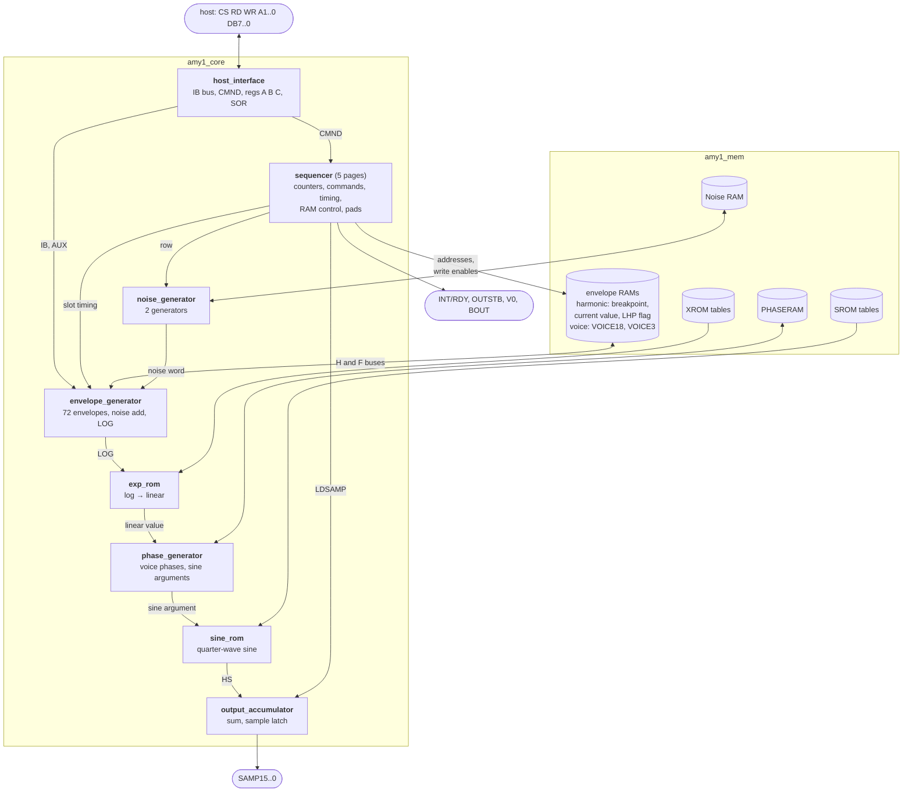
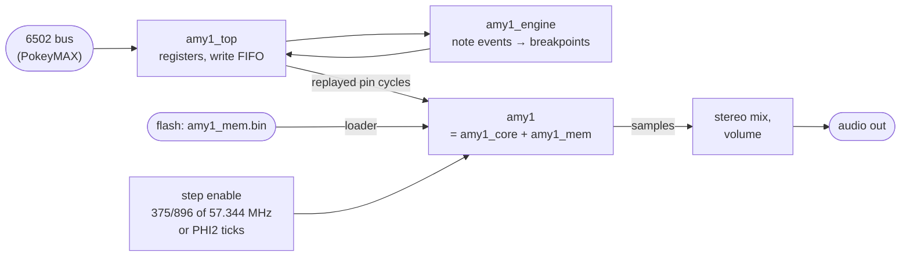
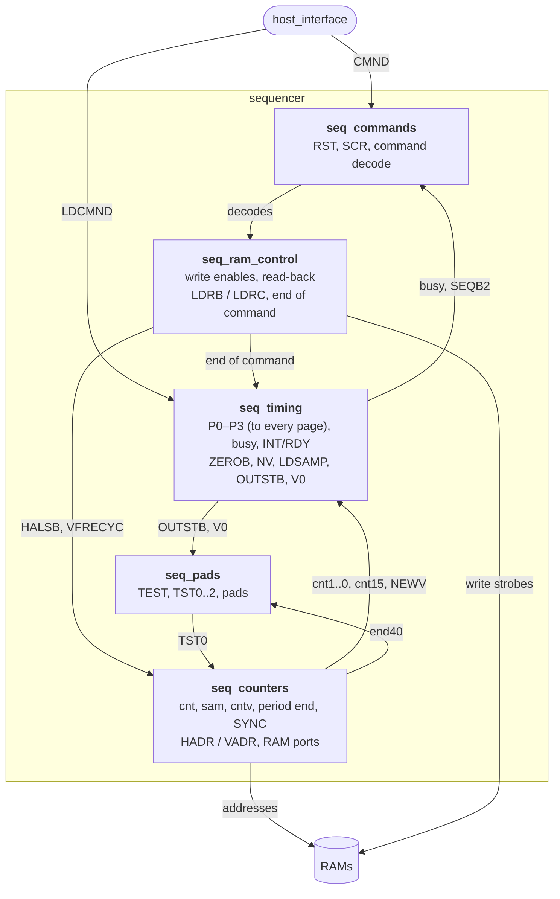
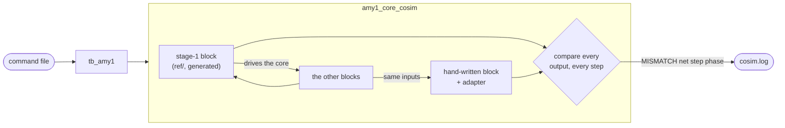

# AMY1 in VHDL

The AMY 1 is Atari's additive-synthesis sound chip of 1983–85: 64 sine harmonics shared out among 8
voices, each harmonic with its own amplitude envelope, each voice with a frequency envelope, plus two
noise generators. It never shipped. This package rebuilds it in VHDL from the chip's own SILOS netlist
(Dec 1985, "AMY1 version 3 including host sync modifications"), for the PokeyMAX (MAX 10 10M16).

The core started as a netlist-exact translation, one statement per node. It has since been split into
the netlist's schematic blocks and every block rewritten by hand to a spec (`AMY1_SPEC.md`), checked
step by step against the generated version. The result is less than half the size, and readable.

## The chip at a glance



In every slot of four internal clocks (32 slots, 128 clocks per sample period with 64 harmonics) the
sequencer visits two harmonics. For each, the envelope generator steps its amplitude (or a voice's
frequency) and turns it into a log value, exp_rom makes it linear, the phase generator turns frequency into phase and builds the sine
argument, and sine_rom's value is added into the output accumulator. At the spec's 8 MHz a sample period
is 32 µs (31.25 kHz).

Around the chip, `amy1_top` is the PokeyMAX wrapper:



## Files

| file | what it is |
|---|---|
| `vhdl/amy1_top.vhd` | PokeyMAX wrapper: memory loader, step enable, host write FIFO, stereo output, the note engine (`ENGINE`) |
| `vhdl/amy1_engine.vhd` | note engine: note events in, every harmonic breakpoint out (see below) |
| `vhdl/amy1.vhd` | the chip: `amy1_core` + `amy1_mem` |
| `vhdl/amy1_core.vhd` | the core: the twelve blocks wired together, with small adapters (generated) |
| `vhdl/amy1_<unit>.vhd` (12 files) | the hand-written blocks, see "The core in blocks" |
| `vhdl/amy1_mem.bin` / `.hex` | the memory image to put in flash (1208 32-bit words, little endian in the .bin) |
| `vhdl/amy1_mem_packed.vhd` | memory layout for the FPGA: 4 M9Ks + 160 bits of logic + a 32x4 table in LUTs (used by `amy1.vhd`) |
| `vhdl/amy1_mem.vhd` | the 12 RAMs/ROMs, one block each: the reference layout (architecture `rtl`) |
| `vhdl/amy1_mem_pkg.vhd` | memory types and the image layout (generated) |
| `vhdl/amy1_dpram_altera.vhd` / `amy1_dpram_sim.vhd` | true dual-port RAM for the ROM pairs: altsyncram for Quartus / behavioural for GHDL |
| `vhdl/ref/amy1_<unit>_ref.vhd` | the stage-1 (generated, netlist-exact) version of every block, for co-simulation |
| `vhdl/amy1_core_flat.vhd` | the flat generated core, before the split, for reference |
| `vhdl/tb_amy1.vhd`, `tb_top.vhd`, `tb_engine.vhd` | testbenches: the chip with a command file, `amy1_top` at 57.344 MHz, the engine alone |
| `AMY1_SPEC.md` | the behavioural spec: timing, formats, every block, quirks and decisions |
| `gen/` | the generators (`silos2v.py`, `vhdlgen.py`, `stepcut.py`, `splitgen.py`), the adapters (`stage2_wiring.py`) and their inputs |
| `test/` | command files, reference results, the co-simulation, noise and engine tests |
| `vbi/` | a VBI music player for the Atari that drives the engine |

Add to a Quartus project: `amy1_mem_pkg`, `amy1_dpram_altera`, `amy1_mem_packed` (and `amy1_mem`),
the twelve block files, `amy1_core`, `amy1`, `amy1_engine`, `amy1_top`. The twelve blocks and
`amy1_core` are strict VHDL-93; the testbenches need VHDL-2008.

## The core in blocks

The netlist is drawn as eight schematic blocks; the sequencer's five pages are kept as five files. Each
entity is `amy1_<name>`, so it doesn't clash with PokeyMAX's own units (the SID has an envelope generator
too).

| file | schematic | what it does | LUTs / FFs | stage 1 |
|---|---|---|---|---|
| `amy1_host_interface.vhd` | BUS | pins, the IB bus, command register, registers A/B/C, SOR | 105 / 44 | 148 / 73 |
| `amy1_seq_counters.vhd` | SEQCONT p. 15 | clock, sample and voice counters, period end, RAM addresses | 62 / 25 | 126 / 66 |
| `amy1_seq_commands.vhd` | SEQCONT p. 16 | reset synchroniser, SCR, command decode, Noise RAM host write | 24 / 10 | 43 / 20 |
| `amy1_seq_timing.vhd` | SEQCONT p. 17 | P0–P3, command handshake and busy, INT/RDY, voice and sample strobes | 29 / 28 | 68 / 46 |
| `amy1_seq_ram_control.vhd` | SEQCONT p. 18 | RAM write/read enables, read-back loads, end of command | 31 / 15 | 49 / 26 |
| `amy1_seq_pads.vhd` | SEQCONT p. 19 | test mode, the OUTSTB/T1, V0/T0, BOUT/CSYNC pads | 10 / 4 | 13 / 3 |
| `amy1_envelope_generator.vhd` | ENVGEN | breakpoints, slopes, levels, the noise offset, LOG | 306 / 93 | 709 / 311 |
| `amy1_noise_generator.vhd` | NOISE | the two noise generators | 46 / 58 | 188 / 117 |
| `amy1_exp_rom.vhd` | XROM | log-to-linear lookup | 78 / 93 | 419 / 214 |
| `amy1_phase_generator.vhd` | PHASE | voice phase accumulators, harmonic sine arguments | 189 / 53 | 386 / 162 |
| `amy1_sine_rom.vhd` | SINROM | quarter-wave sine lookup with interpolation | 38 / 81 | 221 / 169 |
| `amy1_output_accumulator.vhd` | ACC | sample accumulator, sample latch, SAMP pins | 102 / 51 | 181 / 102 |
| **whole core** | | | **970 / 558** | **2,202 / 1,437** |

(Yosys, generic 4-LUT, flattened, memories outside. Per block, each synthesised alone; the whole core is
smaller than the sum because Yosys optimises across the blocks.)

The sequencer in more detail:



## Stage 2: the hand-written blocks

`AMY1_SPEC.md` is the spec the blocks are written to. It is **exact by default**: a block must reproduce
the netlist, and every deliberate deviation is listed (D1 `NOISE_FIX`, D2 the SAMP pins holding when OE
is off). The chip's quirks are documented and kept unless a fix can't change any sensible program.

How the blocks are written:

* **Clean ports**: vectors, one polarity, names that say what the signal is. The core still uses the
  netlist's names between blocks, so `stage2_wiring.py` gives each block a small adapter in
  `amy1_core.vhd` (for example `hadr <= not HADR5N..HADR0N`).
* **next/reg style**, register then logic, in the chip's order. Initial values follow the netlist's
  power-up state.
* **`step_en` stays outside.** The chip's registers are two-phase (sample at the end of CLKN, show from
  CLK); each becomes one register updated on `tick` (`step_en` in step 0, the first after the first
  CLKN). Inputs made by precharged logic are latched on `sample` (step 5, the end of CLKN) first, as the
  chip's master latch does.
* **Step-level state where the chip has it**: CLKN or CLK pass latches, cross-coupled gate latches, the
  T10MHZ master-slave flip-flops of the command and reset synchronisers, pads that keep their charge.
  These update on `step_en` and are named and commented as such.

Each block's chapter in the spec says what it does, its ports and memories, its comparison window and
its size.

### How they were checked



1. **Co-simulation** (`test/cosim/run_cosim.sh [cmds] [stop]`). The stage-1 version of every block
   (`vhdl/ref/`) runs the core; the hand-written blocks run alongside on the same inputs, and every
   output is compared at every step after power-up (the first 12 steps; 18 for seq_timing, 30 for
   exp_rom). A few outputs are compared only where they are used: RAM write data while written, and
   outputs that the stage-1 model computes with precharged logic, one-step transients or loop cuts
   (`cmp_when` in `stage2_wiring.py`; each is explained in the block's chapter).
2. **Full-core regressions**, with all twelve hand-written blocks: sample-identical to the netlist core
   in quickclr_spec and rich_spec, and in the drum test with `NOISE_FIX` on and off.
3. The read-back test (`test/cmds/cmds_readback.txt`: harmonic amplitude and voice frequency read
   commands) in co-simulation.

To regenerate the core and the co-simulation:

```
cd gen
python3 silos2v.py adjusted.mac synchro.net quickclr.pat amy1.v fixnoise fixnzinit   # amy1.v.json, .mem.json, .blk.json
python3 blk2.py amy1.v.json amy1.v.blk.json amy1.v.blk2.json   # the untagged v3 gates to their pages
python3 splitgen.py amy1.v.json amy1.v.mem.json amy1.v.blk2.json synchro.net out/
```

`splitgen.py` writes `amy1_core.vhd`, `ref/` and `cosim/amy1_core_cosim.vhd`; the hand-written block
files are not generated, copy them in. `amy1.v.blk.json` gives each device its schematic block (from
the deck's block and page tags); `blk2.py` gives the seven untagged v3
host-synchronisation gates to sequencer pages 15 and 18, where the hand-written blocks have them.

## How the generated core was built (stage 1)

Two netlist transcription errors are corrected in generation by `silos2v.py` switches:

* `fixnoise`: the Noise RAM data pins are listed as NZIO2, NZIO1, NZIO1; the last is NZIO0.
* `fixnzinit`: the NOISE page re-derives NZINIT from NZINITN (XCMP209) under the same name as
  the SEQCONT DREG that makes NZINIT. The two drivers latch each other, so NZINIT never changes
  after power-up, the Noise RAM write strobe (WRNZN) never fires, and busy is never cleared:
  a Write Noise RAM command (`$80+addr` with SC1/NZINIT set) left INT/RDY low for good. The
  switch drops the copy, so NZINIT comes from the DREG only. Nothing else uses the duplicate;
  with NZINIT off (every program that never sets SC1) the core output is unchanged.

The hand-written blocks were checked against this generated core; `vhdl/ref/` and
`amy1_core_flat.vhd` are its output. `vhdlgen.py` writes the flat core
(`python3 vhdlgen.py amy1.v.json amy1.v.mem.json synchro.net out/`). Its step model is the one the
Verilog RTL uses, and that RTL was checked sample for sample against the switch-level simulation:

* There are six sequencer steps per internal chip clock: G1 PRECH, S2 CLK+PRECH, S3 CLK+T10,
  G2, S0 CLKN, S1 CLKN+T10. `step_en` advances one step.
* A net driven by a gate is a plain signal.
* Every other net (pass-transistor node, precharged node, bus, pad) is worked out from its
  network in each step: a path to a 0 source gives 0, otherwise a path to a 1 source gives 1,
  otherwise the net keeps its stored charge `<net>_reg`. So `<net>` is the next-state value
  and `<net>_reg` is the register: the next/reg style, one register per dynamic node.
* Memories read synchronously. The address in step k returns data in step k+1, so they map
  straight onto M9K ports clocked with `step_en` as the enable.

**Loop-free.** A two-phase NMOS chip is structurally full of loops: a CLK latch feeds a CLKN
latch, which feeds back into the CLK latch. In the real chip these loops are never closed in
the same step. `stepcut.py` finds, for every signal, the steps in which it can change, and
for every switch, the steps in which it can conduct. It then replaces a read with last step's
value wherever that provably gives the same result. That handles 344 reads exactly.

Three other kinds of cut are needed:

* 15 cross-coupled gate latches. Each is evaluated as its settled value from the previous
  state, which is exact.
* The 8 DB pad input buffers read the pad one step late. That is about 40 ns of input delay.
* 73 reads in the host register file and the bus read-back.

Yosys `check` finds no logic loops.

## Noise generators (and `NOISE_FIX`)

Two noise generators share the 64 x 3 Noise RAM: command address `$80+addr` (with SC1/NZINIT
set) writes row `addr/2` of generator `addr&1`, value = A register bits 2..0 (columns A, B, C).

| rows | A column | B column | C column |
|---|---|---|---|
| 0-14 | PRB A bit 14-row | PRB B bit 14-row | PRB C bit 14-row |
| 15-19 | (working rows, no need to load) | | |
| 20-31 | UD bit row-20 | B bit row-20 | S bit row-20 |

Each sample one generator (alternately) is processed row by row, so each updates every two
samples:

* A, B, C are 15-bit shift registers. The feedback is the XOR of rows 0, 3, 8, 14 (bits 14,
  11, 6, 0), which is a maximal-length LFSR (period 32767).
* UD += fa + fc - 2*fb, where fa, fb, fc are the three feedback bits (a step of -2..+2).
* B += UD (12 bits, wrapping).
* The output word (12 bits, signed) is the last bit of the B adder plus the last 11 bits shifted
  into a chain: during rows 20-31 a bit of B is shifted in only where S is 1, so S packs the
  chosen B bits towards the top; the lower bits come from shifts in rows 0-19 (wherever the
  C column is 1).
* A noise voice (voice type 1 = generator 0, 2 = generator 1) applies the output word to every
  harmonic except the voice's first: in effect a signed gain, from about +0.6 at -1024 through
  ~0 at 0 to about -1.4 at +1000 (measured on the chip model), so each harmonic is ring-modulated
  by the noise and spreads into a band roughly 100-400 Hz wide. Space a noise voice's harmonics
  150-300 Hz apart for a continuous noise band.

**The netlist as drawn never feeds the shift registers.** The selector between the shift path
(rows 0-15) and the arithmetic path (rows 16-31) is registered on NADR5 one row late, so the
feedback is written to row 16 and row 0 is rewritten by the arithmetic path with its own value.
A, B and C therefore fill with copies of their top bit within 15 updates (about 1 ms), UD then
steps by a constant and the "noise" is a slow deterministic ramp: 70-90% of the modulation
power below 50 Hz instead of a band up to several kHz. Whether the real chip had this fault or
it is a transcription error cannot be told from the netlist; the taps are clearly a maximal LFSR.

`amy1` has a generic `NOISE_FIX` (default true) that repairs it outside the generated core: the
write to row 0 of each generator is replaced by the XOR of rows 0, 3, 8, 14 written in that
generator's previous pass (exactly the bit the core's own taps produce). It is off while
NZINIT is set and for the first pass after it, and costs about 40 LEs. With `NOISE_FIX` false
the chip is the netlist as drawn. Only noise voices are affected.

Any non-zero PRB value works with the repair; UD and B may start at 0. S selects the character:
0xFFF or 0xF00 is the narrowest (most energy 50-800 Hz), 0x80F, 0x800 and 0x00F the brightest
(13-20% of the modulation above 3 kHz).

`test/noise/amynoise.py` is a bit-exact model of both generators (RAM state and output word,
checked against the Verilator RTL over 3408 passes from random states, with and without the
repair); `modstat.py` and `modspec.py` compare S settings.

## Verification (GHDL 4.1)

| run | reference | result |
|---|---|---|
| `tb_amy1`, quickclr_spec and rich_spec, bus timing as in GENERATOR.PAS | Verilator RTL (`vlat/`) | identical, every sample |
| `tb_top` at 57.344 MHz, 375/896 step enable, FIFO and RDY handshake | Verilator RTL with the same bus state machine (`valign/`) | identical, every sample |
| both, memories loaded from `amy1_mem.hex` through the load port / flash interface | same | identical |
| `tb_top` with USE_TICK, a tick every 16 clocks (both PHI2 edges) | Verilator, same commands | identical |
| `tb_top`, rich_spec in INDIVIDUAL mode, voice 0 left, voice 1 right | Verilator, same commands | identical; L = voice 0 only, R = voice 1 only |
| `tb_top` with the A/B/C write shortcut, rich_spec and the read-back test | the build before the shortcut | read-back identical; audio the same at gain 255/32 (correlation 0.998, residual under 10 counts) |
| NOISE in M9K 2, OCTSPL in LUTs: `tb_amy1` quickclr_spec and rich_spec (steps exactly 2 clocks apart) | Verilator RTL (`vlat/`) | identical, every sample |
| `tb_amy1`, NZINIT set, all 54 Noise RAM locations of both generators written with `$80+addr`, then noise played on harmonics 1-7 and 9-15 | Verilator RTL with the same fix | identical, every sample; RDY returns about 280 units (1.4 us) after each write, the first waits for the sample boundary (NZINIT syncs there) |
| `tb_amy1` and `tb_top`, quickclr_spec, core with `fixnzinit` | the core without it | identical |
| `tb_amy1`, noise voices on both generators loaded by command, 400 samples, `NOISE_FIX` true and false | Verilator RTL with and without the repair | identical, every sample |
| `tb_amy1` quickclr_spec with `NOISE_FIX` true | reference | identical |
| switch-level netlist (`silos2v.py` output) with the same gate removed, same Noise RAM stimulus | the unfixed netlist hangs at the first write | all 54 writes complete, NZINIT clears after `$31`, noise plays |
| same, `tb_amy1` with 6 of the 8 voices set to the noise types, and `tb_top` rich_spec and noise at 375/896 steps and with 2xPHI2 ticks | the reference memory layout `amy1_mem(rtl)` in the same testbenches | identical, every sample and PCM value |
| co-simulation, all twelve hand-written blocks against their stage-1 versions: quickclr_spec, rich_spec, the drum test, the read-back test | stage-1 blocks in the same core | every output identical at every compared step |
| `tb_amy1`, all twelve hand-written blocks: quickclr_spec, rich_spec, the drum test with `NOISE_FIX` on and off | the stage-1 core | identical, every sample |

## Size and timing (Yosys, generic 4-LUT, memories outside)

* 970 LUT4 and 558 FFs for the core (stage 1: 2,202 and 1,437).
* The longest path is 16 LUT levels (stage 1: 18).
* At 375/896 of 57.344 MHz the steps are 2 or 3 clocks apart, so the core needs a
  multicycle-2 constraint (34.9 ns). If Quartus does not meet that, use STEP_NUM/STEP_DEN = 1/3
  (19.1 MHz of steps, equivalent to a 6.37 MHz AMY). Because the pitch word is logarithmic, you
  can then correct the pitch by adding a constant to every frequency.

## Clocking from PHI2

`USE_TICK = true`: pulse `CHIP_CLK_TICK` for one CLK on every PHI2 edge. Each pulse is one edge
of the AMY's CLOCK input, so the AMY runs at 2 x PHI2 (3.547 MHz PAL, 3.580 MHz NTSC), locked to
the Atari like POKEY. The wrapper makes 3 steps per pulse, `STEP_SPACING` (default 4) CLKs apart,
so the core only needs a multicycle-4 constraint (70 ns at 57.344 MHz).

**4 x PHI2** (the AMY at 7.09 MHz PAL): four `CHIP_CLK_TICK` pulses per PHI2 cycle,
`STEP_SPACING = 2`, a multicycle-2 setup / 1 hold constraint, and with the engine
`ENGINE_UNIT_LOG2 = 15` (keeps its time unit at 9.2 ms). The tables change too: frequency
correction +133 (PAL) / +123 (NTSC), and slopes for the faster clock (`vbiplay_4xphi2.xex`,
`mkvbi.py ... clk4`). Checked: the noise test with a tick every 8 clocks and steps 2 apart is
identical, step for step, to a tick every 16 and steps 4 apart; the engine's full-system test
at that timing with the 4 x PHI2 tables is identical to its model.

**CLK / 8, free running** (the AMY at 57.344 / 8 = 7.168 MHz, not locked to PHI2):
`USE_TICK = false`, `STEP_NUM = 3`, `STEP_DEN = 8` (steps 3, 3, 2 clocks apart, so still
multicycle 2/1), `ENGINE_UNIT_LOG2 = 15`. No PHI2 jitter on the steps, and the pitch
correction is the same for PAL and NTSC: +122 (768 x log2(8 / 7.168) = 121.7). The tables are
`mkinst.py` clock `clk8` (`amybox` with `-DAMY_CLK8`, `vbiplay_clk8.xex`, `mkvbi.py ... clk8`).
Checked: the noise test at 3/8 is identical, step for step, to the other step modes, and the
engine's full-system test at 3/8 with the clk8 tables is identical to its model. If CLK is not
57.344 MHz, the correction is 768 x log2(8 MHz / (CLK / 8)).

| | 8 MHz (spec) | 2 x PHI2 PAL | 2 x PHI2 NTSC |
|---|---|---|---|
| sample rate, 64 harmonics | 31.25 kHz | 13.85 kHz | 13.98 kHz |
| sample rate, 40 harmonics | 50.0 kHz | 22.17 kHz | 22.37 kHz |
| highest fundamental | 7.8 kHz | 3.46 kHz | 3.49 kHz |
| pitch vs. the spec's tables | | -14.08 semitones | -13.92 semitones |
| frequency word correction | | +901 | +891 |

The frequency word is 1/64 semitone per unit, so adding the correction to every frequency
(and its glide destinations) puts notes back on the spec's tables (0x138C = A 440). Envelope
and glide rates run at 0.44x the spec's tables.

## Memories and the load image

Nothing is initialised by the FPGA configuration (MAX 10 compact parts can't). Every memory, the
ROM tables included, has a load port: `load_we/load_addr/load_data` write one 32-bit image word,
`<NAME>_BASE + address` in `amy1_mem_pkg`. `amy1_top` reads the image from flash after reset
through the same request/ready interface as the SID (`ROM_BASE` = word address of the image)
and holds the chip until it is done (1208 requests). The RAM part of the image is the deck's
power-up state (zeros, noise LFSR seed, a few voice values), so a run is reproducible.

## Packed memories (`amy1_mem(packed)`)

| block | contents |
|---|---|
| M9K 1, true dual port | SROMBS (256x17) on port A, XROMBS (128x15) on port B |
| M9K 2, true dual port | SROMINT (512x5) on port A, XROMINT (128x5) on port B, NOISE (64x3) at word 640 |
| M9K 3, simple dual port | HARMBRKPOINT, HARMCURNTVAL and LHPRAM as one 30-bit word (one shared address) |
| M9K 4, simple dual port, 256x36 | VOICE18 and VOICE3 as one 21-bit word in words 0..15; words 16..255 belong to the note engine, through an aux port (it reads and writes on the clocks the chip doesn't use) |
| logic | PHASERAM (8x20); OCTSPL (32x4) is a ROM, so a constant table in LUTs |

Every chip address changes in step 1, so all M9K ports read at the step. NOISE uses M9K 2 in
the clock *after* each step instead: port B reads it (address latched at the step) while port A
does that step's write, at the same edge, with old-data mixed-port read-during-write (supported
by M9K on one clock), which matches the reference read-before-write. The ROM outputs of M9K 2,
and the HARM/VOICE outputs, are held in registers while the ports do something else. So the
NOISE data reaches the core one clock after the step rather than at it: with steps two clocks
apart the core has one clock to use it, the same as any single-cycle path, which the design
already meets at 57.344 MHz. `NOISE_IN_M9K` and `OCTSPL_IN_LUTS` (constants in the file) switch
back to the logic versions.

The grouped RAMs write one clock after the step, merging the new field into the word read
in that step, so **step_en must never be high on two consecutive clocks** (true for both
step modes of `amy1_top`). The ROM pairs are `amy1_dpram`, a true dual-port block:
`amy1_dpram_altera.vhd` instantiates altsyncram for Quartus (inference split the two ports
into two copies), `amy1_dpram_sim.vhd` is the same entity for simulation. Use one or the other.

## Stereo

In SUM mode (the default) the chip outputs one sample per period: both channels get it. In
INDIVIDUAL mode (system options command bit 2: `$24` instead of `$20`) it outputs one sample per
voice, V0 marking voice 0. `amy1_top` snoops the options command, adds up the voices selected by
`VOICE_LEFT` and `VOICE_RIGHT` (bit n = voice n, both = centre) and outputs the pair once per
period, saturated to 16 bits.

## amy1_top host interface (ADDR = A3..A0)

| address | write | read |
|---|---|---|
| 0 | AMY command (`$00`-`$07`: reset the chip, drop queued writes) | status: bit 7 busy, bit 6 FIFO full |
| 1 | AMY A | status |
| 2 | AMY B | B from the last read command (frequency: bits 4..0, top 3 read as 1) |
| 3 | AMY C | C from the last read command |
| 4 | VOICE_LEFT: voices on the left channel, bit n = voice n (INDIVIDUAL mode) | VOICE_LEFT |
| 5 | VOICE_RIGHT | VOICE_RIGHT |
| 6 | VOLUME: output x VOLUME/32, saturating (32 = x1, `$FF` = x7.97) | VOLUME |
| 7 | - | status |
| 8..15 | the note engine (`ENGINE` = true), see below | engine status; 15 reads back CONFIG |

* Registers 4-6 are set straight away and are `$FF` after RESET_N; a chip reset leaves them.
* Writes to 0-3 go through a FIFO of 2**FIFO_LOG2 entries (default 4) and are replayed to the
  chip's pins: CS low, WR low for two internal clocks, release. After a command (register 0) the
  next write waits 6 internal clocks and then for INT/RDY; A, B and C are plain latches, so their
  writes go straight through. After a read command (`$18+v` frequency, `$C0+h` amplitude) the wrapper reads B and
  C (RD low for two internal clocks each) into the read-back registers, so 6502 reads never wait.
* If INT/RDY stays low for 255 internal clocks the chip is reset (safety net).
* The pins change only at the start of step 0; the loop analysis assumes this.
* Output is silent while the chip is in reset.

## The note engine (`ENGINE` = true, `amy1_engine.vhd`)

A VBI player can't afford AMY's write load: a note is a frequency plus 16 harmonic
breakpoints, a plucked note 16 more for the decay, at 3 writes each. The engine takes note
events from the 6502 and writes every breakpoint itself, from instrument tables in the VOICE
M9K's spare 240 words, into the same FIFO as the host's writes.

| reg | name | |
|---|---|---|
| 8, 9, 10 | W0, W1, W2 | word builder (kept between writes) |
| 11 | EVENT | write byte 3: queue {byte3, W2, W1, W0}. `$90+v` note on: W0 note (0 = the global word's note 0, 64 semitones up = amybox's 64), W1 level (1/4 dB, `$D8` normal), W2 harmonics to use (1..16, the band limit). `$80+v` note off. `$A0+v` instrument W0 for voice v (the voice must be silent) |
| 12 | ADDR | RAM word for WRITE (32..255) |
| 13 | WRITE | write byte 3: RAM word ADDR <= {byte3, W2, W1, W0}, at once |
| 14 | STATUS | bit 7 busy, bit 6 queue full (16 events) |
| 15 | CONFIG | bit 0 on, bit 1 8 harmonics x 8 voices (else 16 x 4); reads back, so a player can find the engine |

To use it in PokeyMAX: `ENGINE => true` and all four address bits into `ADDR` (16
registers). The engine needs no M9K of its own: the VOICE block was one M9K already and is now
used 256 deep and 36 wide.

A note on costs the 6502 four stores, a note off one. The engine's writes go into the chip's
A/B/C latches, so write chip registers 0..3 (and reset the chip) only while STATUS says idle.

**RAM** (36-bit words): 16..31 the event queue, 32..39 voice states, 40 the frequency word of
note 0 (the pitch correction goes here), 48..59 instrument headers, 64..255 twelve instruments
of 16 harmonics.

* Header: release slope (7..0), glide slopes up (15..8) and down (31..24), release drop per
  time unit in 1/4 dB (20..16), decay flag (23: plucked, decay breakpoints after the attack).
* Harmonic k of instrument i at 64 + 16i + k: level offset below the note (7..0, 255 =
  unused), attack slope (15..8, 0 = jump), decay slope (23..16), sustain offset below the
  peak (31..24).
* Time unit: 2^14 chip internal clocks, 9.2 ms at 2 x PHI2.

**What it writes.** A note on: the frequency (gliding only when legato, i.e. no note off
since the last note on), then every harmonic of the voice, an attack for those in the note and
a release for the rest, then the decay pass for plucked instruments. A note off releases every
harmonic. Every harmonic gets a breakpoint in every pass, and after each pass the engine waits
1-2 samples (two changes of prescaler bit 7), so a harmonic's next write reaches the chip at least
2.5 samples after a jump. That margin matters: a jump is lost if the next write to that harmonic
comes before the harmonic's next slot, which can be up to ~1.3 samples later (chip model), and a
lost jump followed by a decay leaves the decay pointing the wrong way, so the harmonic wraps to
full level. Without the wait the 8 x 8 layout only had 8 breakpoints (1.2-1.5 samples) between,
and that is what made the loud even harmonics in Warhawk on PokeyMAX.

**Never the wrong way.** Releases fall to 0; decays follow jumps only; an attack rises only
when the note is at least 2 dB above the voice's *ceiling*, else it jumps. The ceiling is the
loudest level since the voice was silent, less the instrument's release drop for each time unit
the voice has been released (the engine adds it up in a loop, a clock per unit). That's the
same rule amybox applies per harmonic, and it rises about as often: CANTINA in the strings
ensemble 5049 rising attacks to 1421 jumps (amybox's log: 3002 to 707). The release time has
8 bits, so after 255 units (2.4 s) the drop can come out too small: a voice may then jump where
it could have risen, never the other way.

**Size** (Yosys, 4-LUT with carry chains, iCE40 mapping as a stand-in for MAX 10 LEs): about
490 LUTs and 160 FFs, of which ~25 LUTs are glide (`ENGINE_GLIDE` = false drops it). With
`ENGINE` = false nothing is added and the chip is bit-identical to the build before.

**Verification** (`test/engine`):

| test | result |
|---|---|
| `tb_engine`, 6 songs x 6 ensembles, 16 x 4: every chip write against `engmodel.py` | identical (2.77 M writes) |
| same in the 8 x 8 layout | identical (1.50 M writes) |
| edge cases: glide up and down, rise and jump by level and release age, band limits, levels below the offsets, a 20-event burst through a full queue, a header rewritten between notes, instrument changes; both layouts | identical |
| `tb_top` with `ENGINE` = true and the real chip: chip-bus writes against the model, and the time from each jump to the next write to that harmonic | identical; at least 2.98 samples (16 x 4) and 2.50 samples (8 x 8, CLK / 8) |
| `tb_top` with `ENGINE` = false, rich_spec at 375/896 | identical to the build before |

## VBI player (`vbi/`)

`vbiplay.xex` (AMY at 2 x PHI2), `vbiplay_4xphi2.xex` and `vbiplay_clk8.xex` play the six amybox songs from a
VBI through the engine (START next, SELECT previous) and show the most VCOUNT lines a frame
has taken. The border turns red while the player runs: the VBI only marks the frame, and the
main loop runs it at VCOUNT 16, on screen (in the vertical blank the colour would never show);
calling `play` from your own VBI works the same. It is one assembler program: `mkvbi.py` turns the `.MUS` files into
`vbidata.inc` (the songs as JCODE bytes, the engine RAM image, the band-limit table), which
`vbiplay.s` includes; `build.sh` builds all three. The AMY is at `AMY = $D2C0` (16 registers with
the engine), a constant at the top of `vbiplay.s`. In `py65` the 6502 code
posts exactly the events of the reference player for every song, and costs on average 170-330
cycles a frame, at most 1,196 (about 10.5 scanlines), against about 7,100 cycles per note per
voice for amybox writing the breakpoints itself.
