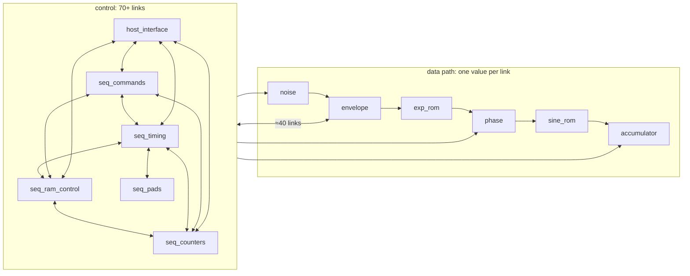
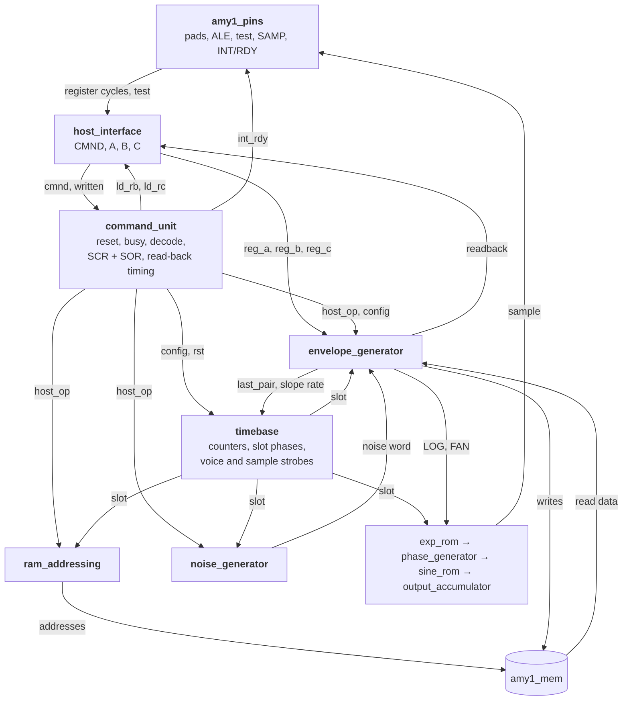

# AMY1 core: interface review

Stage 2 rewrote each schematic block behind the netlist's own boundaries, so the interfaces are the
netlist's: wherever the 1985 drawing put a page break or a bus, there is a port. This review asks, block
by block, whether those boundaries make sense as an architecture, and proposes the interfaces to keep or
change before the blocks are cleaned up behind them.

## 1. Summary

**The data path is good and should stay as it is.** envelope_generator → exp_rom → phase_generator →
sine_rom → output_accumulator is a clean pipeline. Each link is one value plus at most one side flag
(LOG + FAN, xo + clrdisp, arg, hs), and each block owns its ROM or RAM. noise_generator → envelope
(the noise word) is clean too.

**The control side is the netlist's wiring, not an architecture.** Today 111 port connections cross
between the twelve blocks. About 30 of them are active-low or inverted in the adapter. Most of them are
in a web around the sequencer's five pages, the host interface and the envelope generator:

* The sequencer is split by **drawing page**, not by function. One job, such as "run a host command",
  is spread over four pages: the handshake on page 17, the decode on 16, the RAM strobes on 18 and the
  address mux on 15. The pages then exchange 12 command decodes and strobes.
* **Raw command bits leak everywhere.** CMND goes to seq_commands (decode), seq_counters (the address),
  envelope_generator (CMND0 as the LHP flag) and host_interface (the SOR bits).
* **Read-back goes through three blocks and an 8-bit bus.** The envelope drives values and enables onto
  IB inside host_interface. The sequencer's LDRB/LDRC then latch IB into B and C, in two halves.
* **Configuration is split.** SCR lives in seq_commands and SOR in host_interface, but SOR is loaded by
  the sequencer's decode and read mostly by the sequencer.
* **The two-phase step model leaks into the ports.** `prech`, `clk_ph`, `clkn_ph` and `sample` are block
  inputs, and some outputs (RAM write strobes, the CLKN latches) change mid-clock.
* **Pin behaviour is mixed into the logic blocks:** SAMP0 multiplexing and OE in output_accumulator,
  pad charge in host_interface and seq_pads, BOUT in noise_generator.

The proposal (section 4) keeps the six data-path blocks and reorganises control into a timebase, a
command unit, RAM addressing and a pin layer, with five rules (section 3) for every interface.

## 2. The interfaces today



| link | signals | verdict |
|---|---|---|
| noise → envelope | noise word (12), gen_sel back | clean |
| envelope → exp_rom | LOG (13), FAN | clean |
| exp_rom → phase | xo (18), clrdisp | clean (clrdisp is FAN delayed with the data: a valid/mute flag; rename) |
| phase → sine | arg (14) | clean, but sine latches it on `sample` (see F6) |
| sine → accumulator | hs (13) | clean |
| sequencer → data path | P0–P3, cnt, voice, ld_voice, nv, ldsamp, outstb, ssen, odd, sync, clrph, rst | sound in content; split over pages and polarities |
| sequencer ↔ envelope | 9 bus/RAM enables, upenff/upenha back, ss, lhpulse_n | wrong split (F4) |
| host ↔ envelope | IB (8), AUX (13), CMND0; read-back: 2 enables + 21 data bits | wrong split (F3) |
| sequencer pages ↔ each other | ≈45 | page artefact (F1) |

## 3. Rules for every interface

1. **Chip-clock synchronous.** An inter-block signal changes only just after `tick` and is valid for the
   whole clock. No `prech`, `clk_ph`, `clkn_ph` or `sample` at a block port. The two places that need
   step-level timing are the pin layer (the host bus is asynchronous) and the memory wrapper (where in
   the clock a write happens).
2. **Active high inside.** `_n` only at pins.
3. **One owner per memory.** The block that computes a RAM's data owns its write enable. The address
   may come from elsewhere. RAM contract, in chip clocks: the address presented in clock n gives its data
   by the end of clock n; a write enabled in clock n happens at the end of clock n; a read during a write
   returns the old data. That is what the blocks rely on today, stated once.
4. **Decode once.** Commands are decoded in one place, into an operation and an index. No raw CMND
   bits elsewhere.
5. **Bundles as records** where several blocks take the same group: slot timing, the host operation,
   configuration, test mode.

## 4. Findings and proposals

### F1. Sequencer: regroup by function

The five pages exchange about 45 signals. Proposed units, with their interfaces:

| unit | holds | gives |
|---|---|---|
| **timebase** | clock counter, P0–P3, period end and sync, sample counter (ODDEV, SSEN), voice counter, the voice and sample strobes (ZEROB/NV, LDVOICE, LDFLO, LDSAMP, OUTSTB, V0) | a `slot` record: `p(0..3)`, `harm(5:0)`, `voice(2:0)`, `new_voice`, `upd_freq` (UPFF), `ssen`, `odd`, `sync`, `ld_voice`, `nv`, `ldsamp`, `outstb`, `v0` |
| **command_unit** | reset synchroniser, request/busy handshake, decode, SCR and SOR, INT/RDY, end of command, read-back load timing | `rst`, a `config` record, and a `host_op` record (F2) |
| **ram_addressing** | harmonic and voice address: from `slot`, or from `host_op` in its slot | `harm_addr(5:0)`, `voice_addr(3:0)` |

seq_pads goes to the pin layer (F5). Inside each unit the netlist structure stays (the handshake's
T10MHZ flip-flops, the gate latches), but no signal crosses a unit boundary mid-clock.

The voice counter's loop (timebase → harmonic → envelope reads the LHP flag → `last_pair` → timebase)
is inherent to the chip and stays, as one active-high signal.

### F2. One decoded host operation

```
host_op: active                 -- a command is executing (busy)
         op      : (none, rd_harm, wr_harm, wr_lhp, wr_noise, rd_freq, wr_freq, wr_type, sor, scr)
         harm    : 5..0         -- CMND5..0 for harmonic operations
         voice   : 2..0, word   -- CMND2..0 and CMND4
         lhp     : flag value   -- CMND0
```

Today `rdha, wrha, rdff, wrff, wrffnz, d2, wr_lhp, ld_scr, ld_sor, hcmd` are separate wires, and
`cmnd(5:0)` and `cmnd0` go to two other blocks. With `host_op`, seq_counters, seq_ram_control and the
envelope read the op instead of decoding again, and the CMND latch → decode → read-back enable → IB
loop disappears. That loop is the reason host_interface now hands CMND over a step late.

### F3. Host registers: values, not a bus

The envelope generator takes `ib` (8 bits) and `aux` (13 bits). `ib` is Reg A, because ENSLP puts A on
IB for the whole command. Read-back goes the other way: the envelope drives `rb_hi`, `rb_lo`, `rb_slope`
and two enables into the IB mux, and the sequencer's LDRC/LDRB latch IB into C and then B.

Proposal:

* host_interface exports `reg_a(7:0)`, `reg_b(4:0)`, `reg_c(7:0)` directly.
* The envelope exports one `readback(12:0)` value (B:C as they should end up) and nothing else.
* The command unit's `ld_rb` / `ld_rc` load B and C from `readback` directly.
* IB becomes internal to host_interface (pin data in, read data out). The test outputs (TST1: xo,
  TST2: the slope latch) go through a small test-readout mux there.

**Exactness.** This changes behaviour only if the host touches the registers while a command runs. In
the netlist a host read or write during busy wired-ANDs with Reg A on IB, so the envelope would see the
AND. The spec requires the host to wait for READY, and amy1_top's FIFO does. This would be a listed
deviation (D3): host register access during busy no longer corrupts the running command's data.

### F4. The envelope owns its RAM writes

Today the sequencer decides who drives the H and F buses (`h_wr`, `aux_wr`, `vnv_wr`, `rdbk`, `sel_ff`).
The envelope computes the values and tells the sequencer whether to write them (`upenha`, `upenff`).
The sequencer then registers those flags and gates them with CLKN into the RAM write enables.

Proposal: the envelope is told **what this clock is** (`slot` + `host_op`) and returns RAM writes:
`hbp_we`/data, `hcv_we`/data, `lhp_we`/data, `v18_we`/data, `v3_we`/data. The address comes from
ram_addressing. The bus enables, `upenha`/`upenff`, `sel_ff` and the precharged `h_bus`/`f_bus`
outputs disappear. What is left of seq_ram_control is the read-back timing, which moves into the
command unit.

This is the biggest interface change and the one that removes the most wiring: about 25 signals.

### F5. A pin layer

All pad behaviour in one place, `amy1_pins`:

* DB pads (charge keeping), ALE, the host bus decode into register cycles;
* TEST, T0/T1 → a `test` record (TST0..2);
* OUTSTB/T1, V0/T0, BOUT/CSYNC pads;
* SAMP15..0 with OE hold (D2) and the SAMP0 bit-16 multiplex (Q9);
* INT/RDY.

output_accumulator then just outputs `sample(16:0)` + `ld_samp`, and noise_generator outputs `serial`
without knowing it goes to a pad. The core gets a register-level host port: `cs/rd/wr` cycles in,
read data out. amy1_top keeps using the pins for now, so nothing changes for the FPGA. Later it could
talk to the register port directly and drop the pin replay.

### F6. `sample`, `prech` and the clock phases

* **sine_rom and output_accumulator latch their inputs on `sample`.** That was needed because stage-1's
  SARG is precharged in steps 0–1. The hand-written phase_generator's `arg` is not precharged: it comes
  from registers and the phase RAM's data, which is stable from step 2 to step 0, so the tick sees the
  same value. **Checked for sine_rom:** with its `sample` latch removed (arg taken at the tick), the full
  core is sample-identical in quickclr_spec and rich_spec. output_accumulator's OUTSTB latch is the
  same case, still to try.
* **`prech`** (envelope) only reproduces the bus precharge in the RAM write data. Under rule 3 it goes
  (F4).
* **`clk_ph`/`clkn_ph`** (noise, phase, accumulator, the sequencer pages) make write strobes and CLKN
  latches. Under rule 3, writes are "enabled in this clock" and the memory wrapper places them. The
  CLKN latches that feed other blocks (end40, the LDSAMP strobe, P15/P35) become tick registers where
  their consumer samples them at the tick anyway. They are listed in the chapters with the steps they
  are used in.

### F7. Small ones

* **Polarity:** `busy_n`, `en_rdbk_n`, `rstbsyp_n`, `wrnz_n`, `en_*wr_n`, `ld_voice_n`, `ld_flo_n`,
  `ild_samp_n`, `outstb_n`, `ssen_n`, `lhpulse_n`, `sum_n`, `rdyn` → active high (rule 2).
* **Inverted RAM addresses.** HADR/VADR reach the RAMs as the netlist's inverted lines. The core should
  give logical addresses (harmonic number, voice word), with the permutation inside amy1_mem (or the
  image regenerated in logical order).
* **noise_generator's `hadr`** is the harmonic RAM address reused as the noise row. It should take the
  row from `slot` and the host address from `host_op`.
* **Names:** `clrdisp` → `mute`; `xo` → `lin`; `gen_sel` → `noise_gen`; `cnt` → `harm`. The core's
  internal signals take the interface names, and amy1_core.vhd becomes hand-written. The generated
  netlist names (HADR5N, X159K19, X131441_X2K0_reg, X…_X5K0) go.

## 5. Target



## 6. Decisions for you

1. **Regroup the sequencer by function (F1)**, or keep the five pages and only tidy their ports?
   Recommended: regroup.
2. **Host registers as values and D3 (F3)**: accept that host access during a busy command no longer
   wired-ANDs into the command's data? Recommended: accept; amy1_top never does it.
3. **The envelope owns its RAM writes (F4).** Recommended.
4. **A pin layer (F5)**, with amy1_top still on the pins for now. Recommended.
5. **Logical RAM addresses (F7)**: permute inside amy1_mem (no image change), or regenerate the image in
   logical order? Recommended: permute inside amy1_mem first.

## 7. How the change is checked

Co-simulation against stage 1 compares port by port, and the ports are what changes. The reference
becomes **the current stage-2 core**, which is verified sample-identical to the netlist core:

* each new interface signal is compared, at the tick, with the signal it replaces in the current core
  (`host_op.op = wr_harm` against `WRHA`, `slot.p` against P0–P3, the RAM writes against the RAM ports at
  CLKN, and so on);
* the full-core regressions stay as they are: quickclr_spec, rich_spec, the drum test with NOISE_FIX on
  and off, and the read-back test;
* D3 gets a targeted test: a host register write during busy, showing the difference stays inside
  that case.

Order: rules 2 and 5 and the names (no behaviour change) → F6 (`sample`, `prech`) → F2 + F1 (command
unit, timebase) → F4 → F3 → F5 → logical addresses → a hand-written amy1_core.

## 8. Decisions (3 Nov)

1. **Sequencer: regroup by function** (F1). The pages were only a convenient first split.
2. **Conformance: the spec first.** Simplicity and clarity matter more than the netlist's edge cases.
   No software depends on them, and the chip was never finished. D3 (F3) is accepted, and so is the
   wider change this implies, recorded in the spec's section 1: the 1983 spec is the reference; where it
   is silent, the netlist's behaviour is kept; netlist quirks that contradict the spec or only add
   complexity may be fixed and listed.
3. **The envelope owns the envelope RAMs** (F4). Those RAMs are the state of 72 envelopes that share one
   stepping unit, not a cache: each visit reads an envelope's breakpoint and current value, steps it,
   and writes the current value back. Host breakpoint writes are requests into the same store.
4. **No pins.** The core gets a plain synchronous RTL interface (below). The 6502 bus adaptor lives
   outside. ALE mode and the pad-level test modes go.
5. **Logical RAM addresses.** The inversion has no benefit in an FPGA. In the chip the RAM decoders were
   driven straight from the inverting address-mux gates, and the order of the words never mattered.
   The memory image's RAM sections are regenerated in logical order.

### Proposed external interface

```
entity amy1 is
  generic (NOISE_FIX : boolean := true);
  port (
    clk        : in  std_logic;
    rst        : in  std_logic;                     -- synchronous, active high (the RESET pin)
    ce         : in  std_logic;                     -- one AMY internal clock (spec: 4 MHz);
                                                    -- at most every second clk
    -- registers: 0 command, 1 A, 2 B, 3 C
    addr       : in  std_logic_vector(1 downto 0);
    we         : in  std_logic;                     -- write wdata to addr, one clk
    wdata      : in  std_logic_vector(7 downto 0);
    rdata      : out std_logic_vector(7 downto 0);  -- register at addr (B, C after a read command)
    rdy        : out std_logic;                     -- INT/RDY as the SOR selects it
    -- audio
    sample     : out signed(16 downto 0);           -- the 17-bit sum, two's complement
                                                    -- (SAMP15..0 = bits 15..0 with 15 inverted)
    sample_stb : out std_logic;                     -- one clk per sample (per voice in INDIVIDUAL mode)
    sample_v0  : out std_logic;                     -- INDIVIDUAL mode: this sample is voice 0
    -- memory image load (as now)
    load_we    : in  std_logic;
    load_addr  : in  std_logic_vector(10 downto 0);
    load_data  : in  std_logic_vector(31 downto 0);
    -- aux port on the VOICE block RAM for the note engine (as now)
    ...
  );
end entity;
```

* **Timing.** `ce` replaces the six-step `step_en`: one enable per chip clock. The memories read in the
  clk cycles between enables, which is why `ce` may come at most every second `clk`.
* **What changes.** Moving from steps to `ce` removes the T10MHZ synchronisers and the half-clock
  latches. A command can then start a clock earlier or later than in the netlist, which can move the
  sample in which a breakpoint takes effect.
* **How it is checked.** Phase A (interfaces, behaviour preserved) stays sample-identical to the netlist
  core. Phase B (`ce`, the spec-first changes) is checked against spec-level tests, and against phase A
  with the commands aligned to the sample in which they take effect.

## 9. Phase B: as built

The proposed interface, with these differences:

* The reset input is `reset` (inside the core, `rst` is the registered RST).
* `ce` needs at least one low `clk` before each `ce` with the `rtl` memories (`MEM_PACKED => false`)
  and two with the packed ones (the default): the M9Ks take the read address on the first `clk` after
  a `ce`, NOISE is read on the second. amy1_top's `ce` is at least six clks apart.
* `sample_stb` is high for one chip clock (from one `ce` to the next), not one `clk`: count it at `ce`,
  as amy1_top does. `sample` holds until the next one.
* A write on the register port takes effect at its `clk` edge, `ce` or not; a command written in chip
  clock n is busy from clock n+2. `rdy` (READY mode) also covers a pending request, so it falls in the
  clock after a command write (spec D5).
* Generics: `NOISE_FIX` and `MEM_PACKED`.

Inside, every unit takes `clk` and `ce`; `step_en`, `tick`, `sample`, `prech`, `clk_ph` and `clkn_ph`
are gone, and so are the pin cycles, OE, SAMP0 multiplexing and the test pads. The memory contract
(spec 2.1): the address of chip clock n has its data before the `ce` that ends clock n; a write enabled
in clock n happens at that `ce`.

**Checked** two ways (spec section 6):

1. *Aligned replay.* Each command is written to the phase-B core two clocks before its busy started in
   phase A; the reset is released to match. Samples, host reads and every RAM write are identical, both
   memory layouts, at several `ce` spacings.
2. *Unaligned*, through amy1_top. Each command's busy start is measured against phase A (3–4 clocks
   earlier in steady state; up to 140 inside a burst, because the FIFO drains faster), and the audio is
   compared by short-time spectrum and level. Tonal tests agree to 0.2% (median spectrum error) and
   0.6 dB. The drum test's noise is a different realisation, because NZINIT now ends one SYNC earlier;
   holding the SCR back to the same SYNC brings it back in line. The note engine's system test is
   identical to its model.

**Size**: 793 LUTs and 492 FFs (phase A 899 / 534), longest path 16 LUT levels. **On the FPGA**
(PokeyMAX, 10M16): works, timing closed at 57.344 MHz without a multicycle constraint, 88% utilisation.

**Since then** (4 Nov): RDY is low while the core's reset is still in effect, and amy1_top waits for
it (the first command after reset was being dropped). Q6 fixed: noise works with 40 harmonics (D7);
the noise generator takes `sel40`. Core 815 LUTs / 514 FFs.

**Next**: the other quirks (Q1, Q2) are spec gaps rather than bugs, to be discussed.
