# AMY 1 — Atari Semiconductor Group — Rev. B Specification

> **Working transcription from the original scanned Atari Rev. B PDF.** Cross-checked diagrams and tables have accompanying source-scan images. Some prose remains unverified; Appendix I numerical rows have been completed and cross-checked against the scanned tables. This is not yet a certified verbatim edition.
>
> This document represents the **original Atari Rev. B specification only** — no FPGA changes have been added. The source scan is included in this archive as [`AMY_1_spec_confidential_binder_ver_2.pdf`](AMY_1_spec_confidential_binder_ver_2.pdf).
>
> Original document: Atari Semiconductor Group, device C021859, document D021859, Rev. B listed on the revision sheet as **22 February 1984** (Rev. A **30 September 1983**); printed form footers still show **6/83**. The source PDF contains 60 scanned pages (cover + 59 numbered pages).
>
> **Fidelity convention:** pages link to the original PDF; original diagrams and dense tables are also provided as cropped scan images. Mermaid drawings are semantic redrawings, **not** substitutes for electrical schematic or timing accuracy. Appendix I Tables A/B/C have complete numerical rows, checked against the source scans. Source images remain alongside them for historical verification. No 2026 FPGA changes are included.

## Navigation

- [1–5. General description, features, block and pins](#1-general-description)
- [6. Functional description](#6-functional-description)
- [7. Register organization and command set](#7-register-organization)
- [8. Operating procedure](#8-operating-procedure)
- [9–12. Electrical and timing characteristics](#9-maximum-ratings-beyond-which-useful-life-may-be-impaired)
- [Appendix I. Slope and pitch tables](#appendix-i)
- [Appendix II. Musical specifications](#appendix-ii)
- [Appendix III. Test mode](#appendix-iii)

---

<!-- Original PDF scan 01; document printed page 0 -->

Original scan 01 · [View PDF page 1](./AMY_1_spec_confidential_binder_ver_2.pdf#page=1)

AMY 1 Spec.

CONFIDENTIAL

---

<!-- Original PDF scan 02; document printed page 1 -->

Original scan 02 · [View PDF page 2](./AMY_1_spec_confidential_binder_ver_2.pdf#page=2)

COMPANY CONFIDENTIAL

NOTICE TO ALL PERSONS RECEIVING THIS DOCUMENT CONFIDENTIAL:

Reproduction forbidden without the specific written permission of Atari, Inc., Sunnyvale, California. This document is only conditionally issued and neither receipt nor possession thereof confers or transfers any right in, or license to use the subject matter of the document or any design or technical information shown thereon, nor any right to reproduce this document or any part thereof, except for manufacture under the corporation’s written license.

ATARI, INCORPORATED — 275 GIBRALTAR DRIVE — SUNNYVALE, CA 94086

| Revision | Device revision | Original title-sheet date | Note |
|---|---|---|---|
| A | N/C | 9/30/83 | See revision descriptions on printed page 2 |
| B | N/C | 2/22/84 | This copy's latest recorded revision |

*Revision dates transcribed from the title sheet; the printed form footer says 6/83, which is a different date.*

---

<!-- Original PDF scan 03; document printed page 2 -->

Original scan 03 · [View PDF page 3](./AMY_1_spec_confidential_binder_ver_2.pdf#page=3)

## REVISIONS

The original AMY 1 was revised to Rev. A with a higher permitted clock speed (10 MHz instead of 5 MHz) and a RESET pulse requirement of ten clock periods rather than two. Rev. B added test-mode features (Appendix III), changes to the noise generator's RAM initialization and revised pin assignments.

*This is Atari's 1983 revision history, not a revision by the FPGA reconstruction project.*

---

View original Atari scan — Early block and package pinout (PDF page 3)

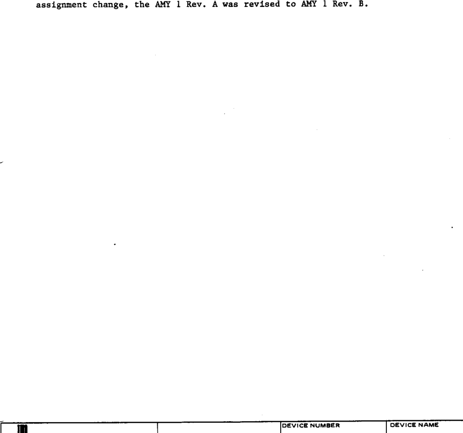

<!-- Original PDF scan 04; document printed page 3 -->

Original scan 04 · [View PDF page 4](./AMY_1_spec_confidential_binder_ver_2.pdf#page=4)

## TABLE OF CONTENTS

| Section | Description | Original page |
|---|---|---:|
| 1 | General description | 4 |
| 2 | Features | 4 |
| 3 | Block diagram | 4 |
| 4 | Pin assignment | 4 |
| 5 | Pin description | 5 |
| 6 | Functional description | 7 |
| 6.1 | Internal architecture | 7 |
| 6.2 | Complete AMY system | 10 |
| 6.3 | Envelope generation | 11 |
| 6.3.1 | Slope format | 12 |
| 6.3.2 | Destination format | 14 |
| 7 | Register organization | 16 |
| 7.1 | AMY command set | 16 |
| 7.2 | RAM and register areas | 17 |
| 7.3 | AMY data registers | 18 |
| 7.4 | Other accessible registers and RAM | 19 |
| 7.5 | Command descriptions | 20 |
| 7.5.1–7.5.9 | Nine commands | 20–31 |
| 8 | Operating procedure | 32 |
| 8.1 | Initialization | 32 |
| 8.2 | Initialization flowchart | 33 |
| 8.3 | Summary | 34 |
| 9 | Maximum ratings | 38 |
| 10 | Capacitances | 38 |
| 11 | D.C. characteristics | 39 |

---

<!-- Original PDF scan 05; document printed page 4 -->

Original scan 05 · [View PDF page 5](./AMY_1_spec_confidential_binder_ver_2.pdf#page=5)

*Table of contents (continued)*

| Section | Description | Original page |
|---|---|---:|
| 12 | A.C. characteristics | 40 |
| 12.1 | Clock and reset | 40 |
| 12.2 | Output section | 41 |
| 12.3 | System bus interface | 43 |
| Appendix I | Slope tables | 47 |
| Appendix II | Musical specifications | 57 |
| Appendix III | Testing mode | 59 |

## TABLE OF ILLUSTRATIONS

| No. | Figure | Original page |
|---:|---|---:|
| 1 | Simplified block diagram | 7 |
| 2 | HRAM and VRAM data word format | 8 |
| 3 | Complete AMY system | 10 |
| 4 | Piecewise linear envelope | 11 |
| 5 | Harmonic amplitude versus destination | 14 |
| 6 | Fundamental frequency versus destination | 15 |
| 7 | AMY RAM and register areas | 17 |
| 8 | RESET with standard uP reset circuit | 32 |
| 9 | RESET with RC | 32 |
| 10 | INT/RDY pin timing | 37 |

---

<!-- Original PDF scan 06; document printed page 5 -->

Original scan 06 · [View PDF page 6](./AMY_1_spec_confidential_binder_ver_2.pdf#page=6)

## 1. GENERAL DESCRIPTION

AMY 1 is a digital, pipeline architectured, additive music synthesizer chip. There are 8 voices maximum assignable with a total of 64 harmonic oscillators, available in groups of two, for voice assignment. AMY 1 has 72 independent, piecewise linear envelope generators: 8 fundamental frequency envelopes and 64 harmonic amplitude envelopes. A complete sound system requires addition of a D/A converter IC (up to 16 bit). To provide higher level commands, the system will generally include a controlling processor such as the Intel 8051 single chip microcomputer.

## 2. FEATURES

- Single 40-pin DIP
- 3 µm HMOS technology
- Pipeline architecture
- 10 MHz external clock frequency (maximum)
- Integrated exponential ROM
- 1/128 dB harmonic amplitude resolution and 1/64 semitone fundamental frequency resolution
- Interrupt/Ready pin
- Bus compatible with multiplexed and non-multiplexed bus microprocessors
- Full 16-bit digital output width
- Independent voice mode
- Adjustable sample rate
- Programmable noise statistics
- 72 on-chip envelope generators
- Approximately 37,000 transistors

### 3. BLOCK DIAGRAM

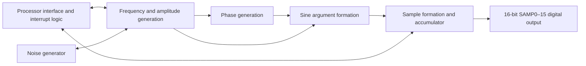

*Functional recreation of the block diagram on printed page 5.*

### 4. PIN ASSIGNMENT

| Pin | Signal | Pin | Signal |
|---:|---|---:|---|
|1|RESERVED|40|VCC|
|2|RESERVED|39|V0/T0|
|3|CLK|38|OUTSTB/T1|
|4|DB7|37|OE|
|5|DB6|36|SAMP15|
|6|DB5|35|SAMP14|
|7|DB4|34|SAMP13|
|8|DB3|33|SAMP12|
|9|DB2|32|SAMP11|
|10|DB1|31|SAMP10|
|11|DB0|30|SAMP9|
|12|ALE|29|SAMP8|
|13|A1|28|SAMP7|
|14|A0|27|SAMP6|
|15|CS|26|SAMP5|
|16|WR|25|SAMP4|
|17|RD|24|SAMP3|
|18|RESET|23|SAMP2|
|19|INT/RDY|22|SAMP1|
|20|GND|21|SAMP0|

*Pin labels are reproduced without drawing the physical notch. Active-low bars are omitted in this text table; see source PDF.*

---

View original Atari scan — Rev. B block diagram and package pinout (PDF page 6)

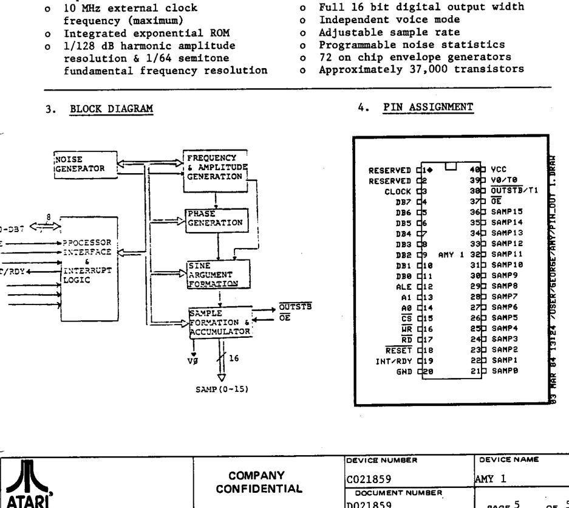

<!-- Original PDF scan 07; document printed page 6 -->

Original scan 07 · [View PDF page 7](./AMY_1_spec_confidential_binder_ver_2.pdf#page=7)

## 5. PIN DESCRIPTION

| Pin(s) | Signal | Direction | Description |
|---|---|---|---|
| 40 | VCC | Supply | +5 V supply, ±5% |
| 20 | GND | Supply | Ground |
| 18 | RESET | Input | Active-low reset; clears control, sequencer, phase and sample output state |
| 13, 14 | A1, A0 | Input | Register address select (ground when ALE mode is used) |
| 17 | RD | Input | Active-low read strobe, with CS low |
| 16 | WR | Input | Active-low write strobe, with CS low |
| 15 | CS | Input | Active-low chip select; bus tri-stated otherwise |
| 3 | CLK | Input | External clock (maximum 10 MHz), divided by 2 internally |
| 4–11 | DB7–DB0 | Bidirectional | Eight-bit tri-state processor data bus; DB7 is most significant |

*Pin-description table reconstructed from original printed page 6; active-low overbars are omitted in plain text.*

---

<!-- Original PDF scan 08; document printed page 7 -->

Original scan 08 · [View PDF page 8](./AMY_1_spec_confidential_binder_ver_2.pdf#page=8)

*Pin description (continued)*

| Pin(s) | Signal | Direction | Description |
|---|---|---|---|
| 36–21 | SAMP15–SAMP0 | Output | 16-bit digital output, tri-stated when OE high |
| 38 | OUTSTB/T1 | Output/test | Active-low sample-output strobe or test input |
| 19 | INT/RDY | Output | Interrupt pulse or ready level depending on mode |
| 12 | ALE | Input | Latches register address from DB0–1 for multiplexed buses |
| 39 | V0/T0 | Output/test | Voice-zero marker in individual output mode or test input |
| 37 | OE | Input | Output enable; SAMP bus enabled when low |
| 1, 2 | RESERVED | Test | Sentry test pins; ground in normal operation |

*Follows Rev. B, not the earlier AMY pin arrangement.*

---

<!-- Original PDF scan 09; document printed page 8 -->

Original scan 09 · [View PDF page 9](./AMY_1_spec_confidential_binder_ver_2.pdf#page=9)

## 6. FUNCTIONAL DESCRIPTION

### 6.1 Internal Architecture

AMY 1 consists of 8 major blocks as shown in Figure 1 below.

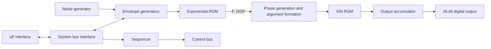

**Figure 1. Simplified block diagram** — re-created from the PDF.

The System Bus Interface block provides the user with a standard microprocessor interface. The user sends all commands and passes frequency and amplitude breakpoint data and current values over the "µP Interface" lines (RESET, RD, WR, CS, DB0–DB7, ALE, INT/RDY, A1, A0).

The Noise Generator block contains a small RAM, a serial adder, and some associated logic. It generates two different channels of bandlimited white noise simultaneously. Bandwidths are programmable by initialization of the Noise RAM.

---

View original Atari scan — Simplified block diagram (PDF page 9)

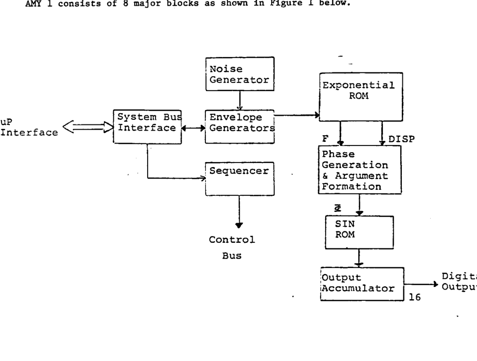

<!-- Original PDF scan 10; document printed page 9 -->

Original scan 10 · [View PDF page 10](./AMY_1_spec_confidential_binder_ver_2.pdf#page=10)

*Internal Architecture (continued)*

The Envelope Generator block contains the Voice RAM (VRAM), Harmonic RAM (HRAM), and logic necessary to generate the 72 piecewise linear envelopes (8 fundamental frequency envelopes and 64 harmonic amplitude envelopes). The RAMs maintain a slope value, destination value and current value for each envelope. The Voice RAM additionally stores a 2-bit voice type selector. The source describes the total Envelope Generator RAM as **(64 × 30) + (21 × 16) bits = 282 bytes**. [The field arithmetic/word counts are reproduced as printed and should not be inferred to describe physical FPGA RAM.]

**Figure 2. HRAM and VRAM data word formats**

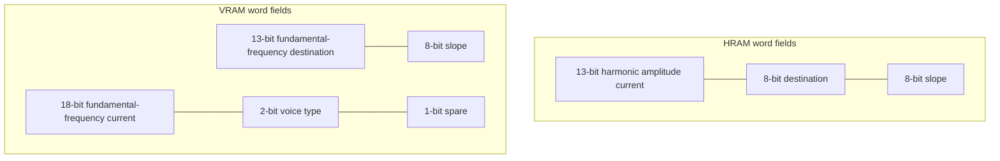

*Conceptual field-level Mermaid diagram; the scanned Figure 2 preserves the original bit positions.*

| Memory | Field | Bits |
|---|---|---:|
| HRAM | Harmonic amplitude current value | 13 |
| HRAM | Harmonic amplitude destination | 8 |
| HRAM | Harmonic amplitude slope | 8 |
| VRAM (word 1) | Fundamental frequency destination | 13 |
| VRAM (word 1) | Fundamental frequency slope | 8 |
| VRAM (word 2) | Fundamental frequency current value | 18 |
| VRAM (word 2) | Voice type select | 2 |
| VRAM (word 2) | Spare | 1 |

*Field widths read from the original PDF. The diagram shows logical fields rather than an exact contiguous software bus layout.*

---

View original Atari scan — HRAM and VRAM data-word formats (PDF page 10)

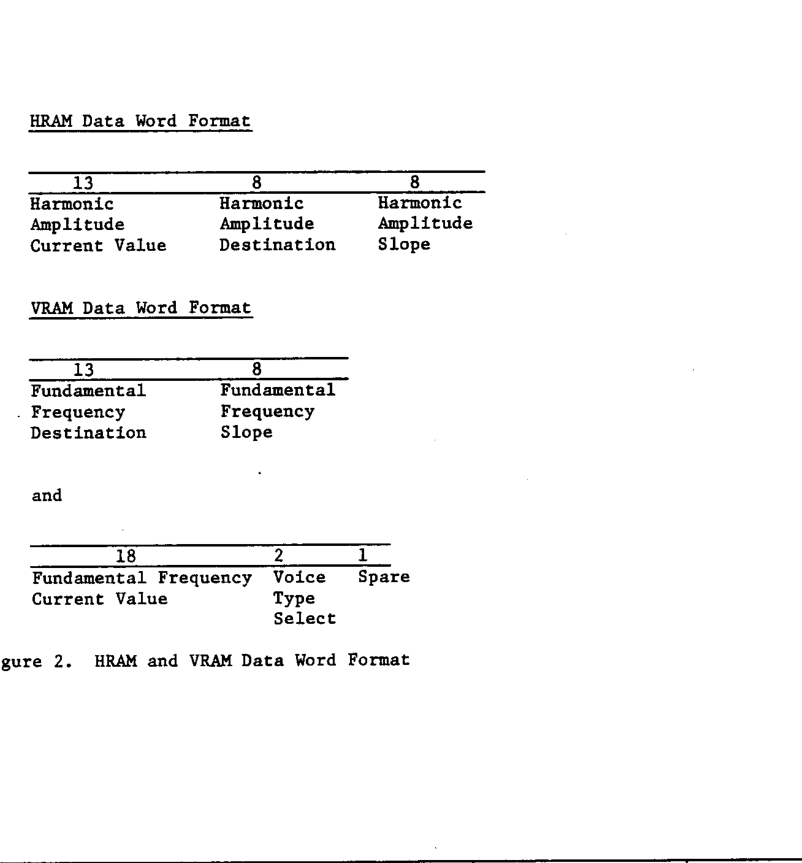

<!-- Original PDF scan 11; document printed page 10 -->

Original scan 11 · [View PDF page 11](./AMY_1_spec_confidential_binder_ver_2.pdf#page=11)

*Internal architecture (continued)*

The envelope generator contains 32 Last Harmonic Pair Flags, adders and sequencer-controlled logic for updating the envelopes from breakpoints in HRAM and VRAM. Its noise adder is used for noise-based voices.

The exponential ROM converts outputs from the 72 envelope generators into piecewise exponential form for use internally. This allows the programmer to specify harmonic amplitude in decibels and fundamental frequency in semitones. It also makes master-amplitude scaling and transposition simple addition operations in the controlling processor.

The sequencer controls the other functional blocks. It contains a seven-bit clock-period counter and a seven-bit subsample counter.

---

<!-- Original PDF scan 12; document printed page 11 -->

Original scan 12 · [View PDF page 12](./AMY_1_spec_confidential_binder_ver_2.pdf#page=12)

### 6.2 Complete AMY System

A complete sound system requires the addition of a D/A converter chip (up to 16 bit). To provide higher-level commands, the system will generally include a controlling processor such as the Intel 8051 single-chip microcomputer.

**Figure 3. Complete AMY system** — re-created from the PDF.

---

View original Atari scan — Complete AMY system (PDF page 12)

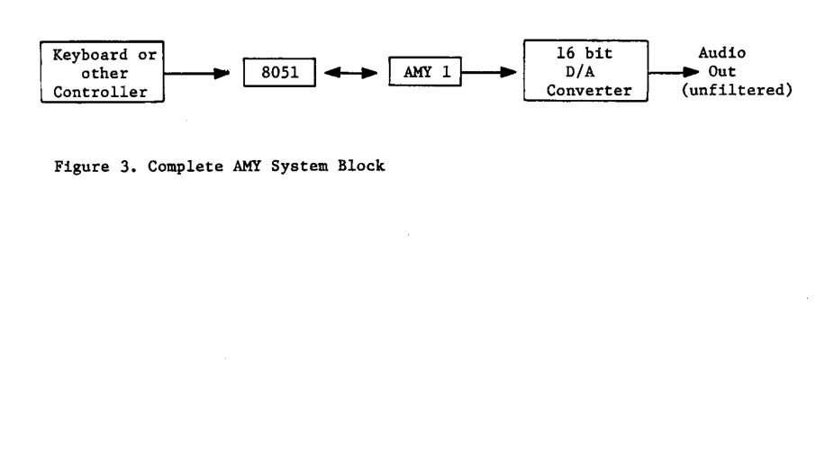

<!-- Original PDF scan 13; document printed page 12 -->

Original scan 13 · [View PDF page 13](./AMY_1_spec_confidential_binder_ver_2.pdf#page=13)

### 6.3 Envelope Generation

Envelopes are generated by the on-chip AMY 1 envelope generator block. The user may command the generators to make a piecewise linear envelope using a slope and destination scheme. Assume that a particular envelope has previously been loaded immediate to zero. By loading two breakpoints (slope–destination pairs), we obtain the following envelope:

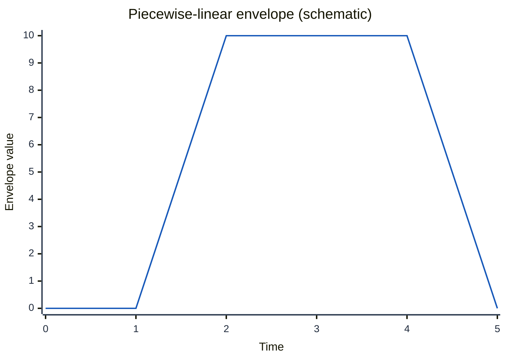

**Figure 4. Piecewise linear envelope**. Point A is the first breakpoint, B the first destination/free point, C the second breakpoint, and D the second free point. This Mermaid graph preserves the *shape*, not the source's exact annotated coordinates.

At point A, BP1 is loaded and the envelope starts rising at the constant slope defined by BP1. At B, the destination is reached and the slope effectively becomes zero (a "free point"). At C, a negative-slope breakpoint with zero destination is loaded. At D, zero is reached, becoming another free point.

---

View original Atari scan — Envelope shape and breakpoint points (PDF page 13)

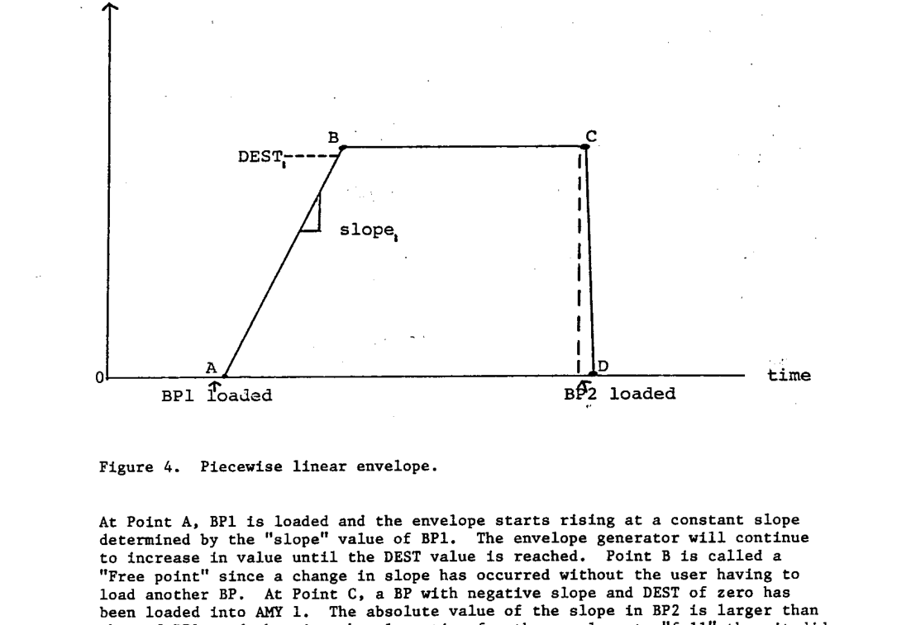

<!-- Original PDF scan 14; document printed page 13 -->

Original scan 14 · [View PDF page 14](./AMY_1_spec_confidential_binder_ver_2.pdf#page=14)

#### 6.3.1 Slope Format

The eight-bit slope uses a sign bit, a two-bit exponent, and a signed five-bit mantissa (two's-complement form). It provides envelope rates from nearly instantaneous to very gradual.

| Bit 7 | Bits 6–5 | Bits 4–0 |
|---|---|---|
| Sign | Exponent / subsample rate | Five-bit signed mantissa |

| Exponent | Addition interval |
|---|---|
| `00` | Every 128 sample periods |
| `01` | Every 32 sample periods |
| `10` | Every 8 sample periods |
| `11` | Every 2 sample periods |

**Table 1. Slope examples**

| Sign | Exponent | Mantissa bits | Relative slope (steps/sample) |
|:--:|:--:|:--:|---|
| 0 | 00 | `00001` | +1/128 ≈ 0.0078 |
| 1 | 00 | `11111` | −1/128 ≈ −0.0078 |
| 0 | 01 | `00011` | +3/32 ≈ 0.094 |
| 0 | 11 | `11111` | +31/2 = 15.5 |
| 1 | 10 | `00100` | −28/8 = −3.5 |
| 1 | 11 | `00001` | −31/2 = −15.5 |

The ratio between maximum and minimum nonzero slope magnitudes is approximately 1984 (15.5 / 0.0078125). Values are from original page 13, with source sign conventions.

---

<!-- Original PDF scan 15; document printed page 14 -->

Original scan 15 · [View PDF page 15](./AMY_1_spec_confidential_binder_ver_2.pdf#page=15)

*Slope format (continued)*

For smooth pitch and amplitude modulation, AMY's individual integration steps are deliberately small: the effective pitch step is **1/2048 of a semitone** (0.0488 cents, around 0.0028% in frequency) and the amplitude step is **1/128 dB**. Both give perceptually continuous modulation at the specified envelope rates.

| Limit | Source specification |
|---|---|
| Maximum effective harmonic amplitude increment | 31/128 dB per update |
| Maximum effective frequency increment | 31/2048 semitone per update |
| Fundamental frequency destination increment | 1/64 semitone |

Atari gives a maximum-to-minimum nonzero slope ratio of approximately **1,984**. It combines this with the 64 dB amplitude range or the 10⅔-octave frequency range to illustrate very large overall amplitude and frequency slew-rate ranges:

\[
R_{amplitude} pprox 1984 	imes 10^{64/20} pprox 3.1 	imes 10^6:1
\]
\[
R_{frequency} pprox 1984 	imes 2^{10+2/3} pprox 3.2 	imes 10^6:1.
\]

*The original uses rounded constants and scientific notation. These equations express the stated calculation in readable form; refer to the scan if exact historical notation is important.*

---

<!-- Original PDF scan 16; document printed page 15 -->

Original scan 16 · [View PDF page 16](./AMY_1_spec_confidential_binder_ver_2.pdf#page=16)

#### 6.3.2 Destination Format

Since all harmonic amplitudes have a 64 dB dynamic range, a single eight-bit destination byte is used per harmonic. The resolution is 64/256 = ¼ dB.

| Destination (8 bits) | Harmonic amplitude |
|---:|---|
| `0x00` | Zero amplitude |
| `0x01` | Minimum nonzero setting (0.25 dB) |
| `0xFF` | Full scale (63.75 dB) |

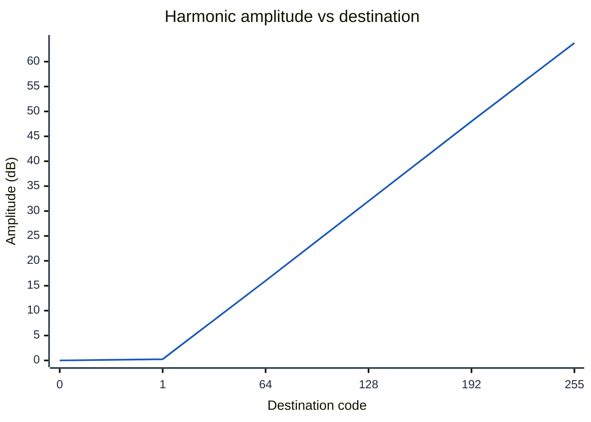

**Figure 5. Harmonic amplitude destination**. Note that Atari's text uses *dB* as a positive magnitude. Graph is representative.

---

View original Atari scan — Amplitude destination plot (PDF page 16)

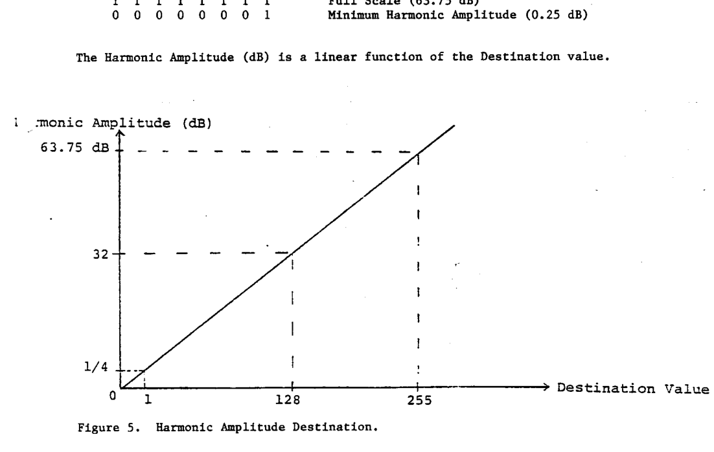

<!-- Original PDF scan 17; document printed page 16 -->

Original scan 17 · [View PDF page 17](./AMY_1_spec_confidential_binder_ver_2.pdf#page=17)

*Destination Format (continued)*

Each fundamental-frequency envelope has a 128-semitone range with destination resolution 1/64 semitone, represented in 13 bits.

| Fundamental-frequency destination field | Width |
|---|---:|
| Semitone field | 7 bits |
| Atari tone field | 6 bits |

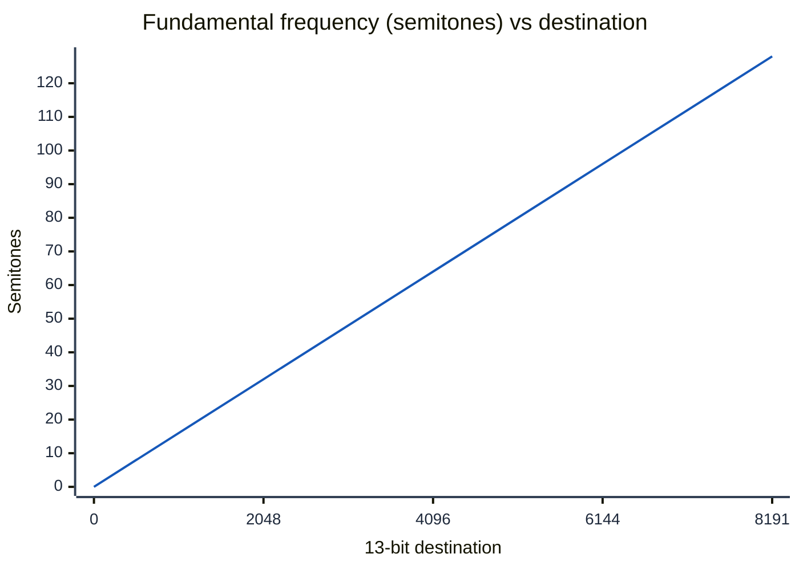

**Figure 6. Fundamental frequency vs destination**. A linear semitone scale; actual Hz is exponential. The original figure uses a broken horizontal axis.

The destination 0 yields a nonzero frequency. The effective Hz resolution is approximately 0.002 Hz per Atari tone near 0 and approximately 7 Hz per tone near 8191. Complete slope tables for a 4 MHz internal clock with 64 harmonics appear in Appendix I.

1 Atari tone = 1/64 semitone.

---

View original Atari scan — Frequency destination plot (PDF page 17)

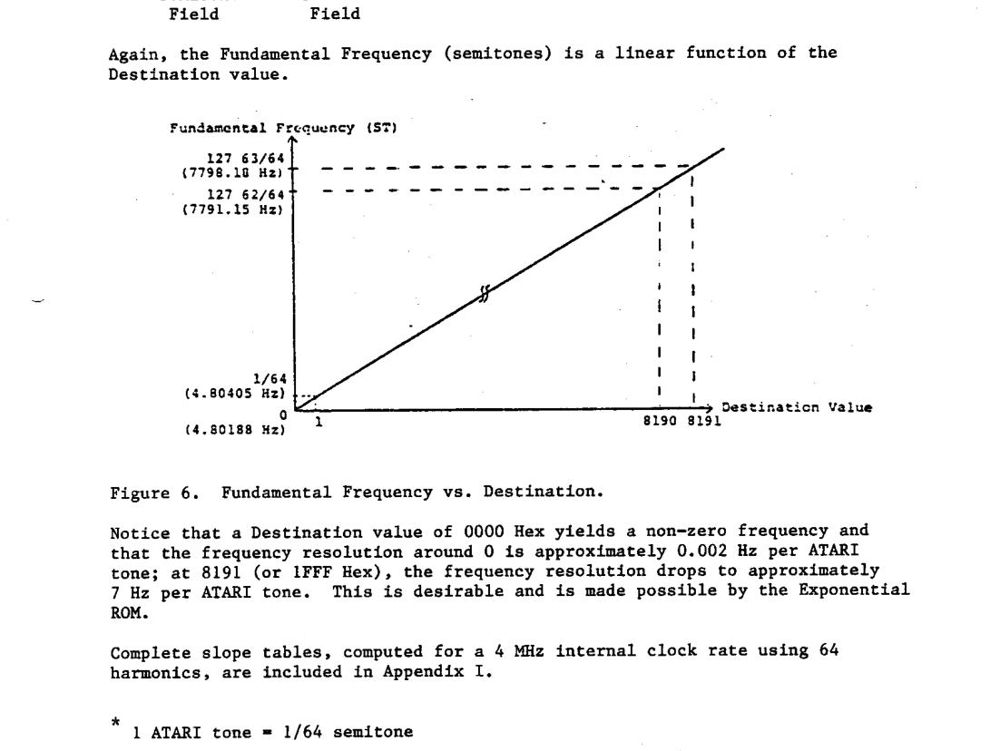

<!-- Original PDF scan 18; document printed page 17 -->

Original scan 18 · [View PDF page 18](./AMY_1_spec_confidential_binder_ver_2.pdf#page=18)

## 7. REGISTER ORGANIZATION

### 7.1 AMY 1 Command Set

Commands are sent by selecting the command register (CS = A1 = A0 = 0, RD = 1, WR active low). Each command contains an opcode and operands, as in Table 2.

**Table 2. AMY 1 commands** (bit patterns cross-checked with the source scan)

| DB7..DB0 pattern | Command |
|---|---|
| `00001 V2 V1 V0` | Write fundamental frequency breakpoint |
| `00010 V2 V1 V0` | Write voice type |
| `00011 V2 V1 V0` | Read current fundamental frequency |
| `0010 SO3 SO2 SO1 SO0` | Write system options register |
| `0011 xx SC1 SC0` | Write system control register |
| `01 H5 H4 H3 H2 H1 H0` | Write harmonic amplitude breakpoint |
| `10 HP4 HP3 HP2 HP1 HP0 D0` | Write last harmonic pair flag (SC1=0) |
| `10 N5 N4 N3 N2 N1 N0` | Write noise RAM (SC1=1) |
| `11 H5 H4 H3 H2 H1 H0` | Read current harmonic amplitude |

*The two `10` formats are selected by the System Control register. Symbols represent individual bits; spaces are for readability.*

---

<!-- Original PDF scan 19; document printed page 18 -->

Original scan 19 · [View PDF page 19](./AMY_1_spec_confidential_binder_ver_2.pdf#page=19)

### 7.2 RAM and Register Areas

The original AMY interface provides four addressable registers: A (8 bits), B (5 bits), C (8 bits), and the command register. For a write command, load A/B/C as appropriate and then issue a command. For a read, issue the command first, then read the data register. A read of the command register exposes internal bus data for diagnostics.

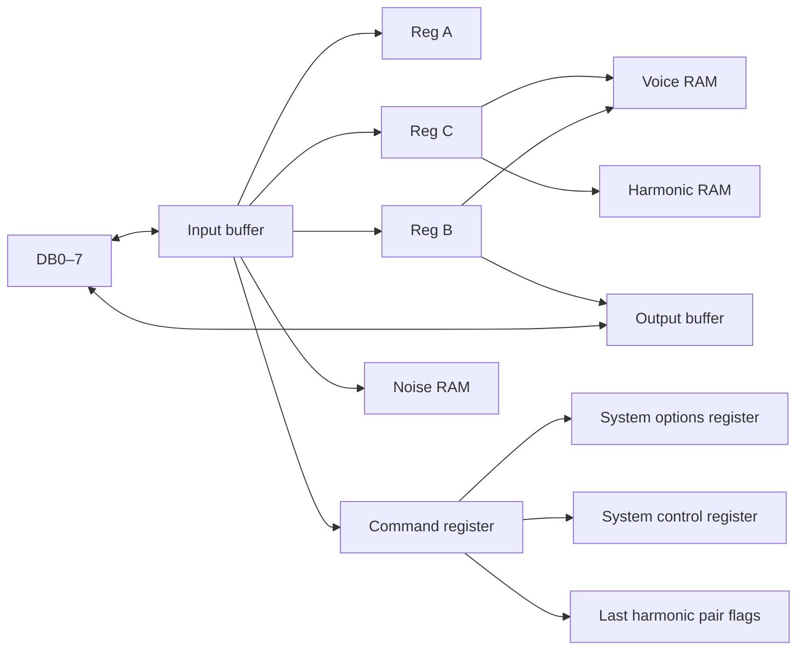

**Figure 7. AMY RAM and register areas** — functional recreation. Not a cycle-accurate wiring drawing.

---

View original Atari scan — RAM/register buses (PDF page 19)

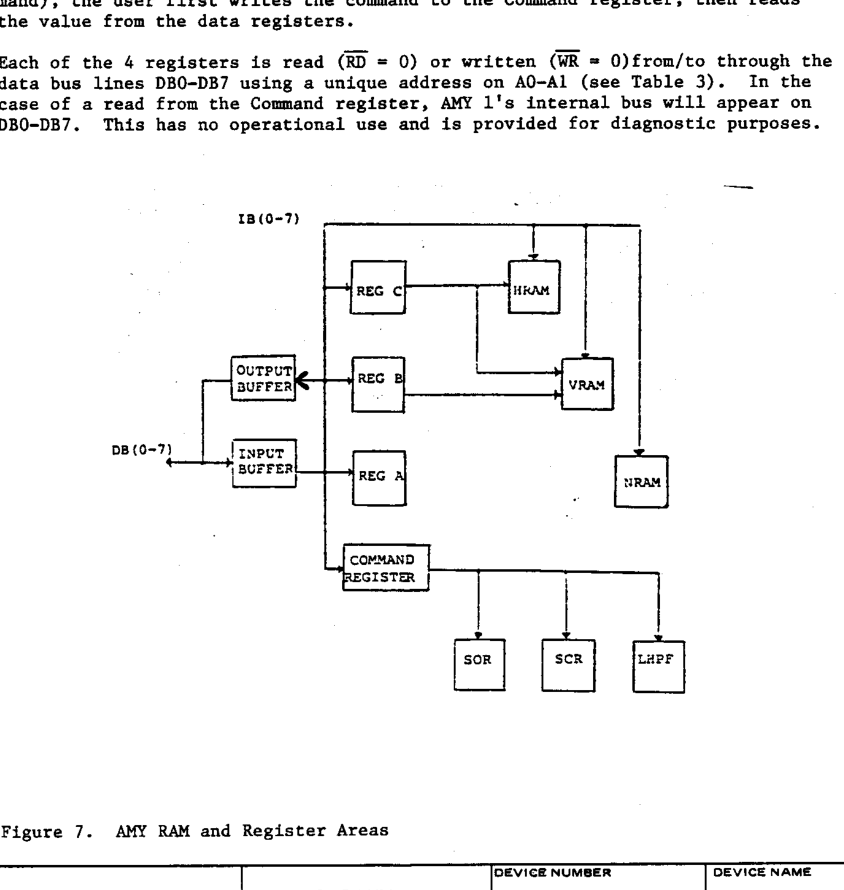

<!-- Original PDF scan 20; document printed page 19 -->

Original scan 20 · [View PDF page 20](./AMY_1_spec_confidential_binder_ver_2.pdf#page=20)

### 7.3 AMY 1 Data Registers

There are three data registers for transferring values between the processor and AMY internal RAM/register areas. A, B and C are accessible through the external register select signals. The user normally loads these before a write command and reads them after a read command.

**Table 3. Register selection**

| CS | A1 | A0 | Selected register |
|---:|---:|---:|---|
| 0 | 0 | 0 | Command (write only) |
| 0 | 0 | 1 | Register A (read/write) |
| 0 | 1 | 0 | Register B (read/write) |
| 0 | 1 | 1 | Register C (read/write) |
| 1 | X | X | None |

---

<!-- Original PDF scan 21; document printed page 20 -->

Original scan 21 · [View PDF page 21](./AMY_1_spec_confidential_binder_ver_2.pdf#page=21)

### 7.4. Other User Accessible Registers and RAM Areas

AMY 1 also contains other internal registers which are loaded by sending various commands to the AMY 1 Command register. These registers are the System Options register, the System Control register, and the Last Harmonic Pair register (see Sections 7.5.5, 7.5.6, and 7.5.8, respectively).

Other AMY 1 commands pass data to or from AMY 1 RAM areas. These RAM areas include the Voice RAM, the Harmonic RAM, and the Noise RAM. The VRAM contains the current fundamental frequency, fundamental frequency breakpoint, and the voice type. The HRAM contains the current harmonic amplitude and the harmonic amplitude breakpoint. Initial conditions of the NRAM may be loaded to obtain specific bandlimited white noise statistics.

In general, all registers are loaded directly with a single one byte write operation (even the SOR, SCR, and LHPR are loaded from operand data in the command byte). Alternately, RAM areas are read/written indirectly by using Reg A, B, and C as data buffers.

---

<!-- Original PDF scan 22; document printed page 21 -->

Original scan 22 · [View PDF page 22](./AMY_1_spec_confidential_binder_ver_2.pdf#page=22)

### 7.5. Command descriptions

#### 7.5.1 Write Fundamental Frequency Breakpoint (WR FFBP)

**Command byte:** `00001 V2 V1 V0` — select one of eight voices. To write a frequency breakpoint, load A, B and C, then issue the command byte.

| Data register | Bit positions | Meaning |
|---|---|---|
| A | A7:A0 | Eight-bit signed/exponent envelope slope |
| B | B4:B0 | Five most-significant bits of 13-bit frequency destination; B7:B5 ignored |
| C | C7:C0 | Eight least-significant bits of frequency destination |

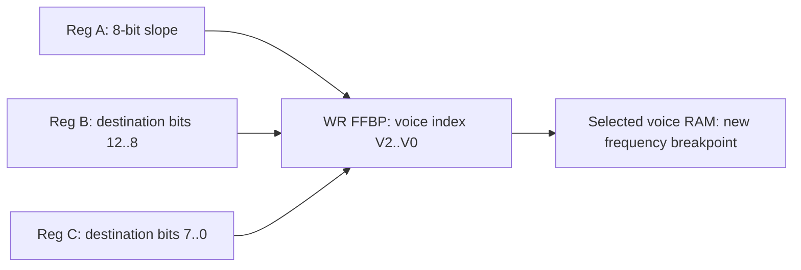

If the slope byte is **zero** when the command is issued, the destination is loaded immediately into the voice's current fundamental-frequency value, rather than starting a ramp. It stays there until another FFBP is written. This is behavior described by Atari, regardless of differences in unfinished silicon/netlist versions.

---

Original Atari command/register-layout scan — PDF page 22

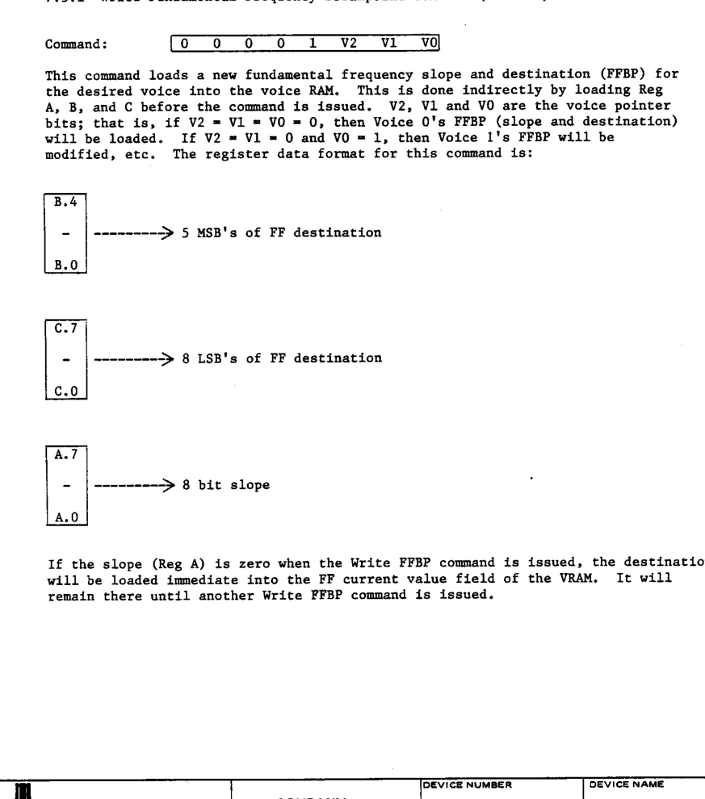

<!-- Original PDF scan 23; document printed page 22 -->

Original scan 23 · [View PDF page 23](./AMY_1_spec_confidential_binder_ver_2.pdf#page=23)

*Write fundamental frequency breakpoint (continued)*

Slope byte loaded in **register A**:

| A7 | A6–A5 | A4–A0 |
|---|---|---|
| Sign | Exponent | Mantissa |

At the finest subsample rate, the fundamental frequency step magnitude ranges from 1/2048 to 31/2048 semitone per update. The original document describes the signed-mantissa layout in detail.

| A6:A5 | Increment interval |
|:--:|---|
| `00` | Once per 128 sample periods |
| `01` | Once per 32 sample periods |
| `10` | Once per 8 sample periods |
| `11` | Once per 2 sample periods |

Destination uses 13 bits in registers B (five most-significant bits) and C (eight least-significant bits), covering a nominal 128-semitone range at 1/64-semitone resolution. The original text says 8196 values; note that 13 bits encode 8192 combinations, so this is likely a typographical error and is **not silently corrected here**.

---

<!-- Original PDF scan 24; document printed page 23 -->

Original scan 24 · [View PDF page 24](./AMY_1_spec_confidential_binder_ver_2.pdf#page=24)

#### 7.5.2 Write Harmonic Amplitude Breakpoint Command (WR HABP)

**Command byte:** `01 H5 H4 H3 H2 H1 H0`.

The six-bit harmonic index selects an HRAM entry. Load **register A = 8-bit slope**, **register C = 8-bit destination**; B is unused.

| Register | Bits | Meaning |
|---|---|---|
| A | 7–0 | Harmonic amplitude envelope slope |
| C | 7–0 | Harmonic amplitude destination |

If register A is zero, the destination is loaded immediately into the harmonic-amplitude current-value field. The original specification recommends using this to clear amplitudes before enabling SEQRUN.

---

Original Atari command/register-layout scan — PDF page 24

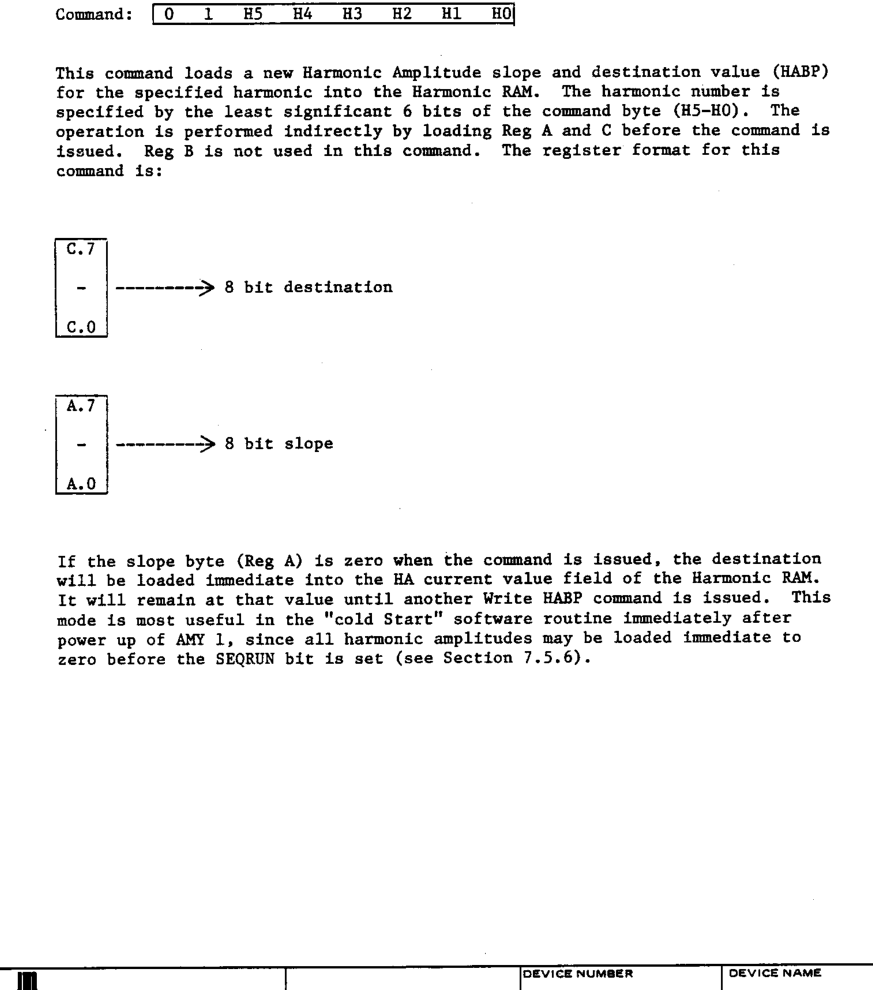

<!-- Original PDF scan 25; document printed page 24 -->

Original scan 25 · [View PDF page 25](./AMY_1_spec_confidential_binder_ver_2.pdf#page=25)

*Write harmonic amplitude breakpoint (continued)*

| Register A | Fields |
|---|---|
| A7 | Sign |
| A6:A5 | Two-bit rate exponent |
| A4:A0 | Five-bit signed mantissa |

In amplitude units, the step size is 1/128 to 31/128 dB in magnitude. The all-zero byte gives zero slope; the signed negative-zero encoding is not permitted.

| A6:A5 | Increment interval |
|:--:|---|
| `00` | Once per 128 sample periods |
| `01` | Once per 32 sample periods |
| `10` | Once per 8 sample periods |
| `11` | Once per 2 sample periods |

The eight-bit destination spans 256 codes across a 64 dB range in increments of ¼ dB.

---

<!-- Original PDF scan 26; document printed page 25 -->

Original scan 26 · [View PDF page 26](./AMY_1_spec_confidential_binder_ver_2.pdf#page=26)

#### 7.5.3 Read Fundamental Frequency Current Value (RD FFCV)

**Command byte:** `00011 V2 V1 V0`. The three low bits select one of the eight voices. The sequencer reads the fundamental-frequency current value from VRAM and loads its 13-bit representation into registers B and C for the host to read.

| Data register | Contents after command |
|---|---|
| B4:B0 | Five most-significant bits of the current frequency value |
| B7:B5 | Don't care |
| C7:C0 | Eight least-significant bits |
| A | Not used by this command |

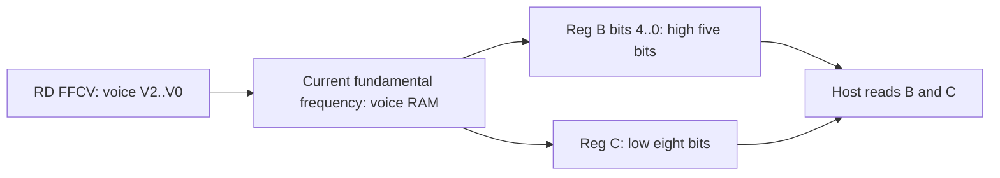

---

Original Atari command/register-layout scan — PDF page 26

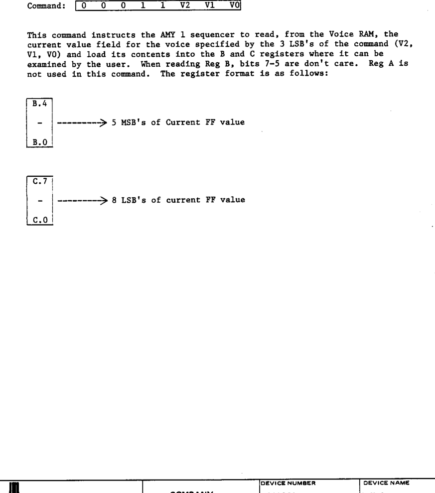

<!-- Original PDF scan 27; document printed page 26 -->

Original scan 27 · [View PDF page 27](./AMY_1_spec_confidential_binder_ver_2.pdf#page=27)

#### 7.5.4 Read Harmonic Amplitude Current Value (RD HACV)

**Command byte:** `11 H5 H4 H3 H2 H1 H0`. The six-bit operand addresses one of the 64 harmonic envelopes. The sequencer reads the harmonic's current amplitude and makes it available in **register C**, bits 7–0. Register A is unused; the command also changes register B internally, even though the user does not need B for this read.

---

Original Atari command/register-layout scan — PDF page 27

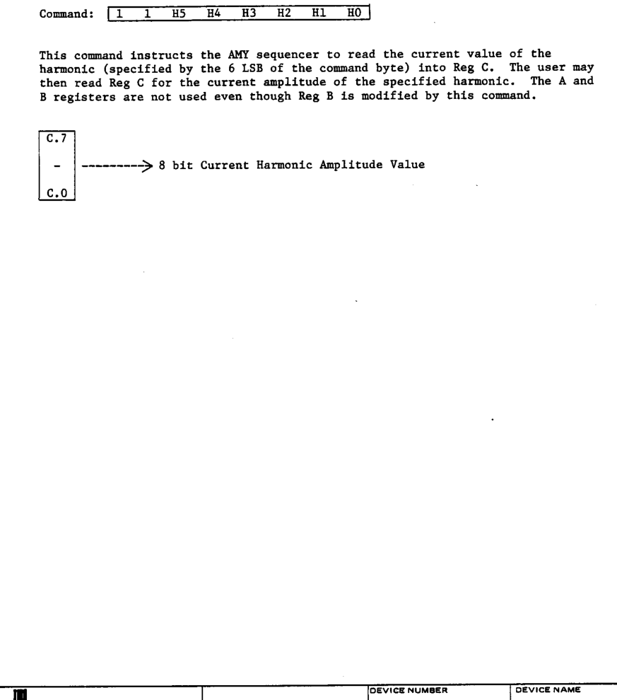

<!-- Original PDF scan 28; document printed page 27 -->

Original scan 28 · [View PDF page 28](./AMY_1_spec_confidential_binder_ver_2.pdf#page=28)

#### 7.5.5 Write System Options Register (WR SOR)

**Command byte:** `0010 SO3 SO2 SO1 SO0`. The four option bits are supplied directly in the command; A/B/C unused. All bits reset low.

**Table 4. System Options Register Selection**

| SO3 | SO2 | SO1 | SO0 | AMY mode |
|:--:|:--:|:--:|:--:|---|
| X | X | X | 0 | Address pin mode |
| X | X | X | 1 | ALE mode |
| X | X | 0 | X | READY mode |
| X | X | 1 | X | INTERRUPT mode |
| X | 0 | X | X | SUM mode |
| X | 1 | X | X | INDIVIDUAL mode |
| 0 | X | X | X | 64 harmonics |
| 1 | X | X | X | 40 harmonics |
| 0 | 0 | 0 | 0 | Reset default (address, ready, sum, 64 harmonics) |

ALE mode uses the DB0/DB1 address field during the ALE strobe. Address-pin mode uses A1 and A0.

---

<!-- Original PDF scan 29; document printed page 28 -->

Original scan 29 · [View PDF page 29](./AMY_1_spec_confidential_binder_ver_2.pdf#page=29)

#### 7.5.6 Write System Control Register (WR SCR)

**Command byte:** `0011 XX SC1 SC0`. Low two bits update the System Control register; A/B/C unused. Reset state is `SC1=SC0=0`.

**Table 5. System Control Register Selection**

| SC1 | SC0 | AMY mode |
|:--:|:--:|---|
| X | 0 | HALT mode (sequencer stopped) |
| X | 1 | SEQUENCER RUN mode |
| 1 | X | Initialize Noise RAM (NZINIT set) |
| 0 | X | NOISE RUN mode |

The sequencer must run to produce sound. In HALT, the output is zero-coded and selected oscillator phases are reset. The Noise RAM can be initialized with the sequencer halted or running.

---

<!-- Original PDF scan 30; document printed page 29 -->

Original scan 30 · [View PDF page 30](./AMY_1_spec_confidential_binder_ver_2.pdf#page=30)

#### 7.5.7. Write Noise RAM Command

Command: `10 N5 N4 N3 N2 N1 N0`.

Note: To use this command, the NZINIT bit in the SCR must be set.

This command loads data from Reg A into the Noise RAM. The address of the Noise RAM is specified in the least significant 6 bits of the command byte. Valid Noise RAM addresses range from 00 to 1D Hex and from 28 to 3F Hex. "Even" addresses in this range correspond to Noise Generator @, and the "odd" addresses correspond to Noise Generator 1. See Table on next page for the initialization data format (Noise RAM Initialization Format). The Noise RAM takes up a total of 54 address locations. Loading Noise RAM data to addresses between LE and 27 Hex is not recommended. Each of the 54 valid Noise RAM locations may be loaded with a 3 bit value. The value is specified by the least significant 3 bits of Reg A. Reg A must be loaded with the proper data before the WR Noise RAM command is issued. See Section 8.2 for the Initialization Flow Chart.

--------= "> 5 MSB's of Reg A are ignored

--------=>> 3 bits of Noise RAM data

---

Original Atari command/register-layout scan — PDF page 30

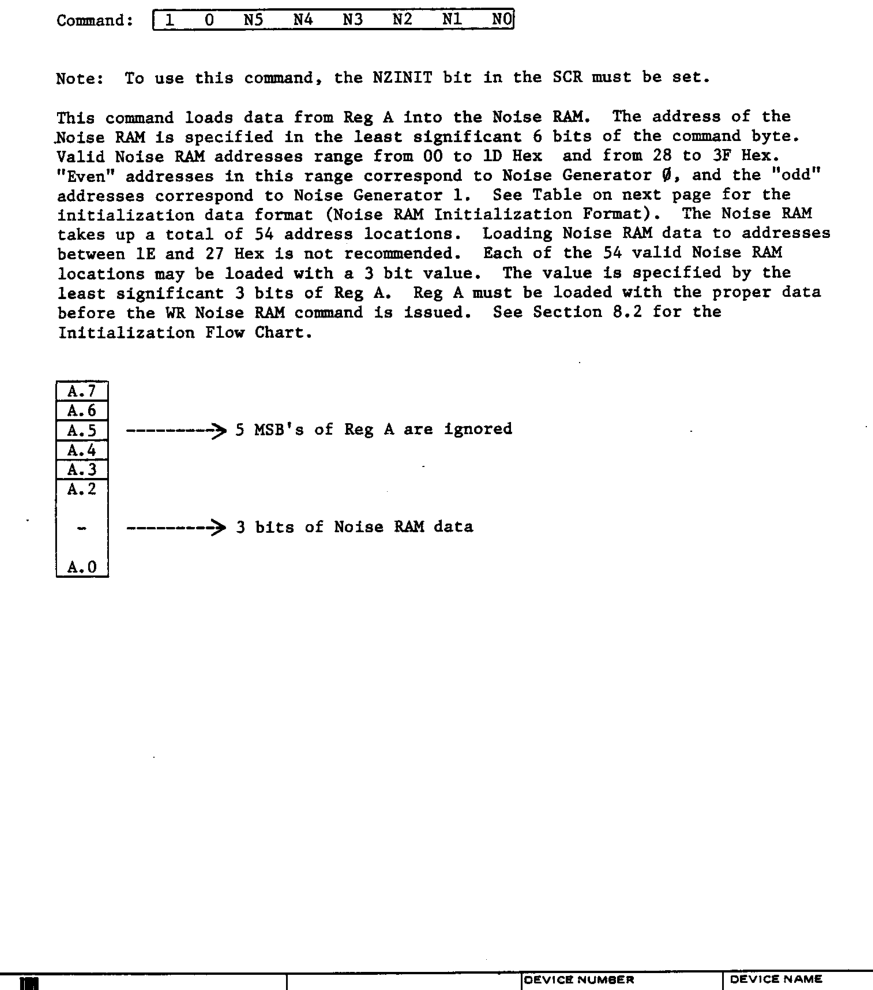

<!-- Original PDF scan 31; document printed page 30 -->

Original scan 31 · [View PDF page 31](./AMY_1_spec_confidential_binder_ver_2.pdf#page=31)

*Write Noise RAM command (continued)*

**Noise RAM initialization format**

| Address N5..N1 | N0=0 (noise generator 0) | N0=1 (noise generator 1) |
|:--:|---|---|
| `00000` | `PRBA14`, `PRBB14`, `PRBC14` | `PRBA'14`, `PRBB'14`, `PRBC'14` |
| `00001` | `PRBA13`, `PRBB13`, `PRBC13` | `PRBA'13`, `PRBB'13`, `PRBC'13` |
| `00010` | `PRBA12`, `PRBB12`, `PRBC12` | `PRBA'12`, `PRBB'12`, `PRBC'12` |
| `00011` | `PRBA11`, `PRBB11`, `PRBC11` | `PRBA'11`, `PRBB'11`, `PRBC'11` |
| `00100` | `PRBA10`, `PRBB10`, `PRBC10` | `PRBA'10`, `PRBB'10`, `PRBC'10` |
| `00101` | `PRBA9`, `PRBB9`, `PRBC9` | `PRBA'9`, `PRBB'9`, `PRBC'9` |
| `00110` | `PRBA8`, `PRBB8`, `PRBC8` | `PRBA'8`, `PRBB'8`, `PRBC'8` |
| `00111` | `PRBA7`, `PRBB7`, `PRBC7` | `PRBA'7`, `PRBB'7`, `PRBC'7` |
| `01000` | `PRBA6`, `PRBB6`, `PRBC6` | `PRBA'6`, `PRBB'6`, `PRBC'6` |
| `01001` | `PRBA5`, `PRBB5`, `PRBC5` | `PRBA'5`, `PRBB'5`, `PRBC'5` |
| `01010` | `PRBA4`, `PRBB4`, `PRBC4` | `PRBA'4`, `PRBB'4`, `PRBC'4` |
| `01011` | `PRBA3`, `PRBB3`, `PRBC3` | `PRBA'3`, `PRBB'3`, `PRBC'3` |
| `01100` | `PRBA2`, `PRBB2`, `PRBC2` | `PRBA'2`, `PRBB'2`, `PRBC'2` |
| `01101` | `PRBA1`, `PRBB1`, `PRBC1` | `PRBA'1`, `PRBB'1`, `PRBC'1` |
| `01110` | `PRBA0`, `PRBB0`, `PRBC0` | `PRBA'0`, `PRBB'0`, `PRBC'0` |
| `10100` | `UD0`, `B0`, `S0A` | `UD'0`, `B'0`, `S0B` |
| `10101` | `UD1`, `B1`, `S1A` | `UD'1`, `B'1`, `S1B` |
| `10110` | `UD2`, `B2`, `S2A` | `UD'2`, `B'2`, `S2B` |
| `10111` | `UD3`, `B3`, `S3A` | `UD'3`, `B'3`, `S3B` |
| `11000` | `UD4`, `B4`, `S4A` | `UD'4`, `B'4`, `S4B` |
| `11001` | `UD5`, `B5`, `S5A` | `UD'5`, `B'5`, `S5B` |
| `11010` | `UD6`, `B6`, `S6A` | `UD'6`, `B'6`, `S6B` |
| `11011` | `UD7`, `B7`, `S7A` | `UD'7`, `B'7`, `S7B` |
| `11100` | `UD8`, `B8`, `S8A` | `UD'8`, `B'8`, `S8B` |
| `11101` | `UD9`, `B9`, `S9A` | `UD'9`, `B'9`, `S9B` |
| `11110` | `UD10`, `B10`, `S10A` | `UD'10`, `B'10`, `S10B` |
| `11111` | `UD11`, `B11`, `S11A` | `UD'11`, `B'11`, `S11B` |

`UD0–UD11` are up/down counters; `PRB0–PRB14` pseudo-random bits; `B0–B11` noise value bits; `S0–S11` shift-control bits. Even addresses program generator 0, odd generator 1. Atari refers the reader to its Operating Manual for actual noise values.

*Cell-accurate table checked against the Rev. B scan (PDF p. 31, printed page 30): all 27 listed `N5..N1` rows and both `N0` columns are represented. These symbolic field names specify the memory-bit mapping, not the actual noise-seed values; Atari refers to the separate Operating Manual for those values.*

---

<!-- Original PDF scan 32; document printed page 31 -->

Original scan 32 · [View PDF page 32](./AMY_1_spec_confidential_binder_ver_2.pdf#page=32)

#### 7.5.8 Write Last Harmonic Pair Flag Command

Command format: `10 HP4 HP3 HP2 HP1 HP0 D0`. Available with NZINIT cleared. Harmonics are assigned as even/odd pairs, starting with 0 and 1 for voice 0. There are 32 end-of-voice flags, at most eight of which should be set.

| Pair | Harmonic indices | D0=1 meaning |
|---:|---|---|
| 0 | 0–1 | Ends current voice |
| 1 | 2–3 | Ends current voice |
| 2 | 4–5 | Ends current voice |
| 3 | 6–7 | Ends current voice |
| … | … | … |
| 31 | 62–63 | Ends current voice |

For example, setting flags 3 and 31 yields an eight-harmonic voice and a 56-harmonic voice. A/B/C unused.

---

Original Atari command/register-layout scan — PDF page 32

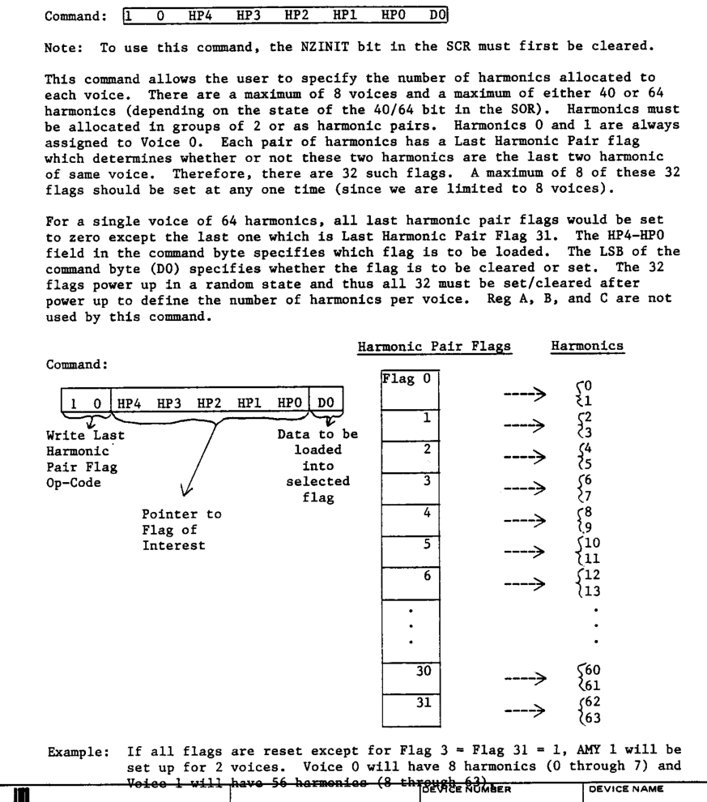

<!-- Original PDF scan 33; document printed page 32 -->

Original scan 33 · [View PDF page 33](./AMY_1_spec_confidential_binder_ver_2.pdf#page=33)

#### 7.5.9 Write Voice Type Command

Command: `00010 V2 V1 V0`. Bits A1:A0 select the type; other bits of register A and registers B/C are not used.

| A1 | A0 | Original voice type |
|:--:|:--:|---|
| 0 | 0 | Harmonic |
| 0 | 1 | Noise type 0 |
| 1 | 0 | Noise type 1 |
| 1 | 1 | Illegal / reserved |

*Historical Rev. B values only; no proposed fourth type is incorporated here.*

---

Original Atari command/register-layout scan — PDF page 33

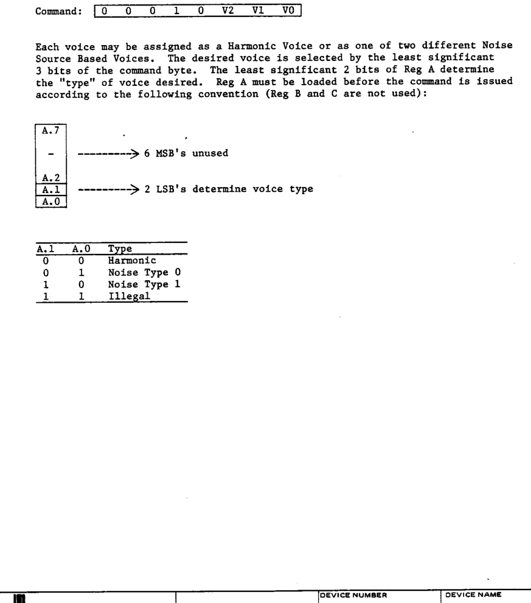

<!-- Original PDF scan 34; document printed page 33 -->

Original scan 34 · [View PDF page 34](./AMY_1_spec_confidential_binder_ver_2.pdf#page=34)

## 8. OPERATING PROCEDURE

### 8.1 Initialization

#### 8.1.1 RESET pin and Power Up Sequence

Hold RESET low through power-up, release after supply and clock have met their specifications for at least 2 ms. The PDF gives two example circuits.

**Figure 8. RESET with standard microprocessor-system reset circuit**

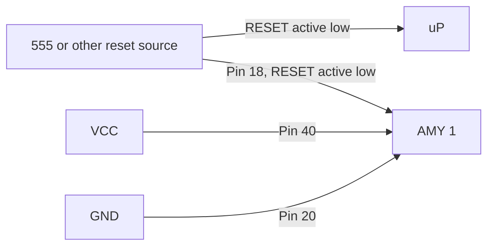

**Figure 9. RESET with RC**

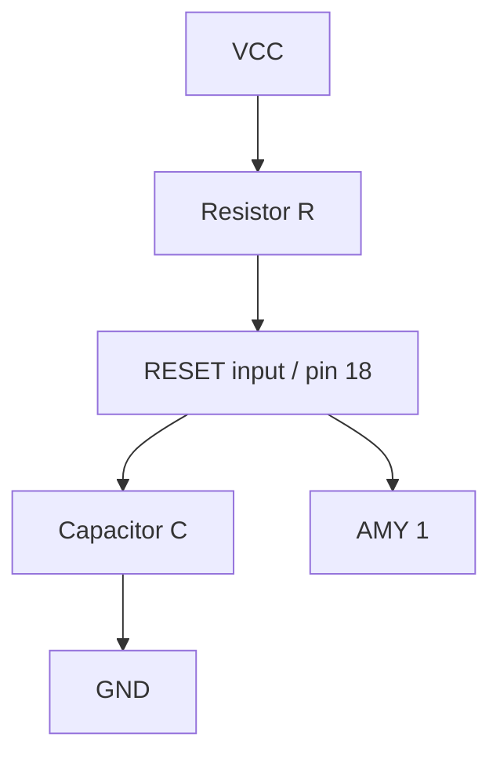

> **Fidelity warning:** Mermaid is not an electrical-schematic or oscilloscope replacement. The original figures include exact reset waveforms and timing constraints. This is a connectivity-level reconstruction; use the [PDF page 34](./AMY_1_spec_confidential_binder_ver_2.pdf#page=34) for circuit and timing details.

---

View original Atari scan — Reset circuits and waveforms (PDF page 34)

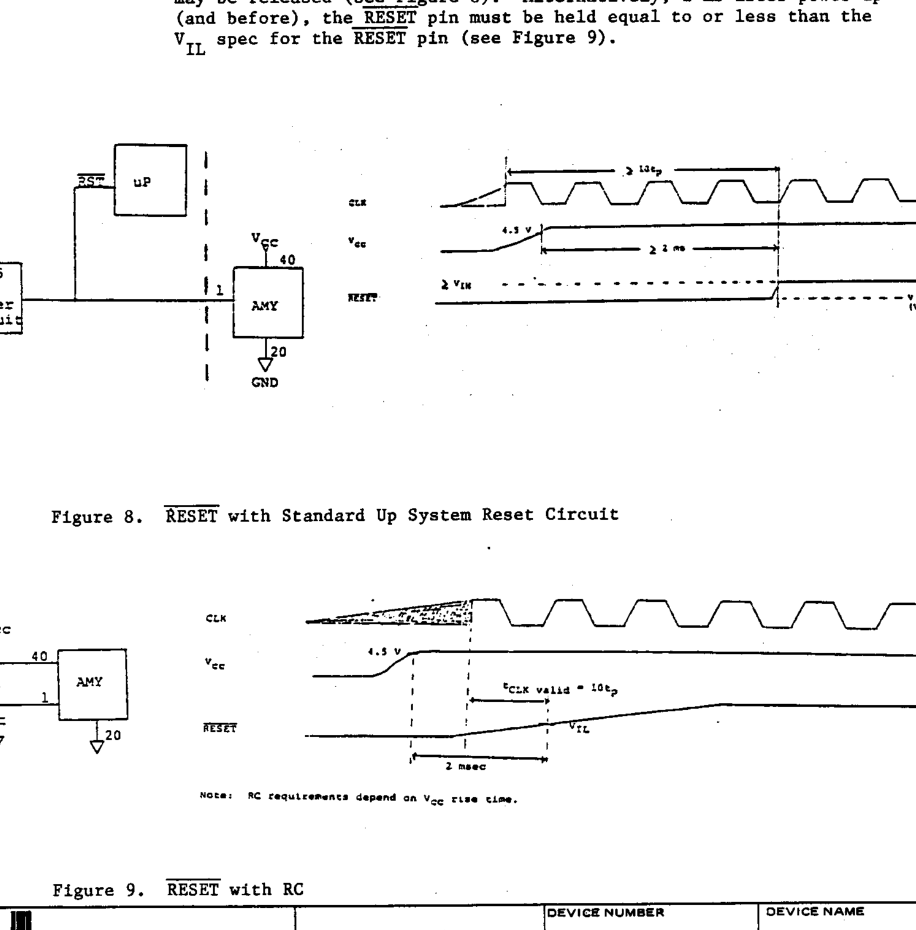

<!-- Original PDF scan 35; document printed page 34 -->

Original scan 35 · [View PDF page 35](./AMY_1_spec_confidential_binder_ver_2.pdf#page=35)

### 8.2 Initialization Flow Chart

After releasing RESET (and assuming correct power and clock), the AMY 1 enters State 0. The flowchart continues across original pp. 34–36.

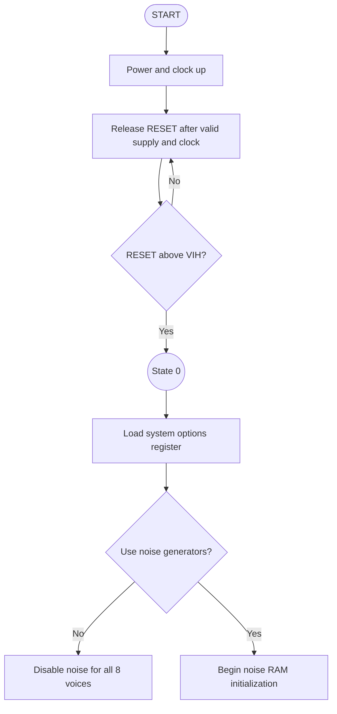

**Initialization flowchart, part 1** — from printed page 34.

---

<!-- Original PDF scan 36; document printed page 35 -->

Original scan 36 · [View PDF page 36](./AMY_1_spec_confidential_binder_ver_2.pdf#page=36)

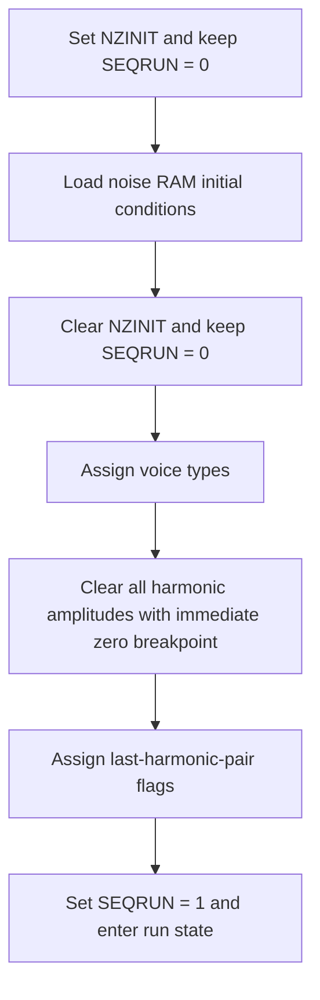

**Initialization flowchart, parts 2–3** — merges the continuation across printed pp. 35–36.

---

<!-- Original PDF scan 37; document printed page 36 -->

Original scan 37 · [View PDF page 37](./AMY_1_spec_confidential_binder_ver_2.pdf#page=37)

*Initialization flowchart — final step / Run state*

After all oscillator amplitudes have been loaded with immediate zero values, write the System Control Register to set **SEQRUN = 1** and clear **NZINIT = 0**. The output remains at zero until envelope data is loaded even though the oscillators are running.

When AMY is in **RUN state (State 1)**, voices can be constructed by first setting fundamental frequencies immediately, then ramping the harmonic amplitudes (and, if required, frequency). The manual allows further harmonic and frequency breakpoints in this state and quotes a maximum breakpoint rate of approximately **200,000 breakpoints per second**. Noise generation can be stopped and Noise RAM reloaded; harmonic allocations and voice types can also change. Current envelope values can be read back.

For drastic changes the manual recommends returning to State 0 by clearing SEQRUN, optionally first ramping all amplitudes to zero to avoid an audible click.

---

<!-- Original PDF scan 38; document printed page 37 -->

Original scan 38 · [View PDF page 38](./AMY_1_spec_confidential_binder_ver_2.pdf#page=38)

### 8.3 Summary

The original initialization sequence requires these operations:

1. Load the System Options Register, selecting 40 or 64 harmonics, ALE/address-pin mode, INT/RDY mode, and SUM/INDIVIDUAL output mode. Sample rate is the internal clock divided by twice the active harmonic count (for example 4 MHz / 128 = 31.25 kHz with 64 harmonics).
2. Define voices with the Last Harmonic Pair Flag command.
3. Clear all harmonic amplitudes to zero before `SEQRUN=1`.
4. Load Noise RAM initial conditions using the System Control Register and Noise RAM write command.
5. Assign each voice its initial voice type.

In READY mode, INT/RDY falls on receipt of a command and rises on completion. In INTERRUPT mode, the output emits a command-completion pulse. Individual mode produces separate voice samples; SUM mode produces their sum.

---

<!-- Original PDF scan 39; document printed page 38 -->

Original scan 39 · [View PDF page 39](./AMY_1_spec_confidential_binder_ver_2.pdf#page=39)

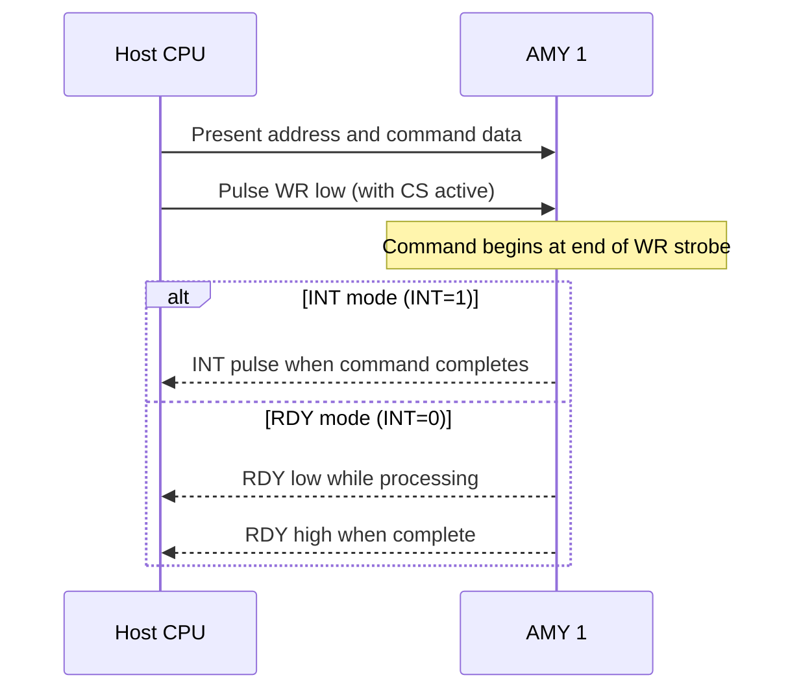

**Figure 10. INT/RDY pin timing**. Event-order representation only. Original timing waveform includes low-active CS, WR, ALE, DB timing; see [source scan](./AMY_1_spec_confidential_binder_ver_2.pdf#page=39).

---

View original Atari scan — INT/RDY timing waveform (PDF page 39)

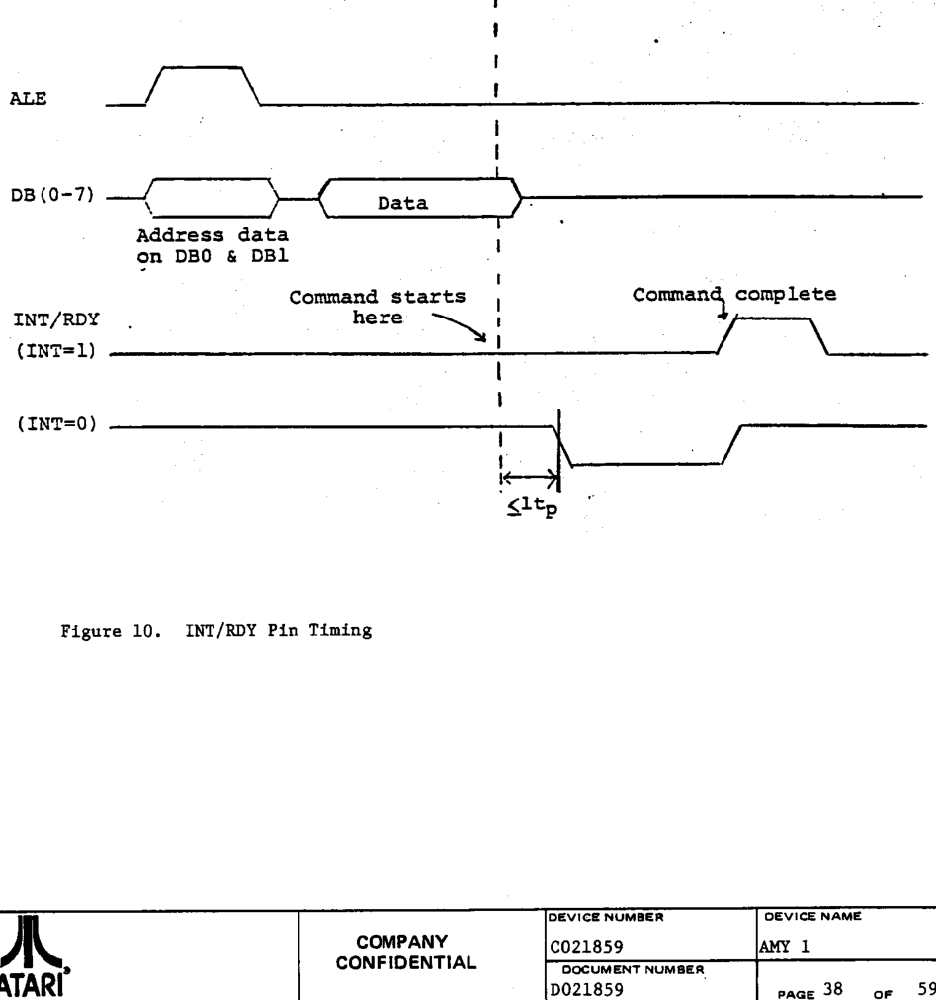

<!-- Original PDF scan 40; document printed page 39 -->

Original scan 40 · [View PDF page 40](./AMY_1_spec_confidential_binder_ver_2.pdf#page=40)

## 9. MAXIMUM RATINGS

| Parameter | Absolute limit |
|---|---|
| Storage temperature | −65 to +150 °C |
| Ambient temperature under bias | 0 to +70 °C |
| Any pin voltage relative to GND | −0.5 to +7 V |
| Power dissipation | 1 W |

## 10. CAPACITANCES

Conditions: T_A = 25 °C; VCC = GND = 0 V.

| Symbol | Parameter | Maximum | Units |
|---|---|---:|---|
| C_IN | Input capacitance | 10 | pF |
| C_OUT | Output capacitance | 10 | pF |

---

<!-- Original PDF scan 41; document printed page 40 -->

Original scan 41 · [View PDF page 41](./AMY_1_spec_confidential_binder_ver_2.pdf#page=41)

## 11. D.C. CHARACTERISTICS

Conditions: ambient temperature 0 to 70 °C; VCC = +5 V ±5%.

| Symbol | Parameter | Min | Max | Units | Test conditions |
|---|---|---:|---:|---|---|
| V_IL | Input low voltage | −0.5 | 0.8 | V | — |
| V_IH | Input high voltage | 2.0 | VCC+0.5 | V | — |
| V_OL | Output low voltage | — | 0.45 | V | I_OL = 2 mA |
| V_OH | Output high voltage | 2.4 | — | V | I_OH = −100 µA |
| I_L | Input leakage current | — | 10 | µA | 0 ≤ V_in ≤ 7.0 V |
| I_O | Output leakage current | — | 10 | µA | 0.45 ≤ V_out ≤ VCC |

---

<!-- Original PDF scan 42; document printed page 41 -->

Original scan 42 · [View PDF page 42](./AMY_1_spec_confidential_binder_ver_2.pdf#page=42)

## 12. A.C. CHARACTERISTICS

### 12.1 Clock & Reset

Conditions: T_A = 0 to 70 °C; VCC = +5 V ±5%.

| No. | Symbol | Parameter | Min | Max | Unit |
|---:|---|---|---:|---:|---|
| 1 | t_p | Clock period | 100 | 500 | ns |
| 2 | t_0 | Clock high time | 0.4 × t_p | 0.6 × t_p | — |
| 3 | t_cr | Clock rise time | — | 10 | ns |
| 4 | t_cf | Clock fall time | — | 10 | ns |
| 5 | t_rpw | RESET pulse width | 10 × t_p | — | — |

Hold RESET low during power-up for at least 2 ms after the supply reaches +5 V ±5%.

---

<!-- Original PDF scan 43; document printed page 42 -->

Original scan 43 · [View PDF page 43](./AMY_1_spec_confidential_binder_ver_2.pdf#page=43)

### 12.2 Output Section

Conditions: ambient 0–70 °C; C_L = 150 pF unless otherwise noted; VCC = 5 V ±5%; **2 MHz ≤ CLK ≤ 5 MHz** (as printed in this A.C. output table, irrespective of the broader clock specification).

| No. | Symbol | Parameter | Min | Max | Unit |
|---:|---|---|---:|---:|---|
| 1 | t_col | CLK to OUTSTB low | 0 | 150 | ns |
| 2 | t_cot | CLK to OUTSTB high | 0 | 150 | ns |
| 3 | t_cvt | CLK to V0 falling edge | 0 | 150 | ns |
| 4 | t_cvl | CLK to V0 rising edge | 0 | 150 | ns |
| 5 | t_s | Sample period, 40 harmonic mode | 80 × t_p | 80 × t_p | — |
| 5 | t_s | Sample period, 64 harmonic mode | 128 × t_p | 128 × t_p | — |
| 6 | t_sh | Sample bus hold time from CLK | 20 | — | ns |
| 7 | t_csh1 | CLK to SAMP0–15 data valid | — | 150 | ns |
| 8 | t_csf | OE rising to SAMP0–15 high impedance | 0 | 150 | ns |
| 9 | t_cse | OE falling to SAMP0–15 valid | 0 | 150 | ns |

---

<!-- Original PDF scan 44; document printed page 43 -->

Original scan 44 · [View PDF page 44](./AMY_1_spec_confidential_binder_ver_2.pdf#page=44)

**Output timing, INDIVIDUAL voice mode (rotated scan).**

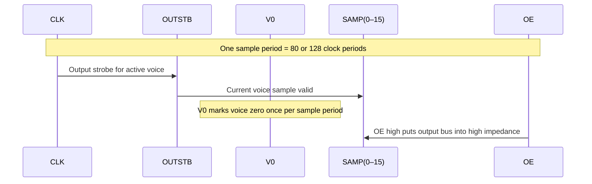

*Mermaid is only an event summary. See the original PDF timing waveform at [page 44](./AMY_1_spec_confidential_binder_ver_2.pdf#page=44) for numbered timing intervals and analog transitions.*

---

View original Atari scan — Individual-output mode timing (PDF page 44)

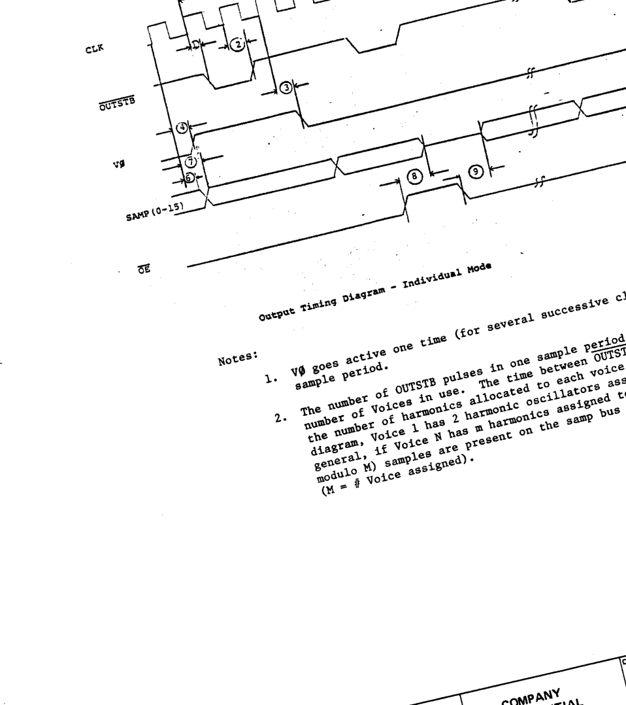

<!-- Original PDF scan 45; document printed page 44 -->

Original scan 45 · [View PDF page 45](./AMY_1_spec_confidential_binder_ver_2.pdf#page=45)

### 12.3 System Bus Interface (Read/Write, address pin and ALE modes)

> **Editorial convention:** Timing values in six rows are placed under their physically intended Min/Max headings; the asterisks identify corrections to the original *printed column placement*. Atari’s unaltered table is visible on PDF pp. 45–46. The other timing rows remain as printed.

| No. | Symbol | Parameter | Min | Max | Unit |
|---:|---|---|---:|---:|---|
| 1 | t_ar | Address valid to RD | 0 | — | ns |
| 2 | t_rr | RD pulse width | 200 | — | ns |
| 3 | t_af | ALE float time | 10 | 100 | ns |
| 4 | t_chr | CS hold time after RD | 0 | — | ns |
| 5 | t_cr | CS active to RD | 0 | — | ns |
| 6 | t_rd | Read access time | — | 150* | ns |
| 7 | t_ao | Address to data valid | — | 150* | ns |
| 8 | t_cd | CS active to data valid | — | 150* | ns |
| 9 | t_rdh | Data hold after RD | — | 10 | ns |
| 10 | t_ahr | Address hold after RD | 0 | — | ns |
| 11 | t_rdead1 | RD dead time, address-pin mode | 100 | — | ns |
| 12 | t_cycr1 | Read cycle time, address-pin mode | 300 | — | ns |
| 13 | t_rdf | Read float time, RD to DB0–7 high-Z | 10 | 100 | ns |
| 14 | t_rdead2 | RD dead time, ALE mode | 250 | — | ns |
| 15 | t_apw | ALE pulse width | 50 | — | ns |
| 16 | t_cycr2 | ALE-mode read cycle time | 450 | — | ns |

*** Editorial correction (rows 6–8):** Atari prints `150 ns` in the **Min** column. Here it is shown in **Max**, consistent with a worst-case read-access/data-valid delay. The numeric value is unchanged; this is a column correction, not a new measurement. See original PDF p. 45.

*All times are from the original scan; labels and active-low edges should be checked against the corresponding waveforms.*

---

<!-- Original PDF scan 46; document printed page 45 -->

Original scan 46 · [View PDF page 46](./AMY_1_spec_confidential_binder_ver_2.pdf#page=46)

*System Bus Interface (continued)*

| No. | Symbol | Parameter | Min | Max | Unit |
|---:|---|---|---:|---:|---|
| 17 | t_chw | CS hold after WR | 0 | — | ns |
| 18 | t_ahw | Address hold after WR | 0 | — | ns |
| 19 | t_aw | Address setup to WR | 50* | — | ns |
| 20 | t_cw | CS setup to WR | 0 | — | ns |
| 21 | t_dw | Data setup to WR | 50* | — | ns |
| 22 | t_ww | WR pulse width | 200 | — | ns |
| 23 | t_wd | Data hold after WR | 0 | — | ns |
| 24 | t_wdead1 | WR dead time, address-pin mode | 100 | — | ns |
| 25 | t_cycw | Write cycle time, address-pin mode | 300 | — | ns |
| 26 | t_alewr | ALE to WR | 50 | — | ns |
| 27 | t_cycwale | Write cycle time, ALE mode | 400 | — | ns |
| 28 | t_wdead2 | WR dead time, ALE mode | 200 | — | ns |
| 29 | t_dwa | Data valid to ALE falling edge | 50* | — | ns |
| 30 | t_wda | Data hold after ALE falling edge | 0 | — | ns |
| 31 | t_alerd | ALE falling edge to RD falling edge | 20 | — | ns |

*** Editorial correction (rows 19, 21 and 29):** Atari prints `50 ns` in the **Max** column. Here it is shown in **Min**, consistent with required address/data setup times. The numeric value is unchanged; this is a column correction, not a new measurement. See original PDF p. 46.

*All other rows follow the printed table. For hardware design, cross-check against the original bus waveforms.*

---

<!-- Original PDF scan 47; document printed page 46 -->

Original scan 47 · [View PDF page 47](./AMY_1_spec_confidential_binder_ver_2.pdf#page=47)

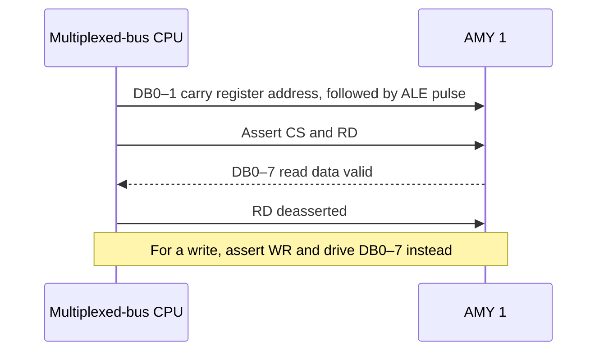

*ALE-mode timing figures from the original PDF; event order preserved, actual nanosecond setup/hold limits are in §12.3.*

---

View original Atari scan — ALE-mode timing (PDF page 47)

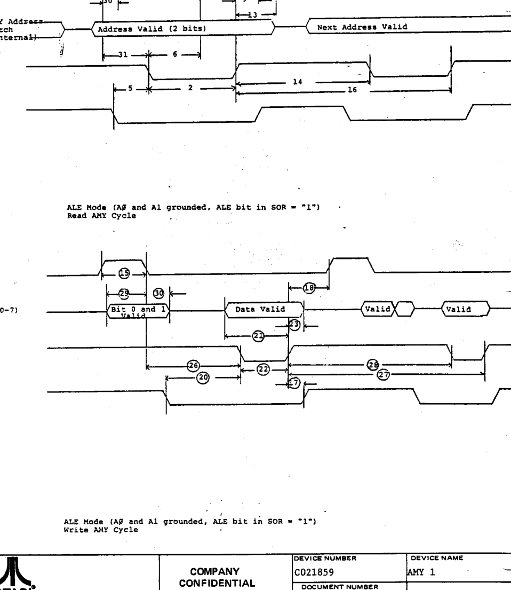

<!-- Original PDF scan 48; document printed page 47 -->

Original scan 48 · [View PDF page 48](./AMY_1_spec_confidential_binder_ver_2.pdf#page=48)

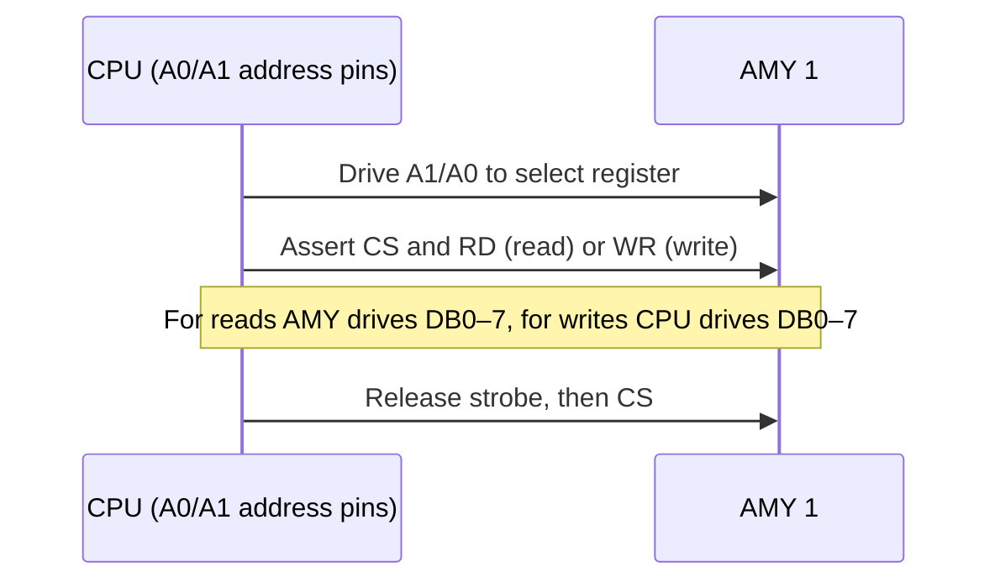

*Address-pin-mode timing figures from the original PDF. Mermaid does not preserve the analog-like waveforms.*

---

View original Atari scan — Address-pin-mode timing (PDF page 48)

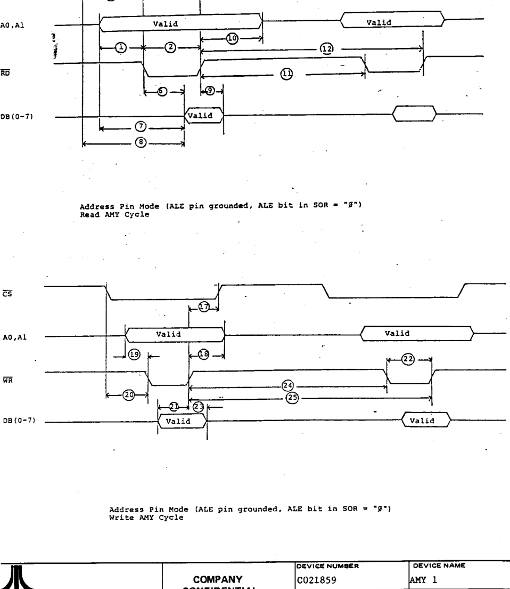

<!-- Original PDF scan 49; document printed page 48 -->

Original scan 49 · [View PDF page 49](./AMY_1_spec_confidential_binder_ver_2.pdf#page=49)

## APPENDIX I.

Table A shows the 13 bit tone values which correspond to full semitone steps on a piano keyboard. For example, Note A (440 Hz) will be reached if a fundamental frequency envelope reaches a destination value of 5004 Decimal (138C Hex). At

a 4 MHz internal clock rate the actual frequency will be 440.04 Hz. The MSB and LSB fields show the Decimal values of the Destination MSB and LSB

fields corresponding to the Atari Tone value.

Table B is in the same format as Table A, but the "Note" field was dropped as the values listed are "in between" 2 semitones (or notes on a piano). Table B shows that the actual frequency resolution at 440 Hz is approximately 0.4 Hz (1.5 cents).

Table C shows actual semitone/sec and decibel/sec slopes achieved by various 8 bit slope values. The M (mantissa) and E (exponent) fields are separated to give a feeling for the exponential coding scheme of slope byte. (Data valid for 4 MHz internal clock frequency and 64 harmonic mode).
> **Transcription note (number base).** The Rev. B printed Table A/B columns are labelled **HEX** for MSB/LSB, although the introductory text above calls them “Decimal values.” The columns below reproduce the printed hexadecimal entries. The earlier Technical Manual prints the corresponding columns in **decimal**. No silent conversion has been made.

---

<!-- Original PDF scan 50; document printed page 49 -->

Original scan 50 · [View PDF page 50](./AMY_1_spec_confidential_binder_ver_2.pdf#page=50)

**Table A — complete transcription of PDF page 50.**

> **EDITORIAL REVIEW FLAG — printed low-frequency values.** Tone 140 is **5.4 Hz** and tone 204 is **5.7 Hz** in both original tables. These are clearly legible, but are slightly lower than a direct calculation from the stated 440.04 Hz reference. I have retained Atari’s printed values.

| Atari tone (dec) | MSB (hex) | LSB (hex) | Frequency (Hz) | Note |
|---:|---:|---:|---:|---|
| 140 | 0 | 8C | 5.4 | F |
| 204 | 0 | CC | 5.7 | F#/Gb |
| 268 | 1 | 0C | 6.1 | G |
| 332 | 1 | 4C | 6.4 | G#/Ab |
| 396 | 1 | 8C | 6.8 | A |
| 460 | 1 | CC | 7.2 | A#/Bb |
| 524 | 2 | 0C | 7.7 | B |
| 588 | 2 | 4C | 8.1 | C |
| 652 | 2 | 8C | 8.6 | C#/Db |
| 716 | 2 | CC | 9.1 | D |
| 780 | 3 | 0C | 9.7 | D#/Eb |
| 844 | 3 | 4C | 10.3 | E |
| 908 | 3 | 8C | 10.9 | F |
| 972 | 3 | CC | 11.5 | F#/Gb |
| 1036 | 4 | 0C | 12.2 | G |
| 1100 | 4 | 4C | 12.9 | G#/Ab |
| 1164 | 4 | 8C | 13.7 | A |
| 1228 | 4 | CC | 14.5 | A#/Bb |
| 1292 | 5 | 0C | 15.4 | B |
| 1356 | 5 | 4C | 16.3 | C |
| 1420 | 5 | 8C | 17.3 | C#/Db |
| 1484 | 5 | CC | 18.3 | D |
| 1548 | 6 | 0C | 19.4 | D#/Eb |
| 1612 | 6 | 4C | 20.6 | E |
| 1676 | 6 | 8C | 21.8 | F |
| 1740 | 6 | CC | 23.1 | F#/Gb |
| 1804 | 7 | 0C | 24.5 | G |
| 1868 | 7 | 4C | 25.9 | G#/Ab |
| 1932 | 7 | 8C | 27.5 | A |
| 1996 | 7 | CC | 29.1 | A#/Bb |
| 2060 | 8 | 0C | 30.8 | B |
| 2124 | 8 | 4C | 32.7 | C |
| 2188 | 8 | 8C | 34.6 | C#/Db |
| 2252 | 8 | CC | 36.7 | D |
| 2316 | 9 | 0C | 38.8 | D#/Eb |
| 2380 | 9 | 4C | 41.2 | E |
| 2444 | 9 | 8C | 43.6 | F |
| 2508 | 9 | CC | 46.2 | F#/Gb |
| 2572 | A | 0C | 49 | G |
| 2636 | A | 4C | 51.9 | G#/Ab |
| 2700 | A | 8C | 55 | A |
| 2764 | A | CC | 58.2 | A#/Bb |
| 2828 | B | 0C | 61.7 | B |
| 2892 | B | 4C | 65.4 | C |
| 2956 | B | 8C | 69.3 | C#/Db |
| 3020 | B | CC | 73.4 | D |
| 3084 | C | 0C | 77.7 | D#/Eb |

Original Atari numeric table, PDF page 50 — consult when OCR values are uncertain

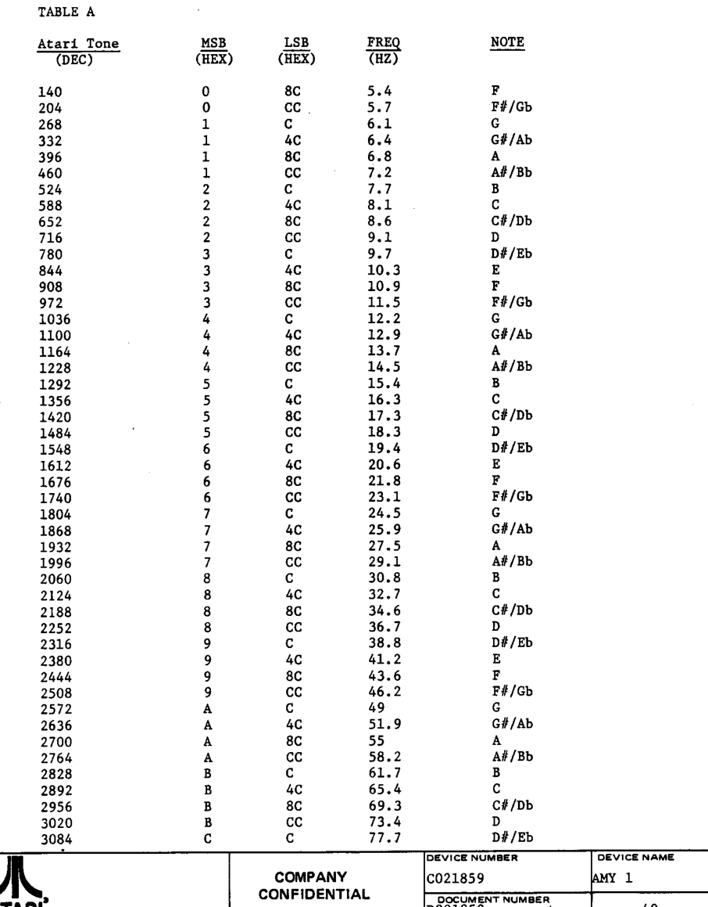

<!-- Original PDF scan 51; document printed page 50 -->

Original scan 51 · [View PDF page 51](./AMY_1_spec_confidential_binder_ver_2.pdf#page=51)

**Table A — complete transcription of PDF page 51.**

| Atari tone (dec) | MSB (hex) | LSB (hex) | Frequency (Hz) | Note |
|---:|---:|---:|---:|---|
| 3148 | C | 4C | 82.4 | E |
| 3212 | C | 8C | 87.3 | F |
| 3276 | C | CC | 92.5 | F#/Gb |
| 3340 | D | 0C | 98 | G |
| 3404 | D | 4C | 103.8 | G#/Ab |
| 3468 | D | 8C | 110 | A |
| 3532 | D | CC | 116.5 | A#/Bb |
| 3596 | E | 0C | 123.4 | B |
| 3660 | E | 4C | 130.8 | C |
| 3724 | E | 8C | 138.6 | C#/Db |
| 3788 | E | CC | 146.8 | D |
| 3852 | F | 0C | 155.5 | D#/Eb |
| 3916 | F | 4C | 164.8 | E |
| 3980 | F | 8C | 174.6 | F |
| 4044 | F | CC | 185 | F#/Gb |
| 4108 | 10 | 0C | 196 | G |
| 4172 | 10 | 4C | 207.6 | G#/Ab |
| 4236 | 10 | 8C | 220 | A |
| 4300 | 10 | CC | 233.1 | A#/Bb |
| 4364 | 11 | 0C | 246.9 | B |
| 4428 | 11 | 4C | 261.6 | C |
| 4492 | 11 | 8C | 277.2 | C#/Db |
| 4556 | 11 | CC | 293.6 | D |
| 4620 | 12 | 0C | 311.1 | D#/Eb |
| 4684 | 12 | 4C | 329.6 | E |
| 4748 | 12 | 8C | 349.2 | F |
| 4812 | 12 | CC | 370 | F#/Gb |
| 4876 | 13 | 0C | 392 | G |
| 4940 | 13 | 4C | 415.3 | G#/Ab |
| 5004 | 13 | 8C | 440 | A |
| 5068 | 13 | CC | 466.2 | A#/Bb |
| 5132 | 14 | 0C | 493.9 | B |
| 5196 | 14 | 4C | 523.3 | C |
| 5260 | 14 | 8C | 554.4 | C#/Db |
| 5324 | 14 | CC | 587.3 | D |
| 5388 | 15 | 0C | 622.3 | D#/Eb |
| 5452 | 15 | 4C | 659.3 | E |
| 5516 | 15 | 8C | 698.5 | F |
| 5580 | 15 | CC | 740 | F#/Gb |
| 5644 | 16 | 0C | 784 | G |
| 5708 | 16 | 4C | 830.7 | G#/Ab |
| 5772 | 16 | 8C | 880 | A |
| 5836 | 16 | CC | 932.4 | A#/Bb |
| 5900 | 17 | 0C | 987.8 | B |
| 5964 | 17 | 4C | 1046.6 | C |
| 6028 | 17 | 8C | 1108.8 | C#/Db |

Original Atari numeric table, PDF page 51 — consult when OCR values are uncertain

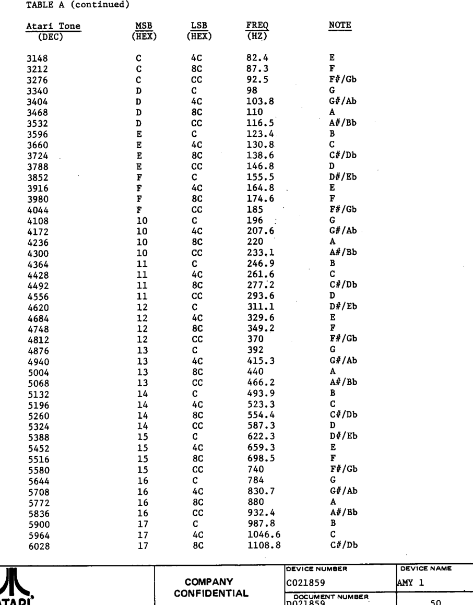

<!-- Original PDF scan 52; document printed page 51 -->

Original scan 52 · [View PDF page 52](./AMY_1_spec_confidential_binder_ver_2.pdf#page=52)

**Table A — complete transcription of PDF page 52.**

| Atari tone (dec) | MSB (hex) | LSB (hex) | Frequency (Hz) | Note |
|---:|---:|---:|---:|---|
| 6092 | 17 | CC | 1174.7 | D |
| 6156 | 18 | 0C | 1244.6 | D#/Eb |
| 6220 | 18 | 4C | 1318.6 | E |
| 6284 | 18 | 8C | 1397 | F |
| 6348 | 18 | CC | 1480.1 | F#/Gb |
| 6412 | 19 | 0C | 1568.1 | G |
| 6476 | 19 | 4C | 1661.4 | G#/Ab |
| 6540 | 19 | 8C | 1760.1 | A |
| 6604 | 19 | CC | 1864.8 | A#/Bb |
| 6668 | 1A | 0C | 1975.7 | B |
| 6732 | 1A | 4C | 2093.2 | C |
| 6796 | 1A | 8C | 2217.7 | C#/Db |
| 6860 | 1A | CC | 2349.5 | D |
| 6924 | 1B | 0C | 2489.2 | D#/Eb |
| 6988 | 1B | 4C | 2637.3 | E |
| 7052 | 1B | 8C | 2794.1 | F |
| 7116 | 1B | CC | 2960.2 | F#/Gb |
| 7180 | 1C | 0C | 3136.3 | G |
| 7244 | 1C | 4C | 3322.7 | G#/Ab |
| 7308 | 1C | 8C | 3520.3 | A |
| 7372 | 1C | CC | 3729.7 | A#/Bb |
| 7436 | 1D | 0C | 3951.4 | B |
| 7500 | 1D | 4C | 4186.4 | C |
| 7564 | 1D | 8C | 4435.4 | C#/Db |
| 7628 | 1D | CC | 4699.1 | D |
| 7692 | 1E | 0C | 4978.5 | D#/Eb |
| 7756 | 1E | 4C | 5274.6 | E |
| 7820 | 1E | 8C | 5588.2 | F |
| 7884 | 1E | CC | 5920.5 | F#/Gb |
| 7948 | 1F | 0C | 6272.6 | G |
| 8012 | 1F | 4C | 6645.5 | G#/Ab |
| 8076 | 1F | 8C | 7040.7 | A |
| 8140 | 1F | CC | 7459.4 | A#/Bb |

Original Atari numeric table, PDF page 52 — consult when OCR values are uncertain

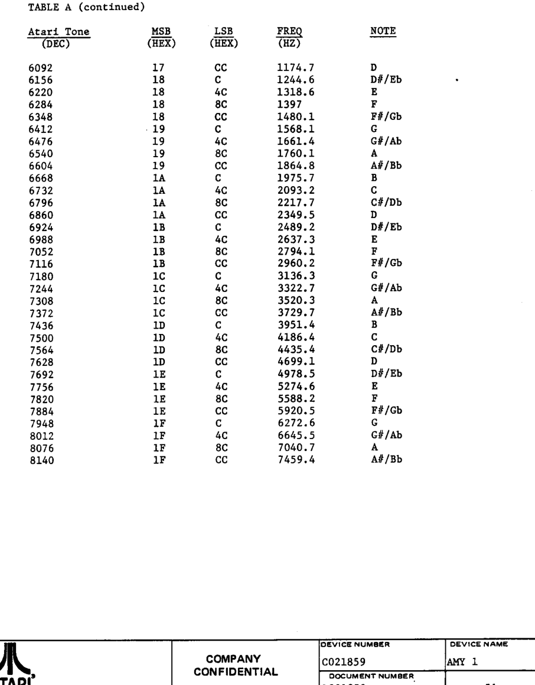

<!-- Original PDF scan 53; document printed page 52 -->

Original scan 53 · [View PDF page 53](./AMY_1_spec_confidential_binder_ver_2.pdf#page=53)

**Table B — complete transcription of PDF page 53.**

| Atari tone (dec) | MSB (hex) | LSB (hex) | Frequency (Hz) |
|---:|---:|---:|---:|
| 4941 | 13 | 4D | 415.7 |
| 4942 | 13 | 4E | 416 |
| 4943 | 13 | 4F | 416.4 |
| 4944 | 13 | 50 | 416.8 |
| 4945 | 13 | 51 | 417.2 |
| 4946 | 13 | 52 | 417.5 |
| 4947 | 13 | 53 | 417.9 |
| 4948 | 13 | 54 | 418.3 |
| 4949 | 13 | 55 | 418.7 |
| 4950 | 13 | 56 | 419.1 |
| 4951 | 13 | 57 | 419.4 |
| 4952 | 13 | 58 | 419.8 |
| 4953 | 13 | 59 | 420.2 |
| 4954 | 13 | 5A | 420.6 |
| 4955 | 13 | 5B | 421 |
| 4956 | 13 | 5C | 421.3 |
| 4957 | 13 | 5D | 421.7 |
| 4958 | 13 | 5E | 422.1 |
| 4959 | 13 | 5F | 422.5 |
| 4960 | 13 | 60 | 422.9 |
| 4961 | 13 | 61 | 423.2 |
| 4962 | 13 | 62 | 423.6 |
| 4963 | 13 | 63 | 424 |
| 4964 | 13 | 64 | 424.4 |
| 4965 | 13 | 65 | 424.8 |
| 4966 | 13 | 66 | 425.2 |
| 4967 | 13 | 67 | 425.5 |
| 4968 | 13 | 68 | 425.9 |
| 4969 | 13 | 69 | 426.3 |
| 4970 | 13 | 6A | 426.7 |
| 4971 | 13 | 6B | 427.1 |
| 4972 | 13 | 6C | 427.5 |
| 4973 | 13 | 6D | 427.8 |
| 4974 | 13 | 6E | 428.2 |
| 4975 | 13 | 6F | 428.6 |
| 4976 | 13 | 70 | 429 |
| 4977 | 13 | 71 | 429.4 |
| 4978 | 13 | 72 | 429.8 |
| 4979 | 13 | 73 | 430.2 |
| 4980 | 13 | 74 | 430.6 |
| 4981 | 13 | 75 | 431 |
| 4982 | 13 | 76 | 431.3 |
| 4983 | 13 | 77 | 431.7 |
| 4984 | 13 | 78 | 432.1 |
| 4985 | 13 | 79 | 432.5 |
| 4986 | 13 | 7A | 432.9 |
| 4987 | 13 | 7B | 433.3 |

*Atari’s printed note: range of two semitones; resolution of one Atari tone (1/64 semitone); centred around A (440 Hz).*

Original Atari numeric table, PDF page 53 — consult when OCR values are uncertain

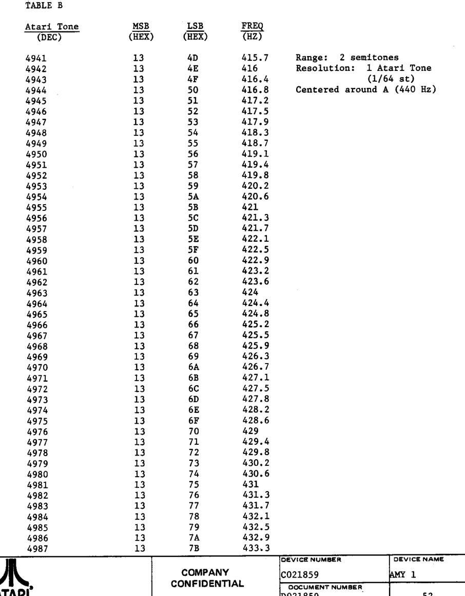

<!-- Original PDF scan 54; document printed page 53 -->

Original scan 54 · [View PDF page 54](./AMY_1_spec_confidential_binder_ver_2.pdf#page=54)

**Table B — complete transcription of PDF page 54.**

| Atari tone (dec) | MSB (hex) | LSB (hex) | Frequency (Hz) |
|---:|---:|---:|---:|
| 4988 | 13 | 7C | 433.7 |
| 4989 | 13 | 7D | 434.1 |
| 4990 | 13 | 7E | 434.5 |
| 4991 | 13 | 7F | 434.9 |
| 4992 | 13 | 80 | 435.3 |
| 4993 | 13 | 81 | 435.6 |
| 4994 | 13 | 82 | 436 |
| 4995 | 13 | 83 | 436.4 |
| 4996 | 13 | 84 | 436.8 |
| 4997 | 13 | 85 | 437.2 |
| 4998 | 13 | 86 | 437.6 |
| 4999 | 13 | 87 | 438 |
| 5000 | 13 | 88 | 438.4 |
| 5001 | 13 | 89 | 438.8 |
| 5002 | 13 | 8A | 439.2 |
| 5003 | 13 | 8B | 439.6 |
| 5004 | 13 | 8C | 440 |
| 5005 | 13 | 8D | 440.4 |
| 5006 | 13 | 8E | 440.8 |
| 5007 | 13 | 8F | 441.2 |
| 5008 | 13 | 90 | 441.6 |
| 5009 | 13 | 91 | 442 |
| 5010 | 13 | 92 | 442.4 |
| 5011 | 13 | 93 | 442.8 |
| 5012 | 13 | 94 | 443.2 |
| 5013 | 13 | 95 | 443.6 |
| 5014 | 13 | 96 | 444 |
| 5015 | 13 | 97 | 444.4 |
| 5016 | 13 | 98 | 444.8 |
| 5017 | 13 | 99 | 445.2 |
| 5018 | 13 | 9A | 445.6 |
| 5019 | 13 | 9B | 446 |
| 5020 | 13 | 9C | 446.4 |
| 5021 | 13 | 9D | 446.8 |
| 5022 | 13 | 9E | 447.2 |
| 5023 | 13 | 9F | 447.6 |
| 5024 | 13 | A0 | 448 |
| 5025 | 13 | A1 | 448.4 |
| 5026 | 13 | A2 | 448.8 |
| 5027 | 13 | A3 | 449.2 |
| 5028 | 13 | A4 | 449.6 |
| 5029 | 13 | A5 | 450 |
| 5030 | 13 | A6 | 450.4 |
| 5031 | 13 | A7 | 450.8 |
| 5032 | 13 | A8 | 451.3 |
| 5033 | 13 | A9 | 451.7 |
| 5034 | 13 | AA | 452.1 |

Original Atari numeric table, PDF page 54 — consult when OCR values are uncertain

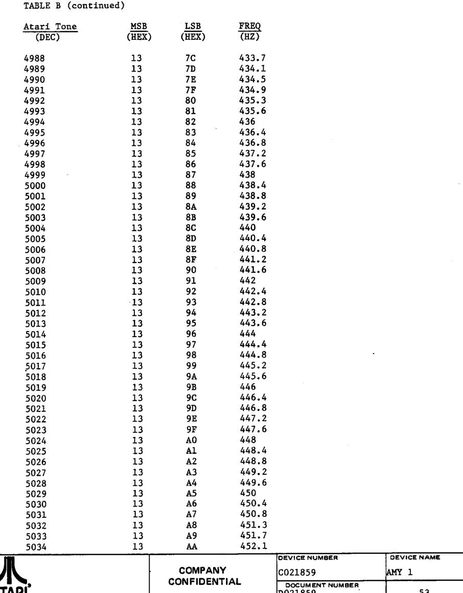

<!-- Original PDF scan 55; document printed page 54 -->

Original scan 55 · [View PDF page 55](./AMY_1_spec_confidential_binder_ver_2.pdf#page=55)

**Table B — complete transcription of PDF page 55.**

| Atari tone (dec) | MSB (hex) | LSB (hex) | Frequency (Hz) |
|---:|---:|---:|---:|
| 5035 | 13 | AB | 452.5 |
| 5036 | 13 | AC | 452.9 |
| 5037 | 13 | AD | 453.3 |
| 5038 | 13 | AE | 453.7 |
| 5039 | 13 | AF | 454.1 |
| 5040 | 13 | B0 | 454.5 |
| 5041 | 13 | B1 | 454.9 |
| 5042 | 13 | B2 | 455.3 |
| 5043 | 13 | B3 | 455.8 |
| 5044 | 13 | B4 | 456.2 |
| 5045 | 13 | B5 | 456.6 |
| 5046 | 13 | B6 | 457 |
| 5047 | 13 | B7 | 457.4 |
| 5048 | 13 | B8 | 457.8 |
| 5049 | 13 | B9 | 458.2 |
| 5050 | 13 | BA | 458.6 |
| 5051 | 13 | BB | 459.1 |
| 5052 | 13 | BC | 459.5 |
| 5053 | 13 | BD | 459.9 |
| 5054 | 13 | BE | 460.3 |
| 5055 | 13 | BF | 460.7 |
| 5056 | 13 | C0 | 461.1 |
| 5057 | 13 | C1 | 461.6 |
| 5058 | 13 | C2 | 462 |
| 5059 | 13 | C3 | 462.4 |
| 5060 | 13 | C4 | 462.8 |
| 5061 | 13 | C5 | 463.2 |
| 5062 | 13 | C6 | 463.6 |
| 5063 | 13 | C7 | 464.1 |
| 5064 | 13 | C8 | 464.5 |
| 5065 | 13 | C9 | 464.9 |
| 5066 | 13 | CA | 465.3 |
| 5067 | 13 | CB | 465.7 |

Original Atari numeric table, PDF page 55 — consult when OCR values are uncertain

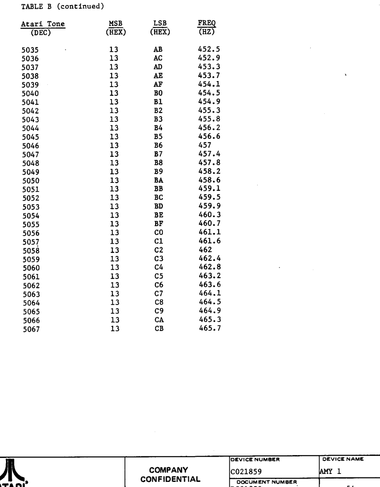

<!-- Original PDF scan 56; document printed page 55 -->

Original scan 56 · [View PDF page 56](./AMY_1_spec_confidential_binder_ver_2.pdf#page=56)

**Table C — complete transcription of PDF page 56.**

| + slope (hex) | − slope (hex) | Semitones/s | dB/s | M (hex) | E (hex) |
|---:|---:|---:|---:|---:|---:|
| 0 | 80 | 0 | 0 | 0 | 0 |
| 1 | 9F | 0.11 | 1.9 | 1 | 0 |
| 2 | 9E | 0.23 | 3.81 | 2 | 0 |
| 3 | 9D | 0.35 | 5.72 | 3 | 0 |
| 4 | 9C | 0.47 | 7.62 | 4 | 0 |
| 5 | 9B | 0.59 | 9.53 | 5 | 0 |
| 6 | 9A | 0.71 | 11.44 | 6 | 0 |
| 7 | 99 | 0.83 | 13.35 | 7 | 0 |
| 8 | 98 | 0.95 | 15.25 | 8 | 0 |
| 9 | 97 | 1.07 | 17.16 | 9 | 0 |
| A | 96 | 1.19 | 19.07 | A | 0 |
| B | 95 | 1.31 | 20.98 | B | 0 |
| C | 94 | 1.43 | 22.88 | C | 0 |
| D | 93 | 1.54 | 24.79 | D | 0 |
| E | 92 | 1.66 | 26.7 | E | 0 |
| F | 91 | 1.78 | 28.61 | F | 0 |
| 10 | 90 | 1.9 | 30.51 | 10 | 0 |
| 11 | 8F | 2.02 | 32.42 | 11 | 0 |
| 12 | 8E | 2.14 | 34.33 | 12 | 0 |
| 13 | 8D | 2.26 | 36.23 | 13 | 0 |
| 14 | 8C | 2.38 | 38.14 | 14 | 0 |
| 15 | 8B | 2.5 | 40.05 | 15 | 0 |
| 16 | 8A | 2.62 | 41.96 | 16 | 0 |
| 17 | 89 | 2.74 | 43.86 | 17 | 0 |
| 18 | 88 | 2.86 | 45.77 | 18 | 0 |
| 19 | 87 | 2.98 | 47.68 | 19 | 0 |
| 1A | 86 | 3.09 | 49.59 | 1A | 0 |
| 1B | 85 | 3.21 | 51.49 | 1B | 0 |
| 1C | 84 | 3.33 | 53.4 | 1C | 0 |
| 1D | 83 | 3.45 | 55.31 | 1D | 0 |
| 1E | 82 | 3.57 | 57.22 | 1E | 0 |
| 1F | 81 | 3.69 | 59.12 | 1F | 0 |
| 20 | A0 | 0 | 0 | 0 | 1 |
| 21 | BF | 0.47 | 7.62 | 1 | 1 |
| 22 | BE | 0.95 | 15.25 | 2 | 1 |
| 23 | BD | 1.43 | 22.88 | 3 | 1 |
| 24 | BC | 1.9 | 30.51 | 4 | 1 |
| 25 | BB | 2.38 | 38.14 | 5 | 1 |
| 26 | BA | 2.86 | 45.77 | 6 | 1 |
| 27 | B9 | 3.33 | 53.4 | 7 | 1 |
| 28 | B8 | 3.81 | 61.03 | 8 | 1 |
| 29 | B7 | 4.29 | 68.66 | 9 | 1 |
| 2A | B6 | 4.76 | 76.29 | A | 1 |
| 2B | B5 | 5.24 | 83.92 | B | 1 |
| 2C | B4 | 5.72 | 91.55 | C | 1 |
| 2D | B3 | 6.19 | 99.18 | D | 1 |
| 2E | B2 | 6.67 | 106.81 | E | 1 |

*The slope code 0 occurs at each exponent with M = 0, as printed in Atari’s table. Negative codes use the chip’s sign/exponent/mantissa encoding.*

Original Atari numeric table, PDF page 56 — consult when OCR values are uncertain

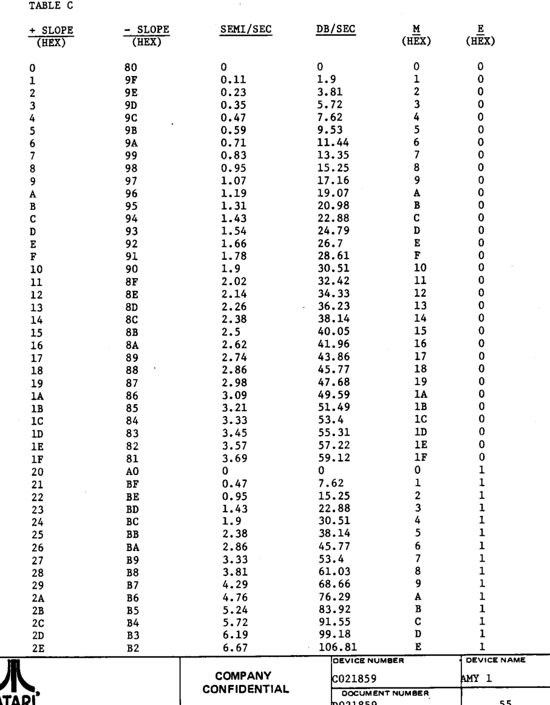

<!-- Original PDF scan 57; document printed page 56 -->

Original scan 57 · [View PDF page 57](./AMY_1_spec_confidential_binder_ver_2.pdf#page=57)

**Table C — complete transcription of PDF page 57.**

| + slope (hex) | − slope (hex) | Semitones/s | dB/s | M (hex) | E (hex) |
|---:|---:|---:|---:|---:|---:|
| 2F | B1 | 7.15 | 114.44 | F | 1 |
| 30 | B0 | 7.62 | 122.07 | 10 | 1 |
| 31 | AF | 8.1 | 129.69 | 11 | 1 |
| 32 | AE | 8.58 | 137.32 | 12 | 1 |
| 33 | AD | 9.05 | 144.95 | 13 | 1 |
| 34 | AC | 9.53 | 152.58 | 14 | 1 |
| 35 | AB | 10.01 | 160.21 | 15 | 1 |
| 36 | AA | 10.49 | 167.84 | 16 | 1 |
| 37 | A9 | 10.96 | 175.47 | 17 | 1 |
| 38 | A8 | 11.44 | 183.1 | 18 | 1 |
| 39 | A7 | 11.92 | 190.73 | 19 | 1 |
| 3A | A6 | 12.39 | 198.36 | 1A | 1 |
| 3B | A5 | 12.87 | 205.99 | 1B | 1 |
| 3C | A4 | 13.35 | 213.62 | 1C | 1 |
| 3D | A3 | 13.82 | 221.25 | 1D | 1 |
| 3E | A2 | 14.3 | 228.88 | 1E | 1 |
| 3F | A1 | 14.78 | 236.51 | 1F | 1 |
| 40 | C0 | 0 | 0 | 0 | 2 |
| 41 | DF | 1.9 | 30.51 | 1 | 2 |
| 42 | DE | 3.81 | 61.03 | 2 | 2 |
| 43 | DD | 5.72 | 91.55 | 3 | 2 |
| 44 | DC | 7.62 | 122.07 | 4 | 2 |
| 45 | DB | 9.53 | 152.58 | 5 | 2 |
| 46 | DA | 11.44 | 183.1 | 6 | 2 |
| 47 | D9 | 13.35 | 213.62 | 7 | 2 |
| 48 | D8 | 15.25 | 244.14 | 8 | 2 |
| 49 | D7 | 17.16 | 274.65 | 9 | 2 |
| 4A | D6 | 19.07 | 305.17 | A | 2 |
| 4B | D5 | 20.98 | 335.69 | B | 2 |
| 4C | D4 | 22.88 | 366.21 | C | 2 |
| 4D | D3 | 24.79 | 396.72 | D | 2 |
| 4E | D2 | 26.7 | 427.24 | E | 2 |
| 4F | D1 | 28.61 | 457.76 | F | 2 |
| 50 | D0 | 30.51 | 488.28 | 10 | 2 |
| 51 | CF | 32.42 | 518.79 | 11 | 2 |
| 52 | CE | 34.33 | 549.31 | 12 | 2 |
| 53 | CD | 36.23 | 579.83 | 13 | 2 |
| 54 | CC | 38.14 | 610.35 | 14 | 2 |
| 55 | CB | 40.05 | 640.86 | 15 | 2 |
| 56 | CA | 41.96 | 671.38 | 16 | 2 |
| 57 | C9 | 43.86 | 701.9 | 17 | 2 |
| 58 | C8 | 45.77 | 732.42 | 18 | 2 |
| 59 | C7 | 47.68 | 762.93 | 19 | 2 |
| 5A | C6 | 49.59 | 793.45 | 1A | 2 |
| 5B | C5 | 51.49 | 823.97 | 1B | 2 |
| 5C | C4 | 53.4 | 854.49 | 1C | 2 |
| 5D | C3 | 55.31 | 885 | 1D | 2 |

Original Atari numeric table, PDF page 57 — consult when OCR values are uncertain

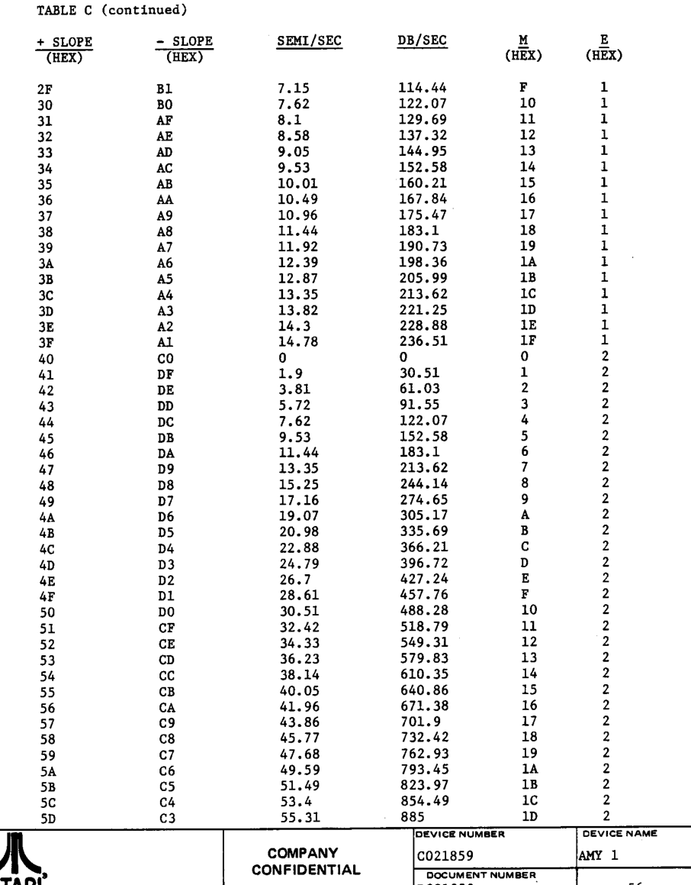

<!-- Original PDF scan 58; document printed page 57 -->

Original scan 58 · [View PDF page 58](./AMY_1_spec_confidential_binder_ver_2.pdf#page=58)

**Table C — complete transcription of PDF page 58.**

> **EDITORIAL REVIEW FLAG — pitch-slope maximum.** The top row of Table C gives **236.51 semitones/s** (and **3784.17 dB/s**), whereas the musical specifications state a maximum fundamental-frequency slope of about **118 semitones/s**. Both values are clear in the original scans. This may reflect a frequency-path update-rate distinction; no numerical correction has been assumed. See `APPENDIX_I_QA_REVIEW.md`.

| + slope (hex) | − slope (hex) | Semitones/s | dB/s | M (hex) | E (hex) |
|---:|---:|---:|---:|---:|---:|
| 5E | C2 | 57.22 | 915.52 | 1E | 2 |
| 5F | C1 | 59.12 | 946.04 | 1F | 2 |
| 60 | E0 | 0 | 0 | 0 | 3 |
| 61 | FF | 7.62 | 122.07 | 1 | 3 |
| 62 | FE | 15.25 | 244.14 | 2 | 3 |
| 63 | FD | 22.88 | 366.21 | 3 | 3 |
| 64 | FC | 30.51 | 488.28 | 4 | 3 |
| 65 | FB | 38.14 | 610.35 | 5 | 3 |
| 66 | FA | 45.77 | 732.42 | 6 | 3 |
| 67 | F9 | 53.4 | 854.49 | 7 | 3 |
| 68 | F8 | 61.03 | 976.56 | 8 | 3 |
| 69 | F7 | 68.66 | 1098.63 | 9 | 3 |
| 6A | F6 | 76.29 | 1220.7 | A | 3 |
| 6B | F5 | 83.92 | 1342.77 | B | 3 |
| 6C | F4 | 91.55 | 1464.84 | C | 3 |
| 6D | F3 | 99.18 | 1586.91 | D | 3 |
| 6E | F2 | 106.81 | 1708.98 | E | 3 |
| 6F | F1 | 114.44 | 1831.05 | F | 3 |
| 70 | F0 | 122.07 | 1953.12 | 10 | 3 |
| 71 | EF | 129.69 | 2075.19 | 11 | 3 |
| 72 | EE | 137.32 | 2197.26 | 12 | 3 |
| 73 | ED | 144.95 | 2319.33 | 13 | 3 |
| 74 | EC | 152.58 | 2441.4 | 14 | 3 |
| 75 | EB | 160.21 | 2563.47 | 15 | 3 |
| 76 | EA | 167.84 | 2685.54 | 16 | 3 |
| 77 | E9 | 175.47 | 2807.61 | 17 | 3 |
| 78 | E8 | 183.1 | 2929.68 | 18 | 3 |
| 79 | E7 | 190.73 | 3051.75 | 19 | 3 |
| 7A | E6 | 198.36 | 3173.82 | 1A | 3 |
| 7B | E5 | 205.99 | 3295.89 | 1B | 3 |
| 7C | E4 | 213.62 | 3417.96 | 1C | 3 |
| 7D | E3 | 221.25 | 3540.03 | 1D | 3 |
| 7E | E2 | 228.88 | 3662.1 | 1E | 3 |
| 7F | E1 | 236.51 | 3784.17 | 1F | 3 |

Original Atari numeric table, PDF page 58 — consult when OCR values are uncertain

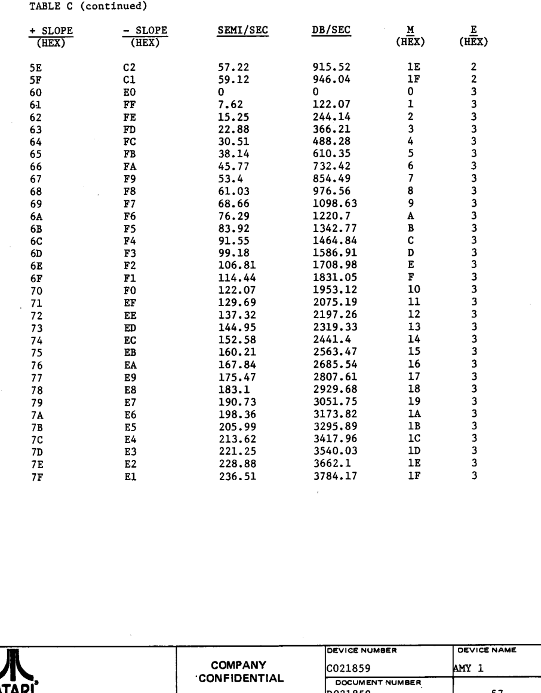

<!-- Original PDF scan 59; document printed page 58 -->

Original scan 59 · [View PDF page 59](./AMY_1_spec_confidential_binder_ver_2.pdf#page=59)

## APPENDIX II — Musical Specifications

*For a 4 MHz internal clock with 64 harmonics enabled (the original OCR interleaves the table columns).* 

| Property | Value in original document |
|---|---|
| Amplitude dynamic range | 63.75 dB |
| Minimum amplitude slope | 1.91 dB/s |
| Maximum amplitude slope | 3784 dB/s |
| Fundamental frequency range | Approximately 4.8 Hz to 7.8 kHz |
| Minimum fundamental frequency slope | 5.97 cents/s |
| Maximum fundamental frequency slope | 118 semitones/s |
| Maximum amplitude increment | 31/128 dB, about 0.242 dB |
| Fundamental frequency increment | 1/64 semitone, about 1.56 cents |
| Fundamental frequency destination resolution | 1/64 semitone |
| Harmonic amplitude destination resolution | ¼ dB |
| Maximum number of harmonics | 64 |
| Maximum number of voices | 8 |
| Harmonics per voice | Multiples of two |
| Harmonic distortion | 1% |

1 cent = 1/100 semitone. Figures are Atari's 1983 specification targets, not guaranteed measurements of a released chip.

---

<!-- Original PDF scan 60; document printed page 59 -->

Original scan 60 · [View PDF page 60](./AMY_1_spec_confidential_binder_ver_2.pdf#page=60)

## APPENDIX III — Test Mode

This appendix describes the **Sentry manufacturing test mode**. Atari explicitly states that system designers should not use it for any purpose. The functional combinations below follow the FPGA project's interpretation of Atari's test-mode table. The source PDF prints different/overlapping rows; those are preserved verbatim in the note below so that this is not mistaken for a literal Atari transcription.

| Pin | Type | Package pin | Normal operation (`TEST=0`) | When TEST pin is high |
|---|---|---:|---|---|
| OUTSTB/T1 | I/O | 38 | Active-low output strobe; low indicates valid SAMP data | Input T1 for Sentry testing |
| V0/T0 | I/O | 39 | Voice-zero marker; goes high for one OUTSTB pulse per sample period in individual-output mode | Input T0 for Sentry testing |
| BOUT/CSYNC (Reserved) | I/O | 1 | Serial noise-term output when TEST is low | Input for synchronizing the internal clock (Sentry only) |
| TEST (Reserved) | Input | 2 | Ground for normal operation | High enables test mode |

### Test-mode selection — clarified interpretation*

| TEST pin | T0 | T1 | Effective function |
|---:|---:|---:|---|
| 0 | X | X | Normal mode |
| 1 | 0 | 0 | Enable two-harmonic counter **and** place 8 LSBs of XROM on the internal bus* |
| 1 | 0 | 1 | Enable two-harmonic counter **and** place the slope register on the internal bus* |

*** Editorial interpretation:** The two enabled functions are the project author's reading of the overlapping test-mode control signals, **not a literal transcription of the printed table**. The original (printed page 59, PDF p. 60) states:

| TEST pin | T0 | T1 | Function exactly as printed by Atari |
|---:|---:|---:|---|
| 0 | X | X | Normal Mode |
| 1 | 0 | X | TST0 — Enable 2 Harmonic Counter |
| 1 | 0 | 1 | TST1 — Enable 8 LSBs of XROM to the Internal Bus |
| 1 | 1 | 0 | TST2 — Enable Slope Reg. to the Internal Bus |

The printed `1 0 X` row overlaps `1 0 1`, and the printed slope-register row is `1 1 0`, not `1 0 1` as in the clarified interpretation. Both readings are retained to avoid silently rewriting the historical source. The distinction can be checked against the SILOS test-mode logic if this interface ever becomes relevant. The main pin description calls pins 1–2 reserved and says to ground them when unused; Appendix III documents additional test behaviour for pin 1.

> When the TEST pin is enabled, Atari states that the accumulator is disabled and data through the pipeline goes directly to the SAMP bus. The noise generator is also disabled in this mode.

The original scanned table is at [PDF page 60](AMY_1_spec_confidential_binder_ver_2.pdf#page=60).

---
