# ATARI AMY — Technical Manual (earlier edition)

> **Working Markdown transcription of Atari’s 55-page Technical Manual**, based on the supplied scanned PDF. This is an **earlier document than the AMY 1 Rev. B specification**, not a corrected or merged copy. It retains its different pin assignments, clock and reset limits, and noise descriptions. The text has been editorially reconstructed against matched sections of the later document and the original scans, so it is not yet a page-perfect critical transcription.
>
> Source: [`AMY_tech_manual.pdf`](AMY_tech_manual.pdf). All page headings below refer to **physical PDF pages** (the source does not use the same later Rev. B binder pagination). Original figure crops are supplied alongside Mermaid redrawings. Tables in Appendix I include only reliable OCR rows; original scanned tables are embedded for the complete printed values.

## Contents

| Section | Subject |
|---|---|
| 1–5 | General description, features, block diagram, pins |
| 6.1 | Musical specifications |
| 6.2–6.4.2 | Internal architecture, system and envelopes |
| 7.1–7.5.9 | Registers and command set |
| 8.1–8.3 | Operating procedure, initialization, timing |
| 9–12 | Maximum ratings and electrical/timing specifications |
| Appendix I | Tables A (semitones), B (tone increments) and C (slopes) |

**Editorial note on page order:** physical PDF page 19 contains §8.1 (reset) before §7.4 resumes on PDF page 20. The following transcription preserves the original *scanned page order* and notes where the subject sequence jumps.

---

<!-- Technical Manual original PDF page 01/55 -->

<sub>Original PDF page 1 · [View source](AMY_tech_manual.pdf#page=1)</sub>

## Table of contents

1. General description
2. Features
3. Block diagram
4. Pin assignment
5. Pin description
6. Functional description
   - 6.1 Musical specifications
   - 6.2 Internal architecture
   - 6.3 Complete AMY system
   - 6.4 Envelope generation (6.4.1 Slope format; 6.4.2 Destination format)
7. Register organization
   - 7.1 Command set; 7.2 RAM/register areas; 7.3 Data registers; 7.4 Other registers
   - 7.5 Command descriptions (7.5.1 to 7.5.9)
8. Operating procedure (8.1 Initialization, 8.2 Flowchart, 8.3 Summary)
9. Maximum ratings
10. Capacitances
11. DC characteristics
12. AC characteristics (clock and reset, output section, system bus interface)

Appendix I: tables A, B and C.


---


<!-- Technical Manual original PDF page 02/55 -->

<sub>Original PDF page 2 · [View source](AMY_tech_manual.pdf#page=2)</sub>

## Table of illustrations

| Figure | Title | PDF page |
|---:|---|---:|
| 1 | Simplified block diagram | 7 |
| 2 | HRAM and VRAM data word format | 8 |
| 3 | Complete AMY system | 10 |
| 4 | Piecewise linear envelope | 11 |
| 5 | Linear function of harmonic amplitude destination | 14 |
| 6 | Fundamental frequency vs. destination | 15 |
| 7 | AMY RAM and register areas | 17 |
| 8 | RESET with standard µP system reset circuit | 19 |
| 9 | RESET with RC | 19 |
| 10 | INT/RDY pin timing | 36 |


---


<!-- Technical Manual original PDF page 03/55 -->

<sub>Original PDF page 3 · [View source](AMY_tech_manual.pdf#page=3)</sub>

## 1. General description

AMY 1 is a digital, pipeline-architectured additive music synthesizer chip. Eight voices may share a total of 64 harmonic oscillators, assignable in groups of two. There are 72 piecewise-linear envelope generators: eight for fundamental frequency and 64 for harmonic amplitude. A complete sound system adds a D/A converter (up to 16 bits) and generally a controlling microprocessor such as the Intel 8051.

## 2. Features

| Design | Interface and audio |
|---|---|
| Single 40-pin DIP | Interrupt/Ready pin |
| 3 µm NMOS technology | Multiplexed and nonmultiplexed bus interfaces |
| Pipeline architecture | Full 16-bit digital output width |
| **3–5 MHz external clock** (this earlier manual) | Independent voice mode |
| Integrated exponential ROM | Adjustable sample rate |
| 1/128 dB amplitude and 1/64 semitone frequency resolution | Programmable noise statistics |
| 72 on-chip envelope generators | Approximately 37,000 transistors |

## 3. Block diagram

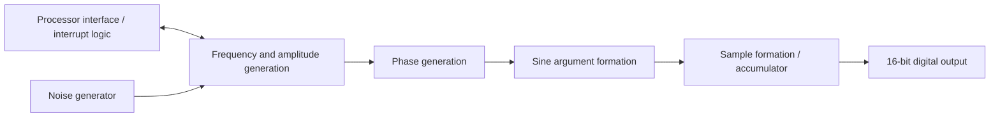

## 4. Pin assignment — **original Technical Manual pinout**

| Pin | Signal | Pin | Signal |
|---:|---|---:|---|
| 1 | RESET | 40 | VCC |
| 2 | RD | 39 | V0 |
| 3 | WR | 38 | OUTSTB |
| 4 | CS | 37 | OE |
| 5 | DB7 | 36 | SAMP15 |
| 6 | DB6 | 35 | SAMP14 |
| 7 | DB5 | 34 | SAMP13 |
| 8 | DB4 | 33 | SAMP12 |
| 9 | DB3 | 32 | SAMP11 |
| 10 | DB2 | 31 | SAMP10 |
| 11 | DB1 | 30 | SAMP9 |
| 12 | DB0 | 29 | SAMP8 |
| 13 | ALE | 28 | SAMP7 |
| 14 | CLK | 27 | SAMP6 |
| 15 | INT/RDY | 26 | SAMP5 |
| 16 | A1 | 25 | SAMP4 |
| 17 | A0 | 24 | SAMP3 |
| 18 | RESERVED | 23 | SAMP2 |
| 19 | RESERVED | 22 | SAMP1 |
| 20 | GND | 21 | SAMP0 |

*Do not substitute the Rev. B pinout here: for example, RESET moved to pin 18 in the later specification.*


<details><summary>Original Atari diagram / timing scan — PDF page 3</summary>

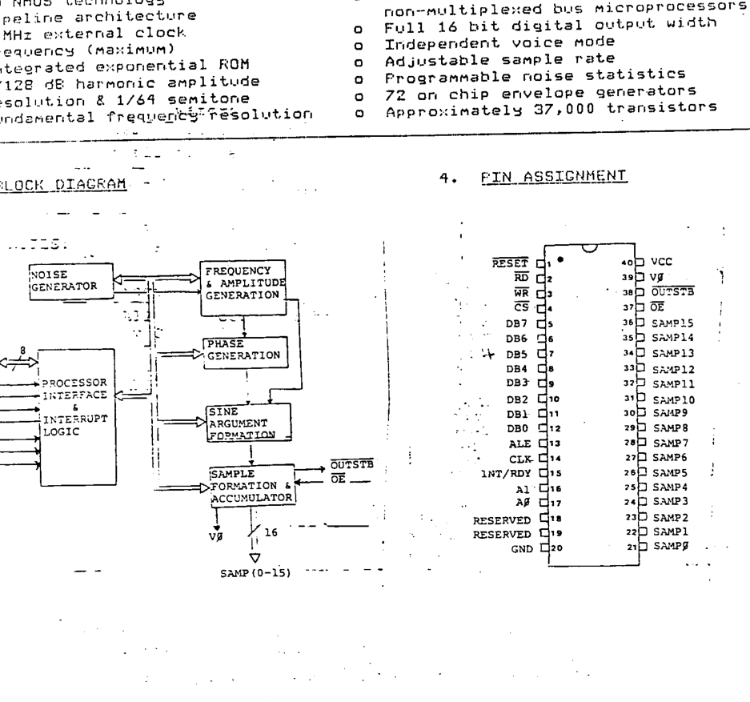

</details>

---


<!-- Technical Manual original PDF page 04/55 -->

<sub>Original PDF page 4 · [View source](AMY_tech_manual.pdf#page=4)</sub>

## 5. Pin description (part 1)

| Signal | Type | Pin(s) | Function |
|---|---|---|---|
| VCC | I | 40 | +5 V supply, ±5% |
| GND | I | 20 | Ground |
| RESET | I | 1 | Active-low asynchronous reset: clears system options, control, sequencer, phase RAM and digital output word |
| A1–A0 | I | 16–17 | Address pins to select AMY registers when ALE is not used; tie to GND for ALE mode |
| RD | I | 2 | Active-low read strobe; requires CS low |
| WR | I | 3 | Active-low write strobe; requires CS low |
| CS | I | 4 | Active-low chip select; enables RD/WR; otherwise data bus is tri-stated |
| CLK | I | 14 | External 3–5 MHz clock (earlier manual) |
| DB7–DB0 | I/O | 5–12 | Eight-bit bidirectional, tri-state data/command bus |
| SAMP15–SAMP0 | O | 36–21 | 16-bit digital audio bus to external D/A converter |
| OUTSTB | O | 38 | Active-low output strobe indicating valid SAMP bus data |


---


<!-- Technical Manual original PDF page 05/55 -->

<sub>Original PDF page 5 · [View source](AMY_tech_manual.pdf#page=5)</sub>

## 5. Pin description (continued)

| Signal | Type | Pin(s) | Function |
|---|---|---|---|
| INT/RDY | I (as printed) | 15 | Interrupt/Ready: high when idle in READY mode; one-clock pulse on command completion in INTERRUPT mode |
| ALE | I | 13 | Address-latch enable; uses DB0 and DB1 for address, with A0/A1 grounded |
| V0 | O | 39 | Voice-zero marker for individual-voice output mode |
| OE | I | 37 | Active-low output enable for the SAMP data bus |
| RESERVED | — | 18, 19 | Undefined; not general-purpose pins |

*The earlier document labels INT/RDY input in its pin-description type column even though its function describes an output. This apparent inconsistency is preserved for source fidelity.*


---


<!-- Technical Manual original PDF page 06/55 -->

<sub>Original PDF page 6 · [View source](AMY_tech_manual.pdf#page=6)</sub>

## 6. Functional description

### 6.1 Musical specifications

Atari gives these values for a **4 MHz external CLK** with **64 harmonics enabled**.

| Characteristic | Published value |
|---|---|
| Amplitude dynamic range | 63.75 dB |
| Minimum harmonic amplitude slope | 1.91 dB/s |
| Maximum harmonic amplitude slope | 3784 dB/s |
| Fundamental frequency range | Approx. 4.8 Hz–7.8 kHz (10⅔ octaves) |
| Minimum fundamental frequency slope | 5.97 cents/s |
| Maximum fundamental frequency slope | 118 semitones/s (9.85 octaves/s) |
| Maximum amplitude increment | 31/128 = 0.242 dB |
| Maximum fundamental frequency increment | 31/2048 = 1.51 cents |
| Harmonics | Maximum 64 |
| Voices | Maximum 8 |
| Harmonics per voice | Any multiple of 2 |
| Harmonic distortion | Less than 1% |

*One cent is 1/100 semitone. This musical-specification section appears at §6.1 in the Technical Manual, but at Appendix II in Rev. B.*


---


<!-- Technical Manual original PDF page 07/55 -->

<sub>Original PDF page 7 · [View source](AMY_tech_manual.pdf#page=7)</sub>

## 6. FUNCTIONAL DESCRIPTION

### 6.2 Internal Architecture

AMY 1 consists of 8 major blocks as shown in Figure 1 below.

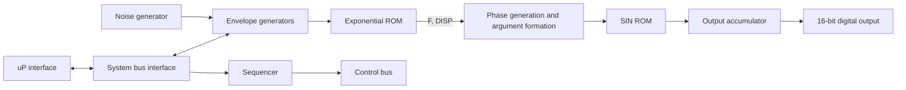

**Figure 1. Simplified block diagram** — re-created from the PDF.

The System Bus Interface block provides the user with a standard microprocessor interface. The user sends all commands and passes frequency and amplitude breakpoint data and current values over the "µP Interface" lines (RESET, RD, WR, CS, DB0–DB7, ALE, INT/RDY, A1, A0).

The Noise Generator block contains a small RAM, a serial adder, and some associated logic. It generates two different channels of bandlimited white noise simultaneously. Bandwidths are programmable by initialization of the Noise RAM.

<details><summary>Original Atari diagram / timing scan — PDF page 7</summary>

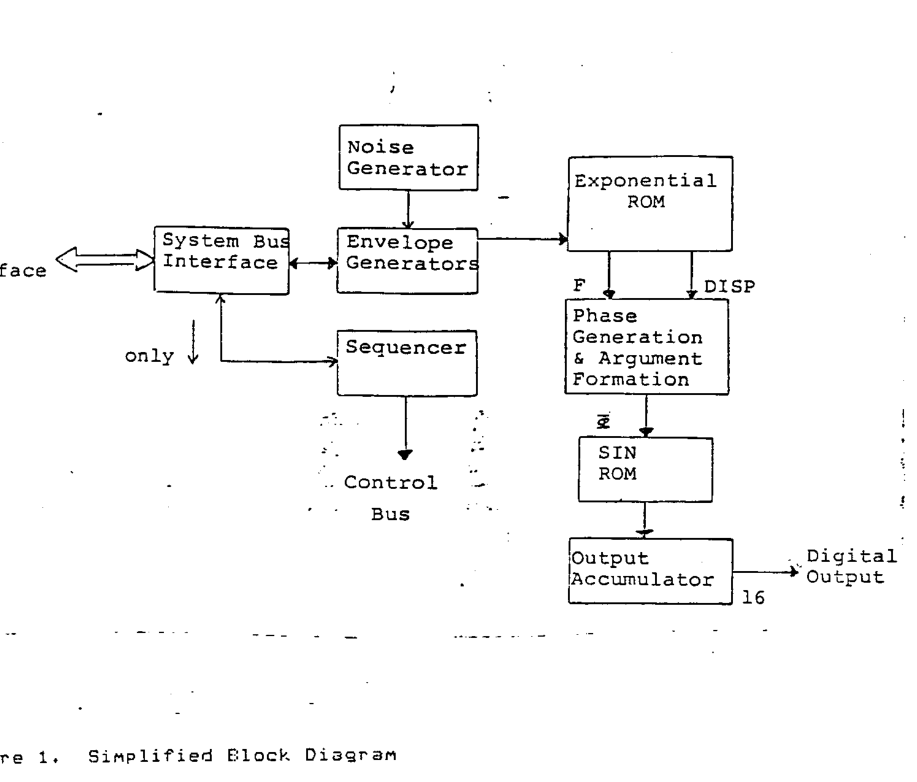

</details>

---


<!-- Technical Manual original PDF page 08/55 -->

<sub>Original PDF page 8 · [View source](AMY_tech_manual.pdf#page=8)</sub>

*Internal Architecture (continued)*

The Envelope Generator block contains the Voice RAM (VRAM), Harmonic RAM (HRAM), and logic necessary to generate the 72 piecewise linear envelopes (8 fundamental frequency envelopes and 64 harmonic amplitude envelopes). The RAMs maintain a slope value, destination value and current value for each envelope. The Voice RAM additionally stores a 2-bit voice type selector. The total Envelope Generator RAM is (64 × 30) + (21 × 16) bits = 282 bytes.

**Figure 2. HRAM and VRAM data word formats**


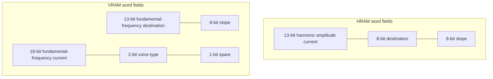

*Conceptual field-level Mermaid diagram; the scanned Figure 2 preserves the original bit positions.*

| Memory | Field | Bits |
|---|---|---:|
| HRAM | Harmonic amplitude current value | 13 |
| HRAM | Harmonic amplitude destination | 8 |
| HRAM | Harmonic amplitude slope | 8 |
| VRAM (word 1) | Fundamental frequency destination | 13 |
| VRAM (word 1) | Fundamental frequency slope | 8 |
| VRAM (word 2) | Fundamental frequency current value | 18 |
| VRAM (word 2) | Voice type select | 2 |
| VRAM (word 2) | Spare | 1 |

*Field widths read from the original PDF. The diagram shows logical fields rather than an exact contiguous software bus layout.*

<details><summary>Original Atari diagram / timing scan — PDF page 8</summary>

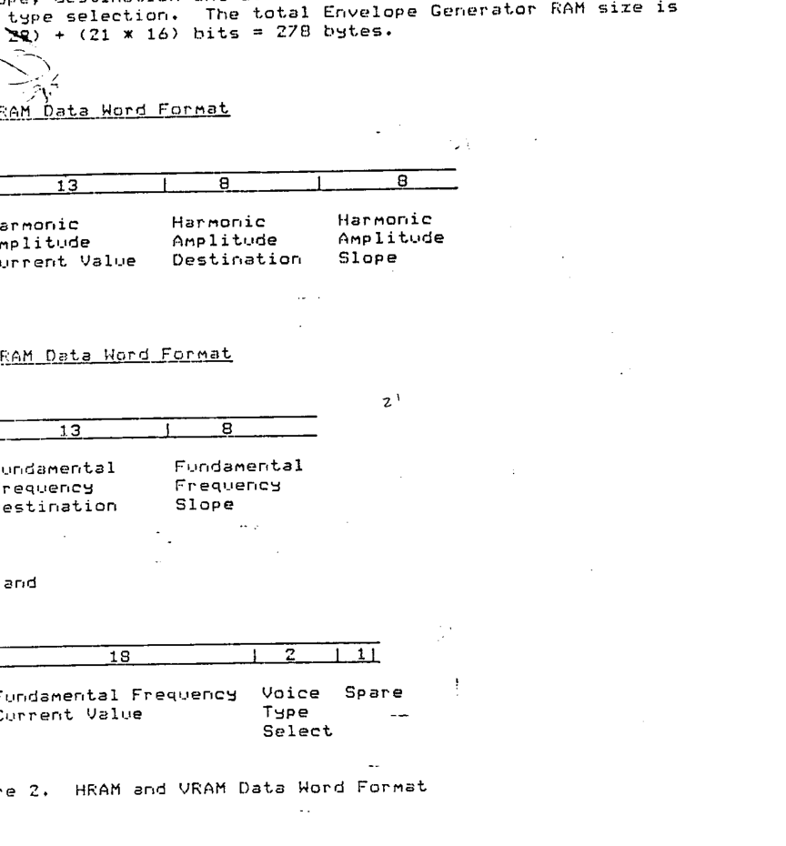

</details>

---


<!-- Technical Manual original PDF page 09/55 -->

<sub>Original PDF page 9 · [View source](AMY_tech_manual.pdf#page=9)</sub>

*Internal architecture (continued)*

The envelope generator contains 32 Last Harmonic Pair Flags, adders and sequencer-controlled logic for updating the envelopes from breakpoints in HRAM and VRAM. Its noise adder is used for noise-based voices.

The exponential ROM converts outputs from the 72 envelope generators into piecewise exponential form for use internally. This allows the programmer to specify harmonic amplitude in decibels and fundamental frequency in semitones. It also makes master-amplitude scaling and transposition simple addition operations in the controlling processor.

The sequencer controls the other functional blocks. It contains a seven-bit clock-period counter and a seven-bit subsample counter.


---

<!-- Technical Manual original PDF page 10/55 -->

<sub>Original PDF page 10 · [View source](AMY_tech_manual.pdf#page=10)</sub>

### 6.3 Complete AMY System

A complete sound system requires the addition of a D/A converter chip (up to 16 bit). To provide higher-level commands, the system will generally include a controlling processor such as the Intel 8051 single-chip microcomputer.


**Figure 3. Complete AMY system** — re-created from the PDF.

<details><summary>Original Atari diagram / timing scan — PDF page 10</summary>

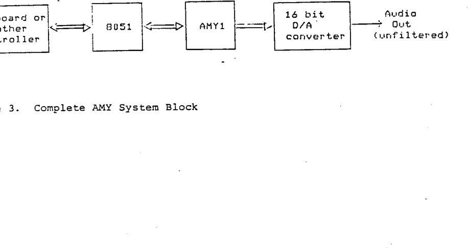

</details>

---


<!-- Technical Manual original PDF page 11/55 -->

<sub>Original PDF page 11 · [View source](AMY_tech_manual.pdf#page=11)</sub>

### 6.4 Envelope Generation

Envelopes are generated by the on-chip AMY 1 envelope generator block. The user may command the generators to make a piecewise linear envelope using a slope and destination scheme. Assume that a particular envelope has previously been loaded immediate to zero. By loading two breakpoints (slope–destination pairs), we obtain the following envelope:

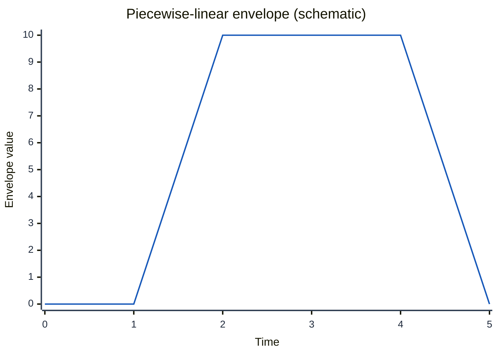

**Figure 4. Piecewise linear envelope**. Point A is the first breakpoint, B the first destination/free point, C the second breakpoint, and D the second free point. This Mermaid graph preserves the *shape*, not the source's exact annotated coordinates.

At point A, BP1 is loaded and the envelope starts rising at the constant slope defined by BP1. At B, the destination is reached and the slope effectively becomes zero (a "free point"). At C, a negative-slope breakpoint with zero destination is loaded. At D, zero is reached, becoming another free point.

<details><summary>Original Atari diagram / timing scan — PDF page 11</summary>

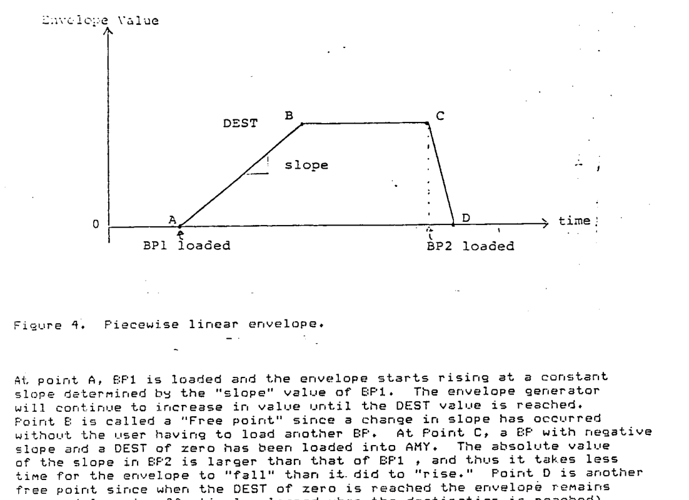

</details>

---


<!-- Technical Manual original PDF page 12/55 -->

<sub>Original PDF page 12 · [View source](AMY_tech_manual.pdf#page=12)</sub>

*Slope format (continued)*

For smooth pitch and amplitude modulation, AMY's individual integration steps are deliberately small: the effective pitch step is **1/2048 of a semitone** (0.0488 cents, around 0.0028% in frequency) and the amplitude step is **1/128 dB**. Both give perceptually continuous modulation at the specified envelope rates.

| Limit | Source specification |
|---|---|
| Maximum effective harmonic amplitude increment | 31/128 dB per update |
| Maximum effective frequency increment | 31/2048 semitone per update |
| Fundamental frequency destination increment | 1/64 semitone |

Atari gives a maximum-to-minimum nonzero slope ratio of approximately **1,984**. It combines this with the 64 dB amplitude range or the 10⅔-octave frequency range to illustrate very large overall amplitude and frequency slew-rate ranges:

\[
R_{amplitude} pprox 1984 	imes 10^{64/20} pprox 3.1 	imes 10^6:1
\]
\[
R_{frequency} pprox 1984 	imes 2^{10+2/3} pprox 3.2 	imes 10^6:1.
\]

*The original uses rounded constants and scientific notation. These equations express the stated calculation in readable form; refer to the scan if exact historical notation is important.*


---

<!-- Technical Manual original PDF page 13/55 -->

<sub>Original PDF page 13 · [View source](AMY_tech_manual.pdf#page=13)</sub>

#### 6.4.1 Slope Format

The eight-bit slope uses a sign bit, a two-bit exponent, and a signed five-bit mantissa (two's-complement form). It provides envelope rates from nearly instantaneous to very gradual.

| Bit 7 | Bits 6–5 | Bits 4–0 |
|---|---|---|
| Sign | Exponent / subsample rate | Five-bit signed mantissa |

| Exponent | Addition interval |
|---|---|
| `00` | Every 128 sample periods |
| `01` | Every 32 sample periods |
| `10` | Every 8 sample periods |
| `11` | Every 2 sample periods |

**Table 1. Slope examples**

| Sign | Exponent | Mantissa bits | Relative slope (steps/sample) |
|:--:|:--:|:--:|---|
| 0 | 00 | `00001` | +1/128 ≈ 0.0078 |
| 1 | 00 | `11111` | −1/128 ≈ −0.0078 |
| 0 | 01 | `00011` | +3/32 ≈ 0.094 |
| 0 | 11 | `11111` | +31/2 = 15.5 |
| 1 | 10 | `00100` | −28/8 = −3.5 |
| 1 | 11 | `00001` | −31/2 = −15.5 |

The ratio between maximum and minimum nonzero slope magnitudes is approximately 1984 (15.5 / 0.0078125). Values are from original page 13, with source sign conventions.

---


<!-- Technical Manual original PDF page 14/55 -->

<sub>Original PDF page 14 · [View source](AMY_tech_manual.pdf#page=14)</sub>

#### 6.4.2 Destination Format

Since all harmonic amplitudes have a 64 dB dynamic range, a single eight-bit destination byte is used per harmonic. The resolution is 64/256 = ¼ dB.

| Destination (8 bits) | Harmonic amplitude |
|---:|---|
| `0x00` | Zero amplitude |
| `0x01` | Minimum nonzero setting (0.25 dB) |
| `0xFF` | Full scale (63.75 dB) |

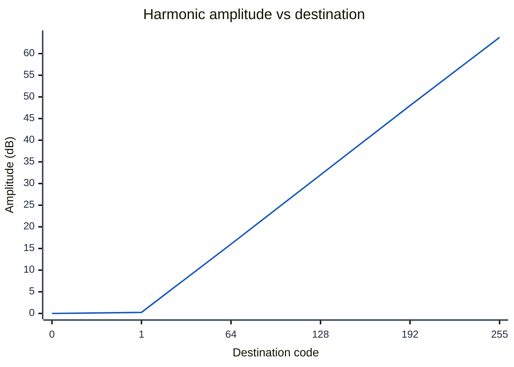

**Figure 5. Harmonic amplitude destination**. Note that Atari's text uses *dB* as a positive magnitude. Graph is representative.

<details><summary>Original Atari diagram / timing scan — PDF page 14</summary>

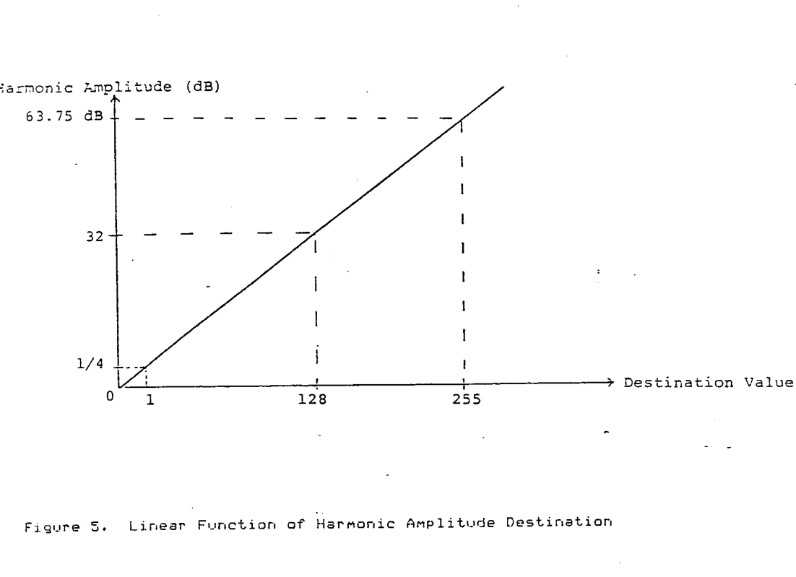

</details>

---


<!-- Technical Manual original PDF page 15/55 -->

<sub>Original PDF page 15 · [View source](AMY_tech_manual.pdf#page=15)</sub>

*Destination Format (continued)*

Each fundamental-frequency envelope has a 128-semitone range with destination resolution 1/64 semitone, represented in 13 bits.

| Fundamental-frequency destination field | Width |
|---|---:|
| Semitone field | 7 bits |
| Atari tone field | 6 bits |

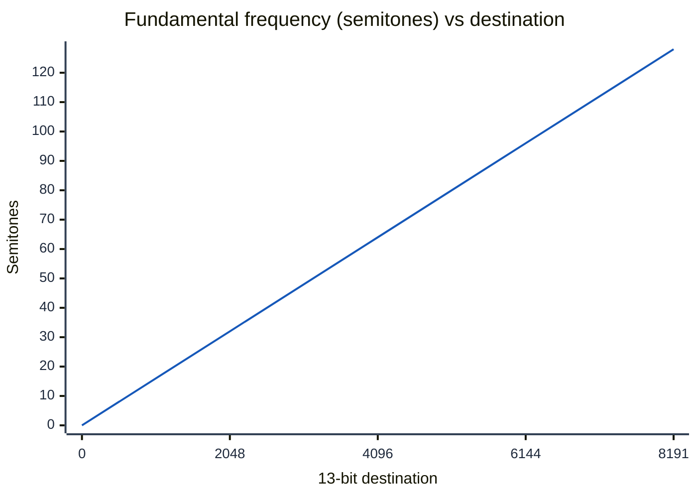

**Figure 6. Fundamental frequency vs destination**. A linear semitone scale; actual Hz is exponential. The original figure uses a broken horizontal axis.

The destination 0 yields a nonzero frequency. The effective Hz resolution is approximately 0.002 Hz per Atari tone near 0 and approximately 7 Hz per tone near 8191. Complete slope tables for a 4 MHz internal clock with 64 harmonics appear in Appendix I.

1 Atari tone = 1/64 semitone.

<details><summary>Original Atari diagram / timing scan — PDF page 15</summary>

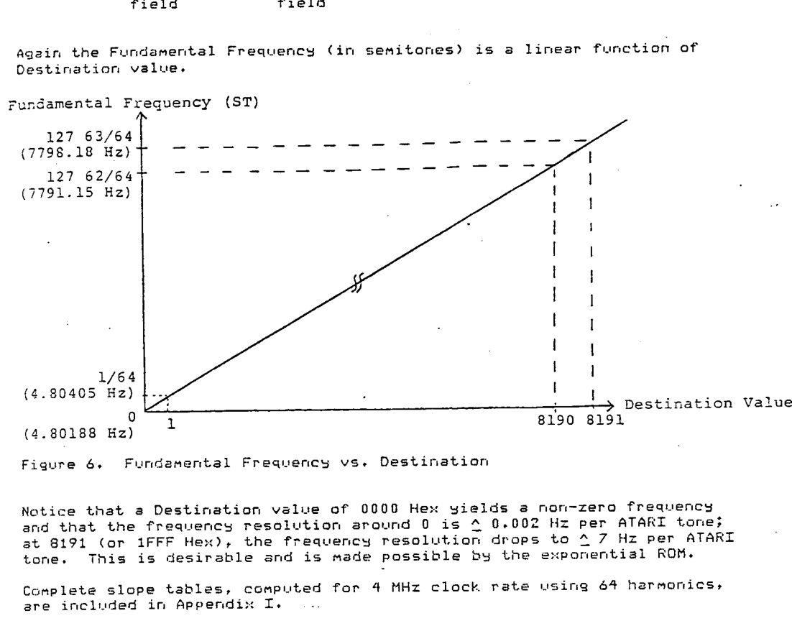

</details>

---


<!-- Technical Manual original PDF page 16/55 -->

<sub>Original PDF page 16 · [View source](AMY_tech_manual.pdf#page=16)</sub>

## 7. REGISTER ORGANIZATION

### 7.1 AMY 1 Command Set

Commands are sent by selecting the command register (CS = A1 = A0 = 0, RD = 1, WR active low). Each command contains an opcode and operands, as in Table 2.

**Table 2. AMY 1 commands** (bit patterns cross-checked with the source scan)

| DB7..DB0 pattern | Command |
|---|---|
| `00001 V2 V1 V0` | Write fundamental frequency breakpoint |
| `00010 V2 V1 V0` | Write voice type |
| `00011 V2 V1 V0` | Read current fundamental frequency |
| `0010 SO3 SO2 SO1 SO0` | Write system options register |
| `0011 xx SC1 SC0` | Write system control register |
| `01 H5 H4 H3 H2 H1 H0` | Write harmonic amplitude breakpoint |
| `10 HP4 HP3 HP2 HP1 HP0 D0` | Write last harmonic pair flag (SC1=0) |
| `10 N5 N4 N3 N2 N1 N0` | Write noise RAM (SC1=1) |
| `11 H5 H4 H3 H2 H1 H0` | Read current harmonic amplitude |

*The two `10` formats are selected by the System Control register. Symbols represent individual bits; spaces are for readability.*

---


<!-- Technical Manual original PDF page 17/55 -->

<sub>Original PDF page 17 · [View source](AMY_tech_manual.pdf#page=17)</sub>

### 7.2 RAM and Register Areas

The original AMY interface provides four addressable registers: A (8 bits), B (5 bits), C (8 bits), and the command register. For a write command, load A/B/C as appropriate and then issue a command. For a read, issue the command first, then read the data register. A read of the command register exposes internal bus data for diagnostics.

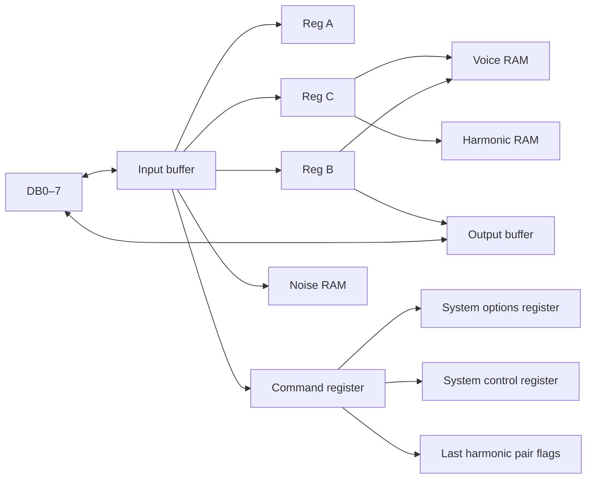

**Figure 7. AMY RAM and register areas** — functional recreation. Not a cycle-accurate wiring drawing.

<details><summary>Original Atari diagram / timing scan — PDF page 17</summary>

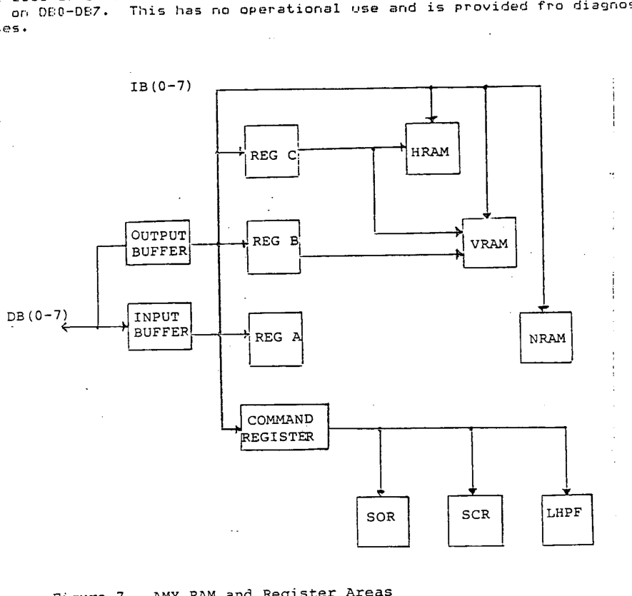

</details>

---


<!-- Technical Manual original PDF page 18/55 -->

<sub>Original PDF page 18 · [View source](AMY_tech_manual.pdf#page=18)</sub>

### 7.3 AMY 1 Data Registers

There are three data registers for transferring values between the processor and AMY internal RAM/register areas. A, B and C are accessible through the external register select signals. The user normally loads these before a write command and reads them after a read command.

**Table 3. Register selection**

| CS | A1 | A0 | Selected register |
|---:|---:|---:|---|
| 0 | 0 | 0 | Command (write only) |
| 0 | 0 | 1 | Register A (read/write) |
| 0 | 1 | 0 | Register B (read/write) |
| 0 | 1 | 1 | Register C (read/write) |
| 1 | X | X | None |

---


<!-- Technical Manual original PDF page 19/55 -->

<sub>Original PDF page 19 · [View source](AMY_tech_manual.pdf#page=19)</sub>

## 8. Operating procedure (bound out of sequence)

### 8.1 Initialization

#### 8.1.1 RESET pin and power-up sequence

The manual instructs that the RESET pin be held low during power-up and released only after power and clock have met their requirements, with the supply stable for at least 2 ms. The RESET pulse must meet the original (two-clock) minimum in §12.1. Figures 8 and 9 provide a standard microprocessor reset circuit and an RC reset option.

**Figure 8. RESET with standard microprocessor-system reset circuit**

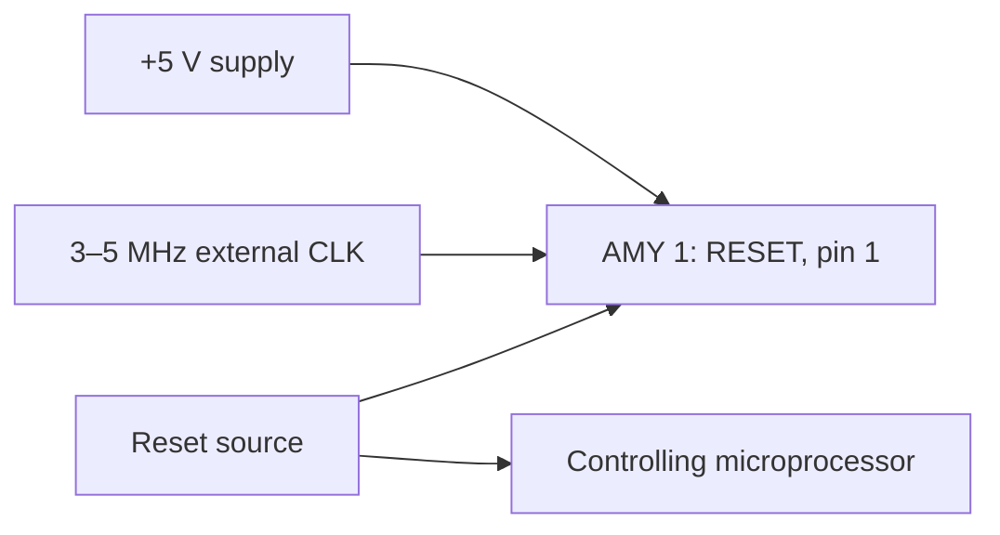

**Figure 9. RESET with RC**

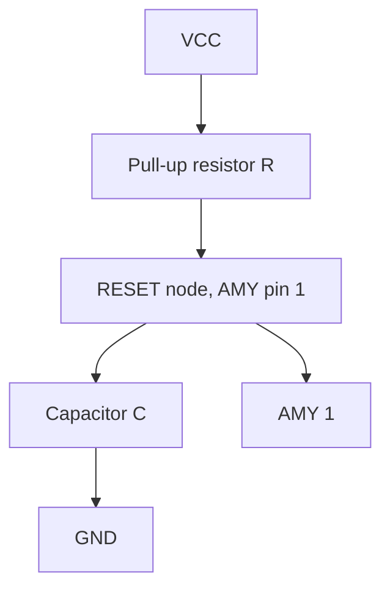

*Mermaid captures the functional connectivity only; for component values, reset timing and waveform limits consult the source figure.*


<details><summary>Original Atari diagram / timing scan — PDF page 19</summary>

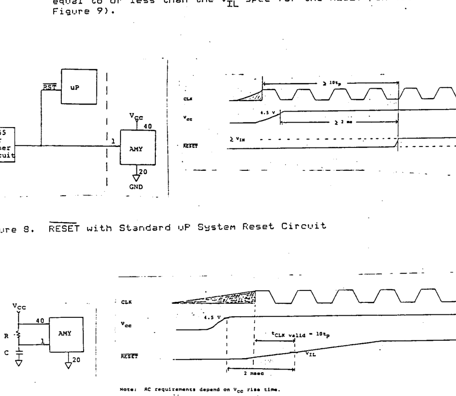

</details>

---


<!-- Technical Manual original PDF page 20/55 -->

<sub>Original PDF page 20 · [View source](AMY_tech_manual.pdf#page=20)</sub>

### 7.4. Other User Accessible Registers and RAM Areas

AMY 1 also contains other internal registers which are loaded by sending various commands to the AMY 1 Command register. These registers are the System Options register, the System Control register, and the Last Harmonic Pair register (see Sections 7.5.5, 7.5.6, and 7.5.8, respectively).

Other AMY 1 commands pass data to or from AMY 1 RAM areas. These RAM areas include the Voice RAM, the Harmonic RAM, and the Noise RAM. The VRAM contains the current fundamental frequency, fundamental frequency breakpoint, and the voice type. The HRAM contains the current harmonic amplitude and the harmonic amplitude breakpoint. Initial conditions of the NRAM may be loaded to obtain specific bandlimited white noise statistics.

In general, all registers are loaded directly with a single one byte write operation (even the SOR, SCR, and LHPR are loaded from operand data in the command byte). Alternately, RAM areas are read/written indirectly by using Reg A, B, and C as data buffers.

---


<!-- Technical Manual original PDF page 21/55 -->

<sub>Original PDF page 21 · [View source](AMY_tech_manual.pdf#page=21)</sub>

### 7.5. Command descriptions

#### 7.5.1 Write Fundamental Frequency Breakpoint (WR FFBP)

**Command byte:** `00001 V2 V1 V0` — select one of eight voices. To write a frequency breakpoint, load A, B and C, then issue the command byte.

| Data register | Bit positions | Meaning |
|---|---|---|
| A | A7:A0 | Eight-bit signed/exponent envelope slope |
| B | B4:B0 | Five most-significant bits of 13-bit frequency destination; B7:B5 ignored |
| C | C7:C0 | Eight least-significant bits of frequency destination |

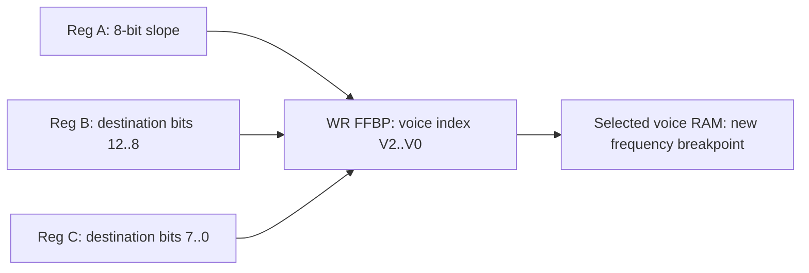

If the slope byte is **zero** when the command is issued, the destination is loaded immediately into the voice's current fundamental-frequency value, rather than starting a ramp. It stays there until another FFBP is written. This is behavior described by Atari, regardless of differences in unfinished silicon/netlist versions.


---


<details><summary>Original Atari command/register-layout scan — PDF page 21</summary>

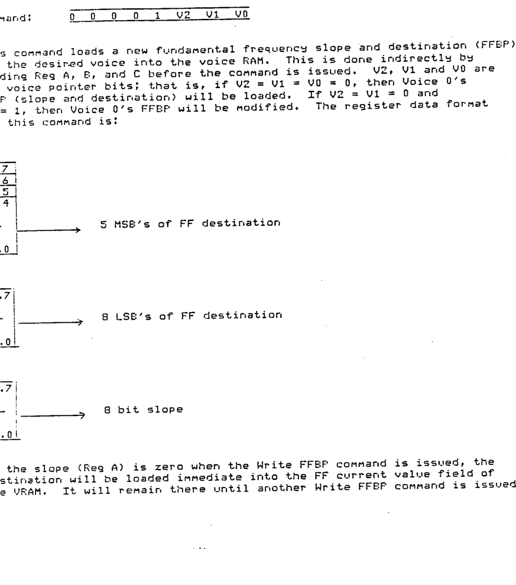

</details>

<!-- Technical Manual original PDF page 22/55 -->

<sub>Original PDF page 22 · [View source](AMY_tech_manual.pdf#page=22)</sub>

*Write fundamental frequency breakpoint (continued)*

Slope byte loaded in **register A**:

| A7 | A6–A5 | A4–A0 |
|---|---|---|
| Sign | Exponent | Mantissa |

At the finest subsample rate, the fundamental frequency step magnitude ranges from 1/2048 to 31/2048 semitone per update. The original document describes the signed-mantissa layout in detail.

| A6:A5 | Increment interval |
|:--:|---|
| `00` | Once per 128 sample periods |
| `01` | Once per 32 sample periods |
| `10` | Once per 8 sample periods |
| `11` | Once per 2 sample periods |

Destination uses 13 bits in registers B (five most-significant bits) and C (eight least-significant bits), covering a nominal 128-semitone range at 1/64-semitone resolution. The original text says 8196 values; note that 13 bits encode 8192 combinations, so this is likely a typographical error and is **not silently corrected here**.

---


<!-- Technical Manual original PDF page 23/55 -->

<sub>Original PDF page 23 · [View source](AMY_tech_manual.pdf#page=23)</sub>

#### 7.5.2 Write Harmonic Amplitude Breakpoint Command (WR HABP)

**Command byte:** `01 H5 H4 H3 H2 H1 H0`.

The six-bit harmonic index selects an HRAM entry. Load **register A = 8-bit slope**, **register C = 8-bit destination**; B is unused.

| Register | Bits | Meaning |
|---|---|---|
| A | 7–0 | Harmonic amplitude envelope slope |
| C | 7–0 | Harmonic amplitude destination |

If register A is zero, the destination is loaded immediately into the harmonic-amplitude current-value field. The original specification recommends using this to clear amplitudes before enabling SEQRUN.

---


<details><summary>Original Atari command/register-layout scan — PDF page 23</summary>

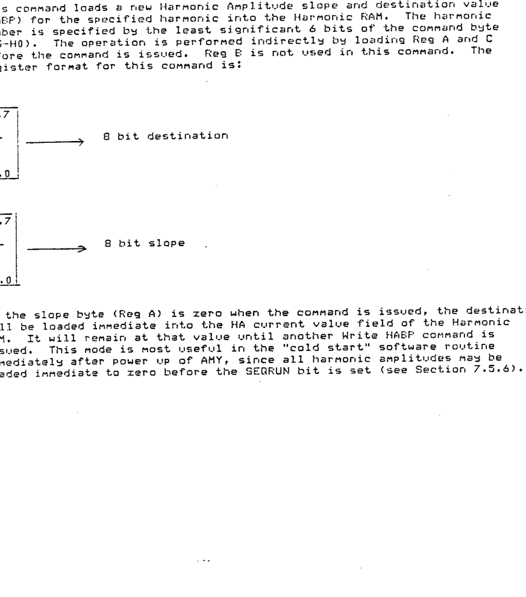

</details>

<!-- Technical Manual original PDF page 24/55 -->

<sub>Original PDF page 24 · [View source](AMY_tech_manual.pdf#page=24)</sub>

*Write harmonic amplitude breakpoint (continued)*

| Register A | Fields |
|---|---|
| A7 | Sign |
| A6:A5 | Two-bit rate exponent |
| A4:A0 | Five-bit signed mantissa |

In amplitude units, the step size is 1/128 to 31/128 dB in magnitude. The all-zero byte gives zero slope; the signed negative-zero encoding is not permitted.

| A6:A5 | Increment interval |
|:--:|---|
| `00` | Once per 128 sample periods |
| `01` | Once per 32 sample periods |
| `10` | Once per 8 sample periods |
| `11` | Once per 2 sample periods |

The eight-bit destination spans 256 codes across a 64 dB range in increments of ¼ dB.

---


<!-- Technical Manual original PDF page 25/55 -->

<sub>Original PDF page 25 · [View source](AMY_tech_manual.pdf#page=25)</sub>

#### 7.5.3 Read Fundamental Frequency Current Value (RD FFCV)

**Command byte:** `00011 V2 V1 V0`. The three low bits select one of the eight voices. The sequencer reads the fundamental-frequency current value from VRAM and loads its 13-bit representation into registers B and C for the host to read.

| Data register | Contents after command |
|---|---|
| B4:B0 | Five most-significant bits of the current frequency value |
| B7:B5 | Don't care |
| C7:C0 | Eight least-significant bits |
| A | Not used by this command |

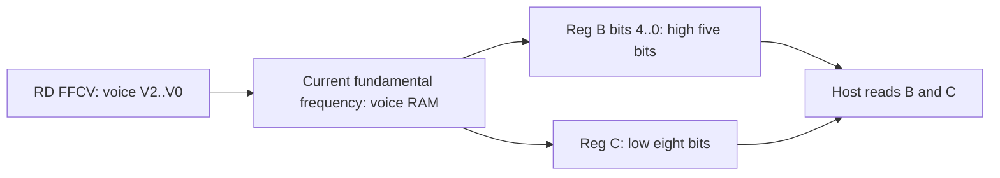


---


<details><summary>Original Atari command/register-layout scan — PDF page 25</summary>

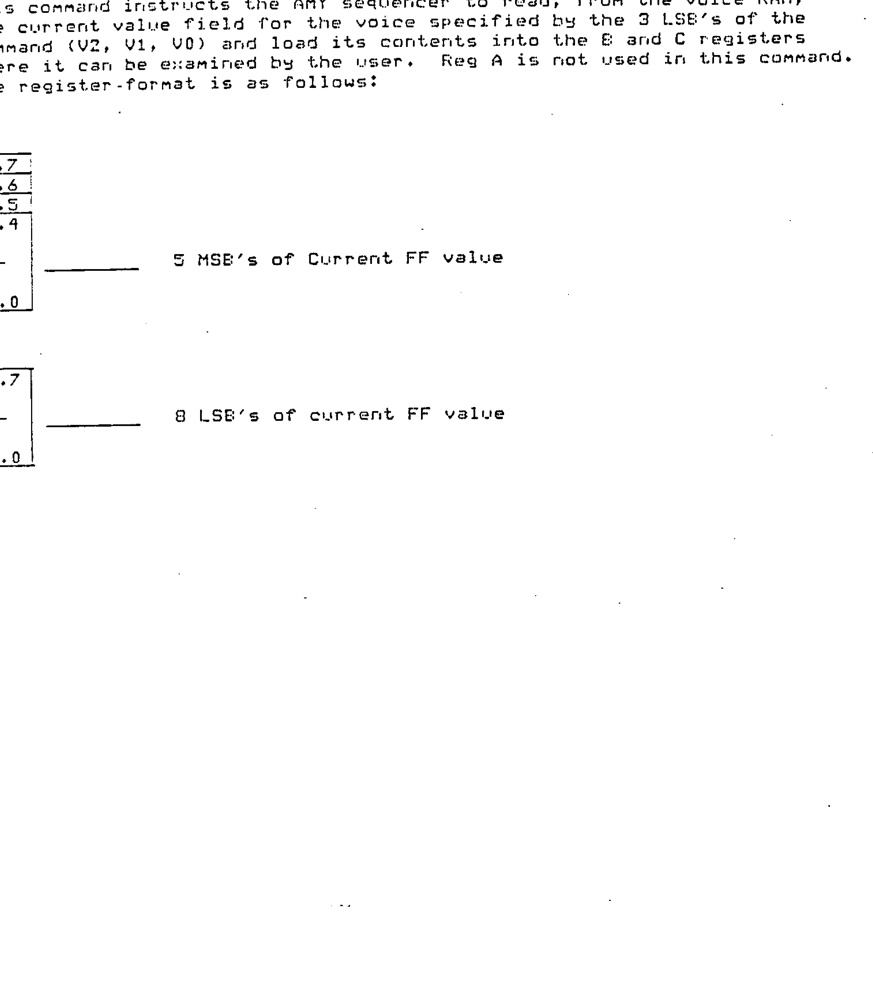

</details>

<!-- Technical Manual original PDF page 26/55 -->

<sub>Original PDF page 26 · [View source](AMY_tech_manual.pdf#page=26)</sub>

#### 7.5.4 Read Harmonic Amplitude Current Value (RD HACV)

**Command byte:** `11 H5 H4 H3 H2 H1 H0`. The six-bit operand addresses one of the 64 harmonic envelopes. The sequencer reads the harmonic's current amplitude and makes it available in **register C**, bits 7–0. Register A is unused; the command also changes register B internally, even though the user does not need B for this read.


---


<details><summary>Original Atari command/register-layout scan — PDF page 26</summary>

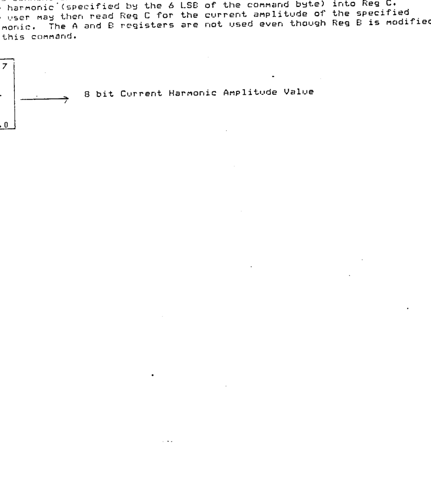

</details>

<!-- Technical Manual original PDF page 27/55 -->

<sub>Original PDF page 27 · [View source](AMY_tech_manual.pdf#page=27)</sub>

#### 7.5.5 Write System Options Register (WR SOR)

**Command byte:** `0010 SO3 SO2 SO1 SO0`. The four option bits are supplied directly in the command; A/B/C unused. All bits reset low.

**Table 4. System Options Register Selection**

| SO3 | SO2 | SO1 | SO0 | AMY mode |
|:--:|:--:|:--:|:--:|---|
| X | X | X | 0 | Address pin mode |
| X | X | X | 1 | ALE mode |
| X | X | 0 | X | READY mode |
| X | X | 1 | X | INTERRUPT mode |
| X | 0 | X | X | SUM mode |
| X | 1 | X | X | INDIVIDUAL mode |
| 0 | X | X | X | 64 harmonics |
| 1 | X | X | X | 40 harmonics |
| 0 | 0 | 0 | 0 | Reset default (address, ready, sum, 64 harmonics) |

ALE mode uses the DB0/DB1 address field during the ALE strobe. Address-pin mode uses A1 and A0.

---


<!-- Technical Manual original PDF page 28/55 -->

<sub>Original PDF page 28 · [View source](AMY_tech_manual.pdf#page=28)</sub>

#### 7.5.6 Write System Control Register (WR SCR)

**Command byte:** `0011 XX SC1 SC0`. Low two bits update the System Control register; A/B/C unused. Reset state is `SC1=SC0=0`.

**Table 5. System Control Register Selection**

| SC1 | SC0 | AMY mode |
|:--:|:--:|---|
| X | 0 | HALT mode (sequencer stopped) |
| X | 1 | SEQUENCER RUN mode |
| 1 | X | Initialize Noise RAM (NZINIT set) |
| 0 | X | NOISE RUN mode |

The sequencer must run to produce sound. In HALT, the output is zero-coded and selected oscillator phases are reset. The Noise RAM can be initialized with the sequencer halted or running.

---


<!-- Technical Manual original PDF page 29/55 -->

<sub>Original PDF page 29 · [View source](AMY_tech_manual.pdf#page=29)</sub>

### 7.5.7 Write Noise RAM command (earlier Technical Manual)

Command: `10 N5 N4 N3 N2 N1 N0` (six-bit noise RAM address). **NZINIT in the System Control Register must be set** before issuing it. Register A supplies the three low bits of the programmed noise value; its other five bits are ignored.

The manual describes **two noise generators**, with odd addresses for generator 1 and even addresses for generator 0. It describes 54 noise RAM addresses, with overlapping ranges and phase-dependent loading. For safe initialization, use the original page scan and the initialization flowchart; **do not substitute the different Rev. B Noise RAM initialization table** here.

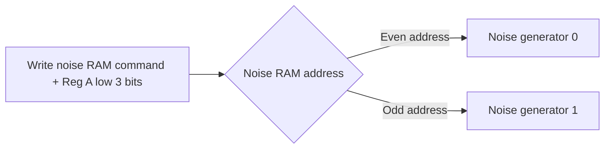


---


<details><summary>Original Atari command/register-layout scan — PDF page 29</summary>

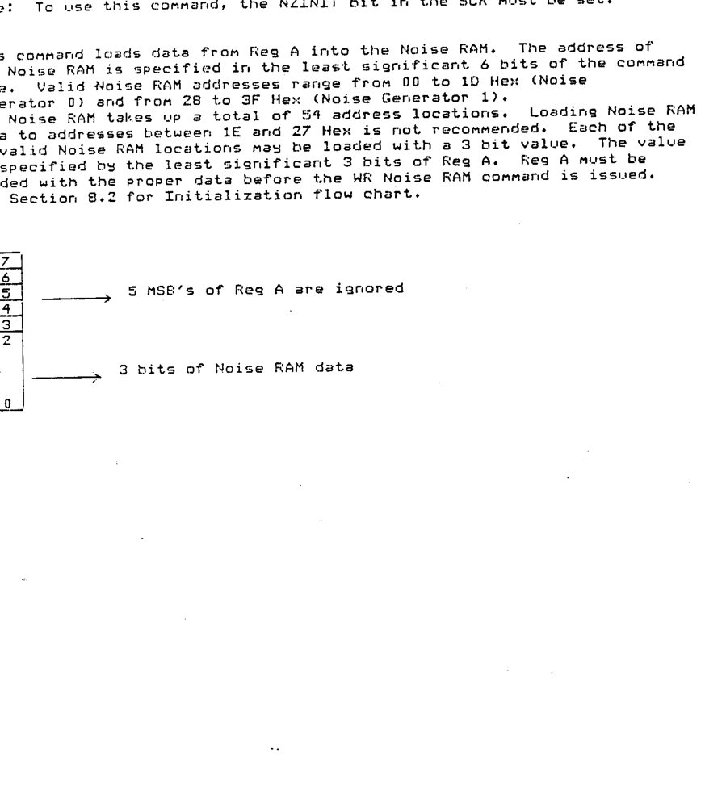

</details>

<!-- Technical Manual original PDF page 30/55 -->

<sub>Original PDF page 30 · [View source](AMY_tech_manual.pdf#page=30)</sub>

#### 7.5.8 Write Last Harmonic Pair Flag Command

Command format: `10 HP4 HP3 HP2 HP1 HP0 D0`. Available with NZINIT cleared. Harmonics are assigned as even/odd pairs, starting with 0 and 1 for voice 0. There are 32 end-of-voice flags, at most eight of which should be set.

| Pair | Harmonic indices | D0=1 meaning |
|---:|---|---|
| 0 | 0–1 | Ends current voice |
| 1 | 2–3 | Ends current voice |
| 2 | 4–5 | Ends current voice |
| 3 | 6–7 | Ends current voice |
| … | … | … |
| 31 | 62–63 | Ends current voice |

For example, setting flags 3 and 31 yields an eight-harmonic voice and a 56-harmonic voice. A/B/C unused.

---


<details><summary>Original Atari command/register-layout scan — PDF page 30</summary>

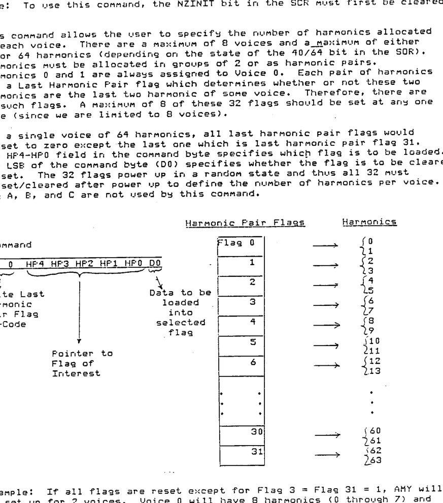

</details>

<!-- Technical Manual original PDF page 31/55 -->

<sub>Original PDF page 31 · [View source](AMY_tech_manual.pdf#page=31)</sub>

#### 7.5.9 Write Voice Type Command

Command: `00010 V2 V1 V0`. Bits A1:A0 select the type; other bits of register A and registers B/C are not used.

| A1 | A0 | Original voice type |
|:--:|:--:|---|
| 0 | 0 | Harmonic |
| 0 | 1 | Noise type 0 |
| 1 | 0 | Noise type 1 |
| 1 | 1 | Undefined |

*Historical Technical Manual values only; no proposed fourth type is incorporated here.*

---


<details><summary>Original Atari command/register-layout scan — PDF page 31</summary>

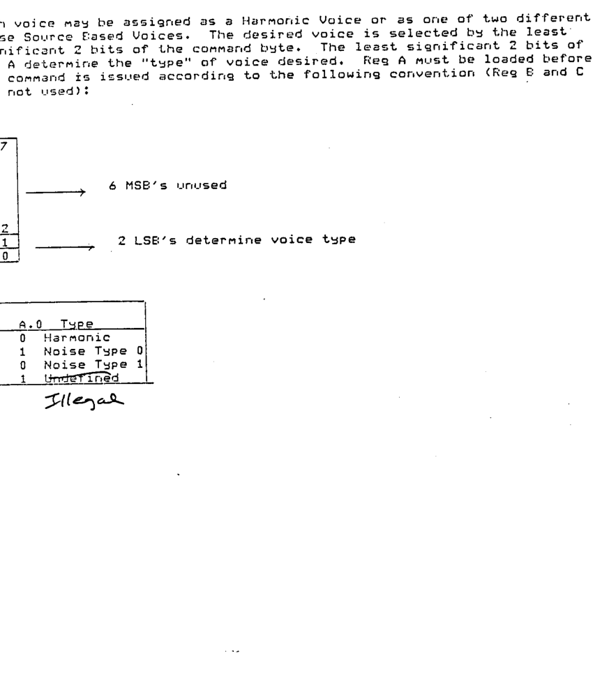

</details>

<!-- Technical Manual original PDF page 32/55 -->

<sub>Original PDF page 32 · [View source](AMY_tech_manual.pdf#page=32)</sub>

### 8.2 Initialization Flow Chart

After releasing RESET (and assuming correct power and clock), the AMY 1 enters State 0. The flowchart continues across original pp. 34–36.

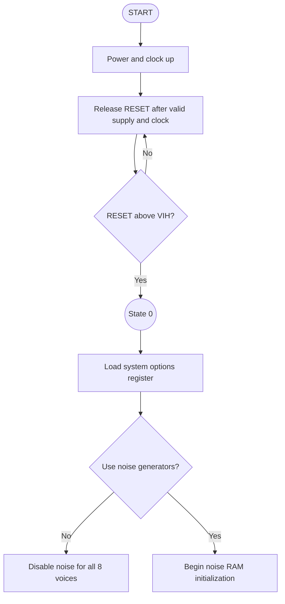

**Initialization flowchart, part 1** — from printed page 34.

---


<!-- Technical Manual original PDF page 33/55 -->

<sub>Original PDF page 33 · [View source](AMY_tech_manual.pdf#page=33)</sub>

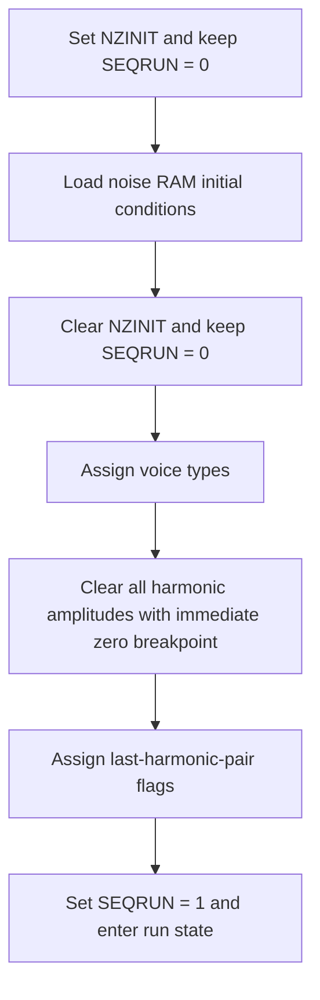

**Initialization flowchart, parts 2–3** — merges the continuation across printed pp. 35–36.

---


<!-- Technical Manual original PDF page 34/55 -->

<sub>Original PDF page 34 · [View source](AMY_tech_manual.pdf#page=34)</sub>

*Initialization flowchart — final step / Run state*

After all oscillator amplitudes have been loaded with immediate zero values, write the System Control Register to set **SEQRUN = 1** and clear **NZINIT = 0**. The output remains at zero until envelope data is loaded even though the oscillators are running.

When AMY is in **RUN state (State 1)**, voices can be constructed by first setting fundamental frequencies immediately, then ramping the harmonic amplitudes (and, if required, frequency). The manual allows further harmonic and frequency breakpoints in this state and quotes a maximum breakpoint rate of approximately **200,000 breakpoints per second**. Noise generation can be stopped and Noise RAM reloaded; harmonic allocations and voice types can also change. Current envelope values can be read back.

For drastic changes the manual recommends returning to State 0 by clearing SEQRUN, optionally first ramping all amplitudes to zero to avoid an audible click.


---

<!-- Technical Manual original PDF page 35/55 -->

<sub>Original PDF page 35 · [View source](AMY_tech_manual.pdf#page=35)</sub>

### 8.3 Summary

The original initialization sequence requires these operations:

1. Load the System Options Register, selecting 40 or 64 harmonics, ALE/address-pin mode, INT/RDY mode, and SUM/INDIVIDUAL output mode. Sample rate is the internal clock divided by twice the active harmonic count (for example 4 MHz / 128 = 31.25 kHz with 64 harmonics).
2. Define voices with the Last Harmonic Pair Flag command.
3. Clear all harmonic amplitudes to zero before `SEQRUN=1`.
4. Load Noise RAM initial conditions using the System Control Register and Noise RAM write command.
5. Assign each voice its initial voice type.

In READY mode, INT/RDY falls on receipt of a command and rises on completion. In INTERRUPT mode, the output emits a command-completion pulse. Individual mode produces separate voice samples; SUM mode produces their sum.

---


<!-- Technical Manual original PDF page 36/55 -->

<sub>Original PDF page 36 · [View source](AMY_tech_manual.pdf#page=36)</sub>

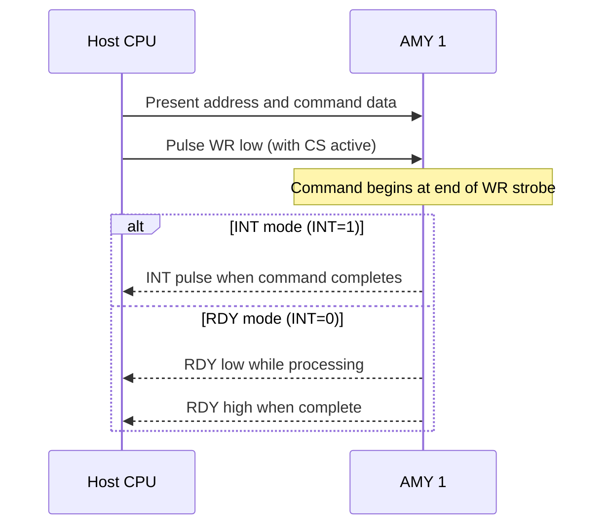

**Figure 10. INT/RDY pin timing**. Event-order representation only. Original timing waveform includes low-active CS, WR, ALE, DB timing; see [source Technical Manual scan](AMY_tech_manual.pdf#page=36).

<details><summary>Original Atari diagram / timing scan — PDF page 36</summary>

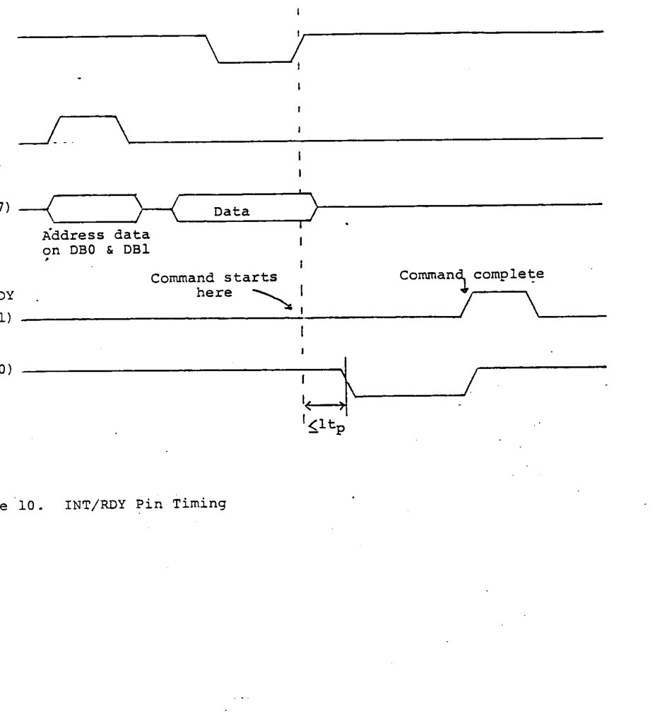

</details>

---


<!-- Technical Manual original PDF page 37/55 -->

<sub>Original PDF page 37 · [View source](AMY_tech_manual.pdf#page=37)</sub>

## 9. Maximum ratings (beyond which useful life may be impaired)

| Parameter | Limit |
|---|---|
| Storage temperature | −65 to +150 °C |
| Ambient temperature under bias | 0 to +70 °C |
| Voltage at any pin relative to GND | −0.5 to +7 V |
| Power dissipation | **750 mW** (earlier manual; Rev. B says 1 W) |

## 10. Capacitances

Conditions: T_A = 25 °C, VCC = GND = 0 V.

| Symbol | Parameter | Max. | Unit |
|---|---|---:|---|
| C_IN | Input capacitance | 10 | pF |
| C_OUT | Output capacitance | 10 | pF |


---


<!-- Technical Manual original PDF page 38/55 -->

<sub>Original PDF page 38 · [View source](AMY_tech_manual.pdf#page=38)</sub>

## 11. D.C. CHARACTERISTICS

Conditions: ambient temperature 0 to 70 °C; the printed source says VCC = +5 V ±10%, with a handwritten correction to **±5%** (PDF p. 38).

| Symbol | Parameter | Min | Max | Units | Test conditions |
|---|---|---:|---:|---|---|
| V_IL | Input low voltage | −0.5 | 0.8 | V | — |
| V_IH | Input high voltage | 2.0 | VCC+0.5 | V | — |
| V_OL | Output low voltage | — | 0.45 | V | I_OL = 2 mA |
| V_OH | Output high voltage | 2.4 | — | V | I_OH = −100 µA |
| I_L | Input leakage current | — | 10 | µA | 0 ≤ V_in ≤ VCC |
| I_O | Output leakage current | — | 10 | µA | 0.45 ≤ V_out ≤ VCC |

---


<!-- Technical Manual original PDF page 39/55 -->

<sub>Original PDF page 39 · [View source](AMY_tech_manual.pdf#page=39)</sub>

## 12. A.C. characteristics

### 12.1 Clock & reset — earlier Technical Manual

Conditions: ambient 0–70 °C; VCC is printed as ±10% with a handwritten correction to **±5%** (PDF p. 39).

| No. | Symbol | Parameter | Min | Max | Unit |
|---:|---|---|---:|---:|---|
| 1 | t_p | Clock period | **200** | 500 | ns |
| 2 | t_0 | Clock high time | 0.4 t_p | 0.6 t_p | clock periods |
| 3 | t_cr | Clock rise time | — | **30** | ns |
| 4 | t_cf | Clock fall time | — | **30** | ns |
| 5 | t_rpw | RESET pulse width | **2 t_p** | — | clock periods |

RESET is held low during power-up and for at least 2 ms after the supply is valid. The later Rev. B document specifies a 100 ns minimum clock period and a 10 t_p RESET pulse instead.

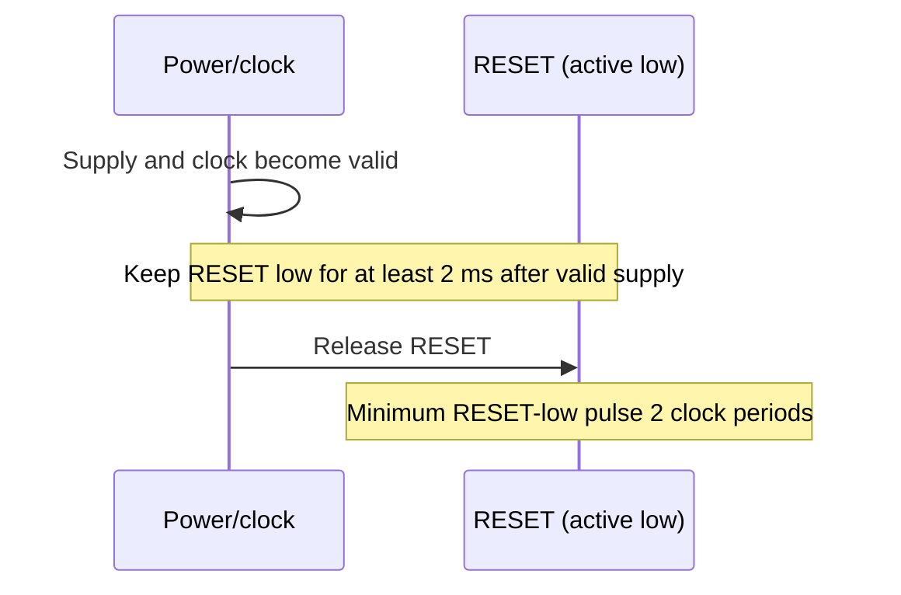


---


<!-- Technical Manual original PDF page 40/55 -->

<sub>Original PDF page 40 · [View source](AMY_tech_manual.pdf#page=40)</sub>

### 12.2 Output Section

Conditions: ambient 0–70 °C; C_L = 150 pF unless otherwise noted; VCC = 5 V ±5%; **2 MHz ≤ CLK ≤ 5 MHz** (as printed in this A.C. output table, irrespective of the broader clock specification).

| No. | Symbol | Parameter | Min | Max | Unit |
|---:|---|---|---:|---:|---|
| 1 | t_col | CLK to OUTSTB low | 0 | 150 | ns |
| 2 | t_cot | CLK to OUTSTB high | 0 | 150 | ns |
| 3 | t_cvt | CLK to V0 falling edge | 0 | 150 | ns |
| 4 | t_cvl | CLK to V0 rising edge | 0 | 150 | ns |
| 5 | t_s | Sample period, 40 harmonic mode | 80 × t_p | 80 × t_p | — |
| 5 | t_s | Sample period, 64 harmonic mode | 128 × t_p | 128 × t_p | — |
| 6 | t_sh | Sample bus hold time from CLK | 20 | — | ns |
| 7 | t_csh1 | CLK to SAMP0–15 data valid | — | 150 | ns |
| 8 | t_csf | OE rising to SAMP0–15 high impedance | 0 | 150 | ns |
| 9 | t_cse | OE falling to SAMP0–15 valid | 0 | 150 | ns |

---


<!-- Technical Manual original PDF page 41/55 -->

<sub>Original PDF page 41 · [View source](AMY_tech_manual.pdf#page=41)</sub>

**Output timing, INDIVIDUAL voice mode (rotated scan).**

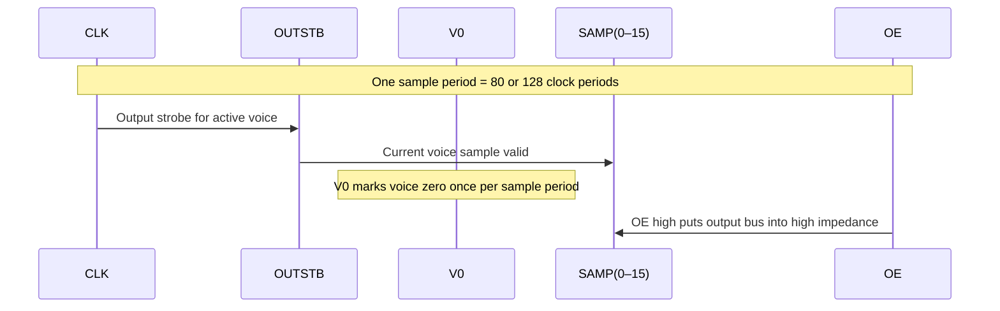

*Mermaid is only an event summary. See the original PDF timing waveform at [page 41](AMY_tech_manual.pdf#page=41) for numbered timing intervals and analog transitions.*

<details><summary>Original Atari diagram / timing scan — PDF page 41</summary>

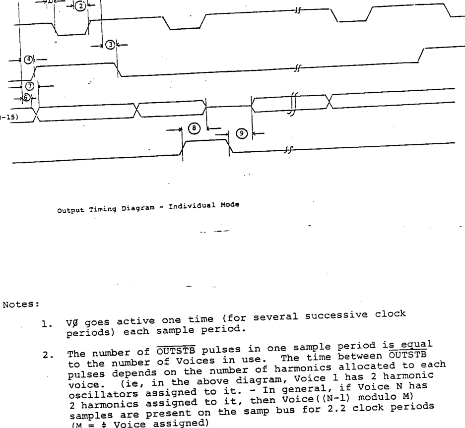

</details>

---


<!-- Technical Manual original PDF page 42/55 -->

<sub>Original PDF page 42 · [View source](AMY_tech_manual.pdf#page=42)</sub>

### 12.3 System Bus Interface (Read/Write, address pin and ALE modes)

> **Transcription alert (printed columns):** In the Atari scan, rows **6–8** put 150 ns under **Min**, while rows **19, 21 and 29** put 50 ns under **Max**. Those placements seem unusual for access/setup times but are reproduced **as printed**; do not use them as engineering limits without checking the timing waveforms and independent evidence. (PDF pp. 42–43.)

| No. | Symbol | Parameter | Min | Max | Unit |
|---:|---|---|---:|---:|---|
| 1 | t_ar | Address valid to RD | 0 | — | ns |
| 2 | t_rr | RD pulse width | 200 | — | ns |
| 3 | t_af | ALE float time | 10 | 100 | ns |
| 4 | t_chr | CS hold time after RD | 0 | — | ns |
| 5 | t_cr | CS active to RD | 0 | — | ns |
| 6 | t_rd | Read access time | 150 | — | ns |
| 7 | t_ao | Address to data valid | 150 | — | ns |
| 8 | t_cd | CS active to data valid | 150 | — | ns |
| 9 | t_rdh | Data hold after RD | — | 10 | ns |
| 10 | t_ahr | Address hold after RD | 0 | — | ns |
| 11 | t_rdead1 | RD dead time, address-pin mode | 100 | — | ns |
| 12 | t_cycr1 | Read cycle time, address-pin mode | 300 | — | ns |
| 13 | t_rdf | Read float time, RD to DB0–7 high-Z | 10 | 100 | ns |
| 14 | t_rdead2 | RD dead time, ALE mode | 250 | — | ns |
| 15 | t_apw | ALE pulse width | 50 | — | ns |
| 16 | t_cycr2 | ALE-mode read cycle time | 450 | — | ns |

*All times are from the original scan; labels and active-low edges should be checked against the corresponding waveforms.*

---


<!-- Technical Manual original PDF page 43/55 -->

<sub>Original PDF page 43 · [View source](AMY_tech_manual.pdf#page=43)</sub>

*System Bus Interface (continued)*

| No. | Symbol | Parameter | Min | Max | Unit |
|---:|---|---|---:|---:|---|
| 17 | t_chw | CS hold after WR | 0 | — | ns |
| 18 | t_ahw | Address hold after WR | 0 | — | ns |
| 19 | t_aw | Address setup to WR | — | 50 | ns |
| 20 | t_cw | CS setup to WR | 0 | — | ns |
| 21 | t_dw | Data setup to WR | — | 50 | ns |
| 22 | t_ww | WR pulse width | 200 | — | ns |
| 23 | t_wd | Data hold after WR | 0 | — | ns |
| 24 | t_wdead1 | WR dead time, address-pin mode | 100 | — | ns |
| 25 | t_cycw | Write cycle time, address-pin mode | 300 | — | ns |
| 26 | t_alewr | ALE to WR | 50 | — | ns |
| 27 | t_cycwale | Write cycle time, ALE mode | 400 | — | ns |
| 28 | t_wdead2 | WR dead time, ALE mode | 200 | — | ns |
| 29 | t_dwa | Data valid to ALE falling edge | — | 50 | ns |
| 30 | t_wda | Data hold after ALE falling edge | 0 | — | ns |
| 31 | t_alerd | ALE falling edge to RD falling edge | 20 | — | ns |

*Numbered entries correspond to the original timing waveform pages. Values in the Min/Max columns follow the printed source, including unusual placements of some setup-time values. Verify the intended timing direction before hardware use.*

---


<!-- Technical Manual original PDF page 44/55 -->

<sub>Original PDF page 44 · [View source](AMY_tech_manual.pdf#page=44)</sub>

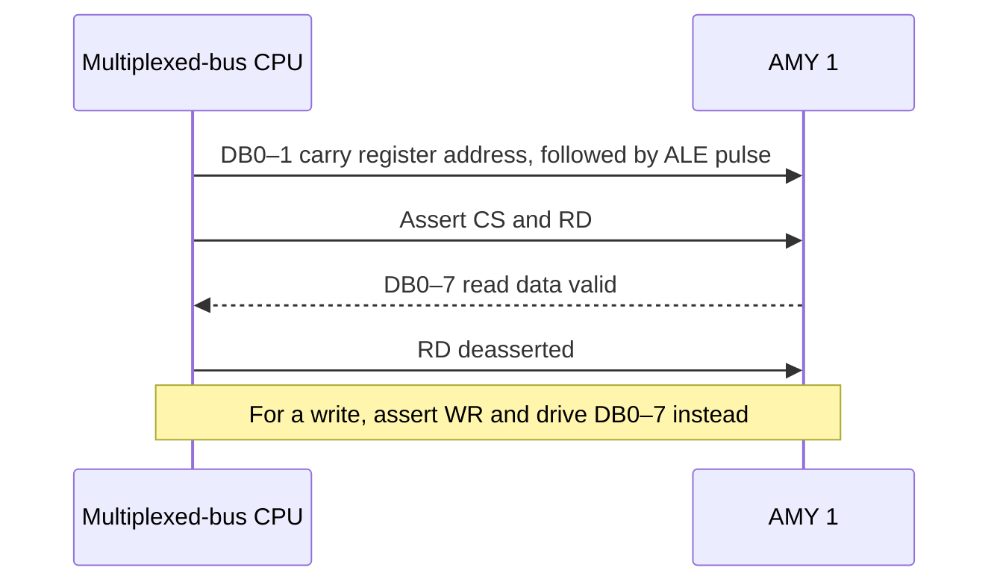

*ALE-mode timing figures from the original PDF; event order preserved, actual nanosecond setup/hold limits are in §12.3.*

<details><summary>Original Atari diagram / timing scan — PDF page 44</summary>

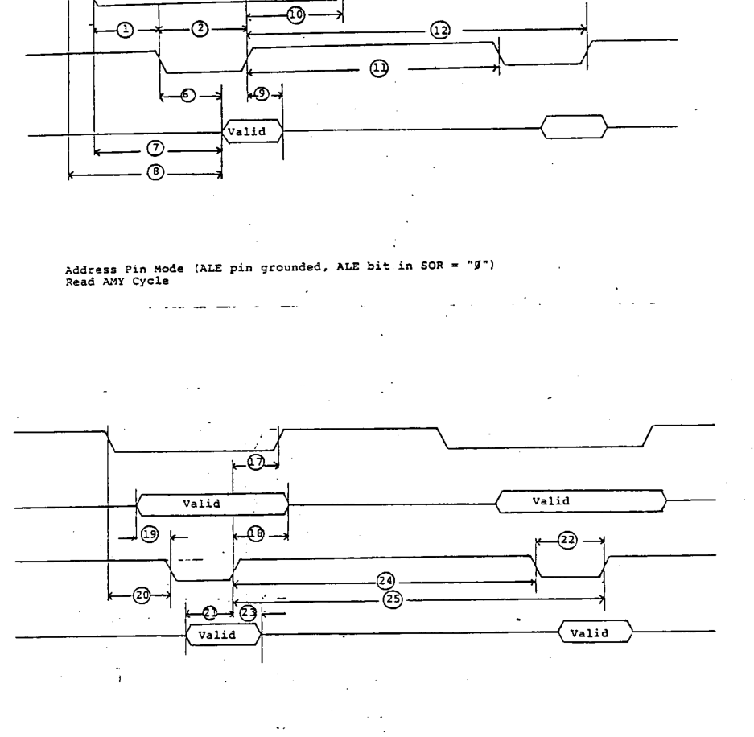

</details>

---


<!-- Technical Manual original PDF page 45/55 -->

<sub>Original PDF page 45 · [View source](AMY_tech_manual.pdf#page=45)</sub>

```mermaid
sequenceDiagram
    participant CPU as CPU (A0/A1 address pins)
    participant AMY as AMY 1
    CPU->>AMY: Drive A1/A0 to select register
    CPU->>AMY: Assert CS and RD (read) or WR (write)
    Note over CPU,AMY: For reads AMY drives DB0–7, for writes CPU drives DB0–7
    CPU->>AMY: Release strobe, then CS
```

*Address-pin-mode timing figures from the original PDF. Mermaid does not preserve the analog-like waveforms.*

<details><summary>Original Atari diagram / timing scan — PDF page 45</summary>

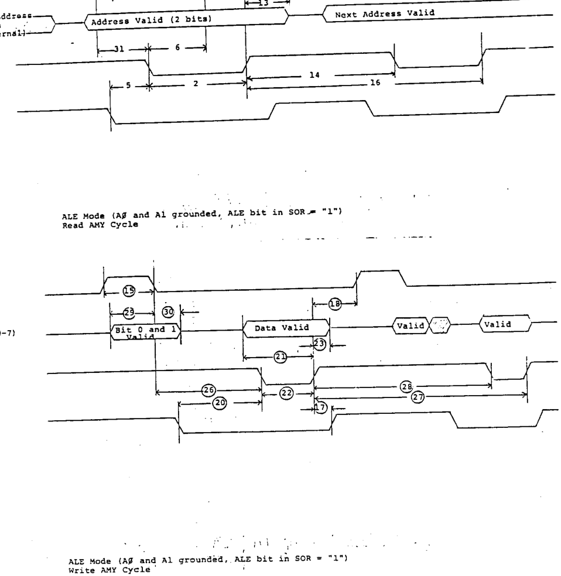

</details>

---


<!-- Technical Manual original PDF page 46/55 -->

<sub>Original PDF page 46 · [View source](AMY_tech_manual.pdf#page=46)</sub>

## APPENDIX I.

Table A shows the 13 bit tone values which correspond to full semitone steps on a piano keyboard. For example, Note A (440 Hz) will be reached if a fundamental frequency envelope reaches a destination value of 5004 Decimal (138C Hex). At

a 4 MHz internal clock rate the actual frequency will be 440.04 Hz. The MSB and LSB fields show the Decimal values of the Destination MSB and LSB

fields corresponding to the Atari Tone value.

Table B is in the same format as Table A, but the "Note" field was dropped as the values listed are "in between" 2 semitones (or notes on a piano). Table B shows that the actual frequency resolution at 440 Hz is approximately 0.4 Hz (1.5 cents).

Table C shows actual semitone/sec and decibel/sec slopes achieved by various 8 bit slope values. The M (mantissa) and E (exponent) fields are separated to give a feeling for the exponential coding scheme of slope byte. (Data valid for 4 MHz internal clock frequency and 64 harmonic mode).

---


<!-- Technical Manual original PDF page 47/55 -->

<sub>Original PDF page 47 · [View source](AMY_tech_manual.pdf#page=47)</sub>

**Table A — OCR transcription (incomplete)** — continuation, Technical Manual source page 47. Values below retain OCR uncertainties and should be checked against the scan.

| Atari tone (dec) | MSB (hex) | LSB (hex) | Frequency (Hz) | Note |
|---:|---:|---:|---:|---|
| 140 | 0 | 8c | 5.4 | F |
| 268 | 1 | c | 6.1 | G |
| 332 | 1 | 4c | 6.4 | G#/Ab |
| 396 | 1 | 8c | 6.8 | A |
| 460 | 1 | cc | 7.2 | A#/Bb |
| 524 | 2 | c | 7.7 | B |
| 588 | 2 | 4c | 8.1 | c |
| 652 | 2 | 8c | 8.6 | c#/Db |
| 716 | 2 | cc | 9.1 | D |
| 780 | 3 | c | 9.7 | D#/Eb |
| 844 | 3 | 4c | 10.3 | E |
| 908 | 3 | 8c | 10.9 | F |
| 972 | 3 | cc | 11.5 | F#/Gb |
| 1036 | 4 | c | 12.2 | G |
| 1100 | 4 | 4c | 12.9 | G#/Ab |
| 1164 | 4 | 8c | 13.7 | A |
| 1228 | 4 | cc | 14.5 | A#/Bb |
| 1292 | 5 | c | 15.4 | B |
| 1356 | 5 | 4c | 16.3 | c |
| 1420 | 5 | 8c | 17.3 | C#/Db |
| 1484 | 5 | cc | 18.3 | D |
| 1548 | 6 | c | 19.4 | D#/Eb |
| 1612 | 6 | 4c | 20.6 | E |
| 1676 | 6 | 8c | 21.8 | F |
| 1740 | 6 | cc | 23.1 | F#/Gb |
| 1804 | 7 | Cc | 24.5 | G |
| 1868 | 7 | 4c | 25.9 | G#/Ab |
| 1932 | 7 | 8c | 27.5 | A |
| 1996 | 7 | cc | 29.1 | At /Bb |
| 2060 | 8 | c | 30.8 | B |
| 2124 | 8 | 4c | 32.7 | c |
| 2188 | 8 | 8c | 34.6 | C#/Db |
| 2252 | 8 | cc | 36.7 | D |
| 2316 | 9 | c | 38.8 | D#/Eb |
| 2380 | 9 | 4c | 41.2 | E |
| 2444 | 9 | 8c | 43.6 | F |
| 2508 | 9 | cc | 46.2 | F#/Gb |
| 2572 | A | c | 49 | G |
| 2636 | A | 4c | 51.9 | G#/Ab |
| 2700 | A | 8c | 55 | A |
| 2764 | A | cc | 58.2 | Ad /Bb |
| 2828 | B | c | 61.7 | B |
| 2892 | B | 4c | 65.4 | c |
| 2956 | B | 8c | 69.3 | C#/Db |
| 3020 | B | cc | 73.4 | D |
| 3084 | c | c | 77.7 | D#/Eb |


> Table transcription is provisional: irregular OCR rows or misread digits require checking against the scan.

<details><summary>Full original printed table — source PDF page 47</summary>

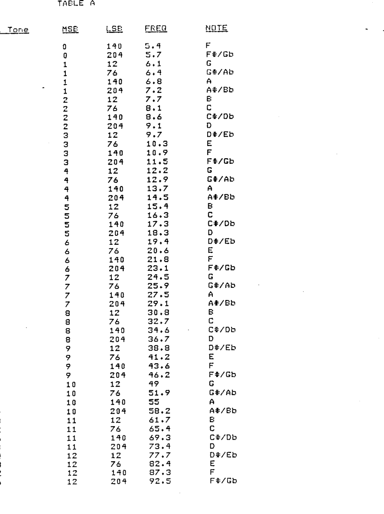

</details>

---


<!-- Technical Manual original PDF page 48/55 -->

<sub>Original PDF page 48 · [View source](AMY_tech_manual.pdf#page=48)</sub>

**Table A — OCR transcription (incomplete)** — continuation, Technical Manual source page 48. Values below retain OCR uncertainties and should be checked against the scan.

| Atari tone (dec) | MSB (hex) | LSB (hex) | Frequency (Hz) | Note |
|---:|---:|---:|---:|---|
| 3148 | c | 4c | 82.4 | E |
| 3212 | c | 8c | 87.3 | F |
| 3276 | c | ce | 92.5 | F#/Gb |
| 3340 | D | Cc | 98 | G |
| 3404 | D | 4c | 103.8 | G#/Ab |
| 3468 | D | 8c | 110 | A |
| 3532 | D | cc | 116.5 | A#/Bb |
| 3596 | E | Cc | 123.4 | B |
| 3660 | E | 4C | 130.8 | Cc |
| 3724 | E | 8c | 138.6 | c#/Db |
| 3788 | E | cc | 146.8 | D |
| 3852 | F | Cc | 155.5 | D#/Eb |
| 3980 | F | 8C | 174.6 | F |
| 4044 | F | cc | 185 | . F#/Gb |
| 4172 | 10 | 4c | 207.6 | G#/Ab |
| 4236 | 10 | 8c | 220 | ~ A |
| 4300 | 10 | cc | 233.1 | A#/Bb |
| 4364 | 11 | c | 246.9 | B |
| 4492 | 11 | 8c | 277.2 | C#/Db |
| 4556 | 11 | cc | 293.6 | D |
| 4620 | 12 | Cc | 311.1 | D#/Eb |
| 4684 | 12 | 4c | 329.6 | E |
| 4748 | 12 | 8c | 349.2 | F |
| 4812 | 12 | cc | 370 | F#/Gb |
| 4876 | 13 | c | 392 | G |
| 4940 | 13 | 4c | 415.3 | G#/Ab |
| 5004 | 13 | 8c | 440 | A |
| 5068 | 13 | cc | 466.2 | A#/Bb |
| 5132 | 14 | c | 493.9 | B |
| 5196 | 14 | 4c | 523.3 | c |
| 5260 | 14 | 8c | 554.4 | C#/Db |
| 5324 | 14 | cc | 587.3 | D |
| 5452 | 15 | 4c | 659.3 | E |
| 5516 | 15 | 8c | 698.5 | F |
| 5580 | 15 | cc | 740 | F#/Gb |
| 5644 | 16 | c | 784 | G |
| 5708 | 16 | 4c | 830.7 | Gi#/Ab |
| 5772 | 16 | 8c | 880 | A |
| 5836 | 16 | cc | 932.4 | Ad#/Bb |
| 6028 | 17 | 8c | 1108.8 | c#/Db |


> Table transcription is provisional: irregular OCR rows or misread digits require checking against the scan.

<details><summary>Full original printed table — source PDF page 48</summary>

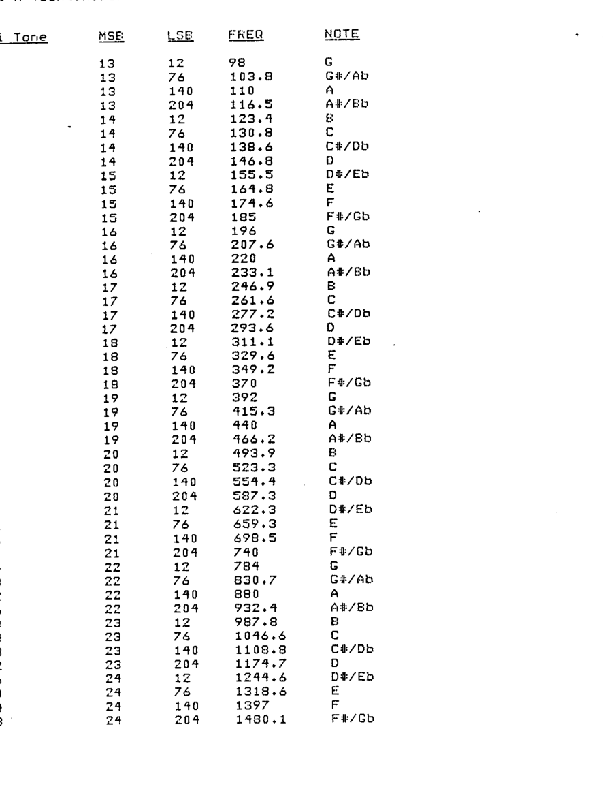

</details>

---


<!-- Technical Manual original PDF page 49/55 -->

<sub>Original PDF page 49 · [View source](AMY_tech_manual.pdf#page=49)</sub>

**Table A — OCR transcription (incomplete)** — continuation, Technical Manual source page 49. Values below retain OCR uncertainties and should be checked against the scan.

| Atari tone (dec) | MSB (hex) | LSB (hex) | Frequency (Hz) | Note |
|---:|---:|---:|---:|---|
| 6092 | 17 | cc | 1174.7 | D |
| 6156 | 18 | c | 1244.6 | D#/Eb . |
| 6220 | 18 | 4c | 1318.6 | E |
| 6284 | 18 | 8c | 1397 | F |
| 6348 | 18 | cc | 1480.1 | F#/Gb |
| 6476 | 19 | 4c | 1661.4 | G#/Ab |
| 6604 | 19 | cc | 1864.8 | A#/Bb |
| 6668 | 1A | Cc | 1975.7 | B |
| 6732 | 1A | 4c | 2093.2 | c |
| 6796 | 1A | 8C | 2217.7 | c#/Db |
| 6860 | 1A | cc | 2349.5 | D |
| 6924 | 1B | c | 2489.2 | D#/Eb |
| 6988 | 1B | 4C | 2637.3 | E |
| 7052 | 18 | 8c | 2794.1 | F |
| 7116 | 1B | cc | 2960.2 | F#/Gb |
| 7244 | 1c | 4c | 3322.7 | Gi#/Ab |
| 7308 | 1c | 8c | 3520.3 | A |
| 7372 | 1c | cc | 3729.7 | A#/Bb |
| 7500 | 1D | 4c | 4186.4 | c |
| 7564 | 1D | 8c | 4435.4 | C#/Db |
| 7692 | 1E | c | 4978.5 | D#/Eb |
| 7756 | 1E | 4c | 5274.6 | E |
| 7820 | 1E | 8C | 5588.2 | F |
| 7884 | 1E | cc | 5920.5 | F#/Gb |
| 8140 | 1F | cc | 7459.4 | A#/Bb |


> Table transcription is provisional: irregular OCR rows or misread digits require checking against the scan.

<details><summary>Full original printed table — source PDF page 49</summary>

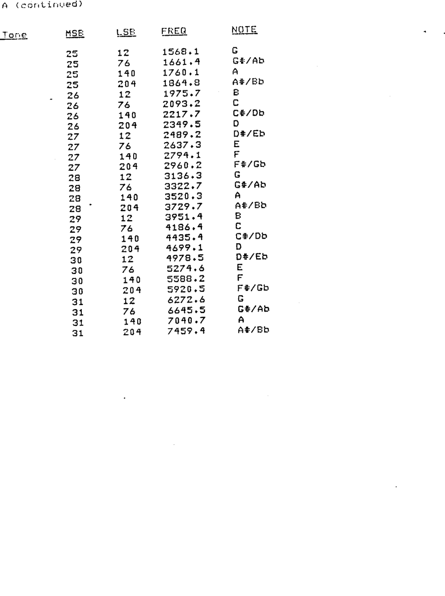

</details>

---


<!-- Technical Manual original PDF page 50/55 -->

<sub>Original PDF page 50 · [View source](AMY_tech_manual.pdf#page=50)</sub>

**Table B — OCR transcription (incomplete)** — continuation, Technical Manual source page 50. Values below retain OCR uncertainties and should be checked against the scan.

| Atari tone (dec) | MSB (hex) | LSB (hex) | Frequency (Hz) | Notes |
|---:|---:|---:|---:|---|
| 4941 | 13 | 4D | 415.7 | Range: 2 semitones |
| 4942 | 13 | 4E | 416 | Resolution: 1 Atari Tone |
| 4943 | 13 | 4F | 416.4 | (1/64 st) |
| 4944 | 13 | 50 | 416.8 | Centered around A (440 Hz) |
| 4945 | 13 | 51 | 417.2 |  |
| 4946 | 13 | 52 | 417.5 |  |
| 4947 | 13 | 53 | 417.9 |  |
| 4948 | 13 | 54 | 418.3 |  |
| 4949 | 13 | 55 | 418.7 |  |
| 4950 | 13 | 56 | 419.1 |  |
| 4951 | 13 | 57 | 419.4 |  |
| 4952 | 13 | 58 | 419.8 |  |
| 4953 | 13 | 59 | 420.2 |  |
| 4954 | 13 | 5A | 420.6 |  |
| 4955 | 13 | 5B | 421 |  |
| 4956 | 13 | 5c | 421.3 |  |
| 4957 | 13 | 5D | 421.7 |  |
| 4958 | 13 | 5E | 422.1 |  |
| 4959 | 13 | 5F | 422.5 |  |
| 4960 | 13 | 60 | 422.9 |  |
| 4961 | 13 | 61 | 423.2 |  |
| 4962 | 13 | 62 | 423.6 |  |
| 4963 | 13 | 63 | 424 |  |
| 4964 | 13 | 64 | 424.4 |  |
| 4965 | 13 | 65 | 424.8 |  |
| 4966 | 13 | 66 | 425.2 |  |
| 4967 | 13 | 67 | 425.5 |  |
| 4968 | 13 | 68 | 425.9 |  |
| 4969 | 13 | 69 | 426.3 |  |
| 4970 | 13 | 6A | 426.7 |  |
| 4971 | 13 | 6B | 427.1 |  |
| 4972 | 13 | 6C | 427.5 |  |
| 4973 | 13 | 6D | 427.8 |  |
| 4974 | 13 | 6E | 428.2 |  |
| 4975 | 13 | 6F | 428.6 |  |
| 4976 | 13 | 70 | 429 |  |
| 4977 | 13 | 71 | 429.4 |  |
| 4978 | 13 | 72 | 429.8 |  |
| 4979 | 13 | 73 | 430.2 |  |
| 4980 | 13 | 74 | 430.6 |  |
| 4981 | 13 | 75 | 431 |  |
| 4982 | 13 | 76 | 431.3 |  |
| 4983 | 13 | 77 | 431.7 |  |
| 4984 | 13 | 78 | 432.1 |  |
| 4985 | 13 | 79 | 432.5 |  |
| 4986 | 13 | 7A | 432.9 |  |
| 4987 | 13 | 7B | 433.3 |  |


> Table transcription is provisional: irregular OCR rows or misread digits require checking against the scan.

<details><summary>Full original printed table — source PDF page 50</summary>

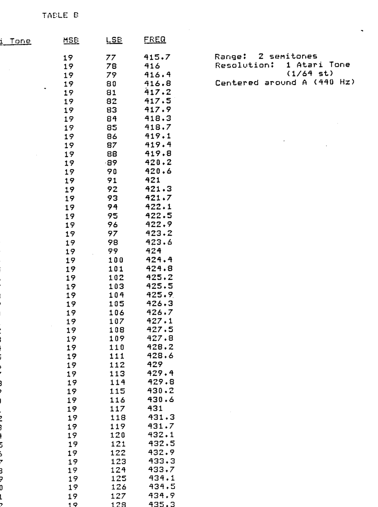

</details>

---


<!-- Technical Manual original PDF page 51/55 -->

<sub>Original PDF page 51 · [View source](AMY_tech_manual.pdf#page=51)</sub>

**Table B — OCR transcription (incomplete)** — continuation, Technical Manual source page 51. Values below retain OCR uncertainties and should be checked against the scan.

| Atari tone (dec) | MSB (hex) | LSB (hex) | Frequency (Hz) | Notes |
|---:|---:|---:|---:|---|
| 4988 | 13 | 7c | 433.7 |  |
| 4989 | 13 | 7D | 434.1 |  |
| 4990 | 13 | 7E | 434.5 |  |
| 4991 | 13 | 7F | 434.9 |  |
| 4992 | 13 | 80 | 435.3 |  |
| 4993 | 13 | 81 | 435.6 |  |
| 4994 | 13 | 82 | 436 |  |
| 4996 | 13 | 84 | 436.8 |  |
| 4997 | 13 | 85 | 437.2 |  |
| 4998 | 13 | 86 | 437.6 |  |
| 4999 | 13 | 87 | 438 |  |
| 5000 | 13 | 88 | 438.4 |  |
| 5001 | 13 | 89 | 438.8 |  |
| 5002 | 13 | 8A | 439.2 |  |
| 5003 | 13 | 8B | 439.6 |  |
| 5004 | 13 | 8c | 440 |  |
| 5006 | 13 | 8E | 440.8 |  |
| 5007 | 13 | 8F | 441.2 |  |
| 5008 | 13 | 90 | 441.6 |  |
| 5010 | 13 | 92 | 442.4 |  |
| 5011 | 13 | 93 | 442.8 |  |
| 5012 | 13 | 94 | 443.2 |  |
| 5013 | 13 | 95 | 443.6 |  |
| 5014 | 13 | 96 | 444 |  |
| 5015 | 13 | 97 | 444.4 |  |
| 5016 | 13 | 98 | 444.8 |  |
| 5017 | 13 | 99 | 445.2 |  |
| 5018 | 13 | 9A | 445.6 |  |
| 5019 | 13 | 9B | 446 |  |
| 5021 | 13 | 9D | 446.8 |  |
| 5022 | 13 | 9E | 447.2 |  |
| 5026 | 13 | A2 | 448.8 |  |
| 5027 | 13 | A3 | 449.2 |  |
| 5028 | 13 | A4 | 449.6 |  |
| 5031 | 13 | A7 | 450.8 |  |
| 5034 | 13 | AA | 452.1 |  |


> Table transcription is provisional: irregular OCR rows or misread digits require checking against the scan.

<details><summary>Full original printed table — source PDF page 51</summary>

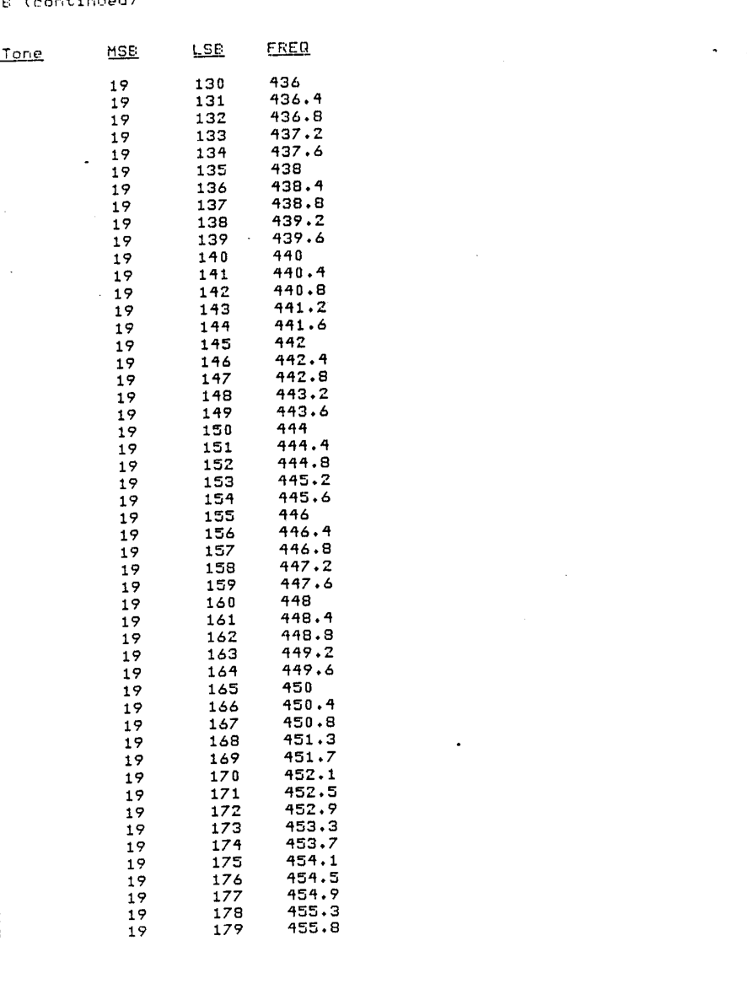

</details>

---


<!-- Technical Manual original PDF page 52/55 -->

<sub>Original PDF page 52 · [View source](AMY_tech_manual.pdf#page=52)</sub>

**Table B — OCR transcription (incomplete)** — continuation, Technical Manual source page 52. Values below retain OCR uncertainties and should be checked against the scan.

| Atari tone (dec) | MSB (hex) | LSB (hex) | Frequency (Hz) | Notes |
|---:|---:|---:|---:|---|
| 5036 | 13 | AC | 452.9 |  |
| 5037 | 13 | AD | 453.3 |  |
| 5038 | 13 | AE | 453.7 | > |
| 5039 | 13 | AF | 454.1 |  |
| 5042 | 13 | B2 | 455.3 |  |
| 5043 | 13 | B3 | 455.8 |  |
| 5044 | 13 | B4 | 456.2 |  |
| 5046 | 13 | B6 | 457 |  |
| 5047 | 13 | B7 | 457.4 |  |
| 5048 | 13 | B8 | 457.8 |  |
| 5050 | 13 | BA | 458.6 |  |
| 5051 | 13 | BB | 459.1 |  |
| 5052 | 13 | BC | 459.5 |  |
| 5053 | 13 | BD | 459.9 |  |
| 5054 | 13 | BE | 460.3 |  |
| 5055 | 13 | BF | 460.7 |  |
| 5058 | 13 | c2 | 462 |  |
| 5059 | 13 | c3 | 462.4 |  |
| 5060 | 13 | c4 | 462.8 |  |
| 5062 | 13 | c6 | 463.6 |  |
| 5063 | 13 | c7 | 464.1 |  |
| 5066 | 13 | CA | 465.3 |  |
| 5067 | 13 | cB | 465.7 |  |


> Table transcription is provisional: irregular OCR rows or misread digits require checking against the scan.

<details><summary>Full original printed table — source PDF page 52</summary>

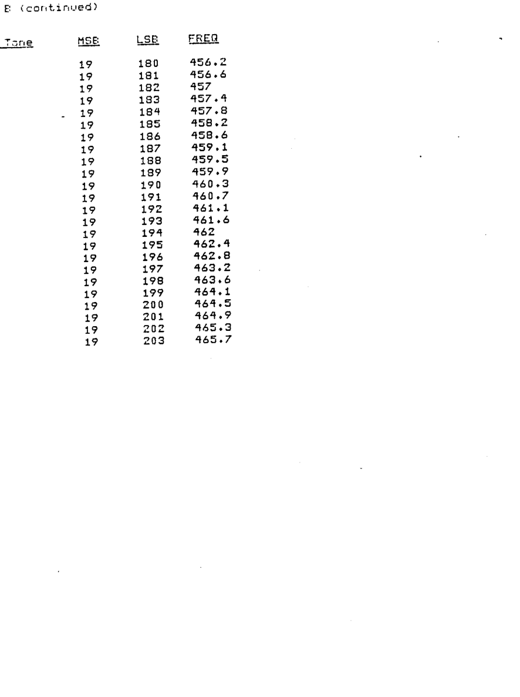

</details>

---


<!-- Technical Manual original PDF page 53/55 -->

<sub>Original PDF page 53 · [View source](AMY_tech_manual.pdf#page=53)</sub>

**Table C — OCR transcription (incomplete)** — continuation; values from unverified OCR.

| + slope (hex) | – slope (hex) | Semitones/s | dB/s | Mantissa (hex) | Exponent |
|---|---|---:|---:|---|---|
| 0 | 80 | 0 | te) | 0 | 0 |
| 1 | oF | 0.11 | 1.9 | 1 | 0 |
| 2 | 9E | 0.23 | 3.81 | 2 | 0 |
| 3 | 9D | 0.35 | 5.72 | 3 | 0 |
| 4 | 9c | 0.47 | 7.62 | 4 | 0 |
| 5 | 9B | 0.59 | 9.53 | 5 | 0 |
| 6 | 9A | 0.71 | 11.44 | 6 | 0 |
| 7 | 99 | 0.83 | 13.35 | 7 | ie) |
| 8 | 98 | 0.95 | 15.25 | 8 | (0) |
| 9 | 97 | 1.07 | 17.16 | 9 | te) |
| A | 96 | 1,19 | 19.07 | A | 0 |
| B | 95 | 1.31 | 20.98 | B | 0 |
| c | 94 | 1.43 | 22.88 | Cc | 0 |
| D | 93 | 1.54 | 24.79 | D | 0 |
| E | 92 | 1.66 | 26.7 | E | ie) |
| F | 91 | 1.78 | 28.61 | F | 0 |
| 10 | 90 | 1.9 | 30.51 | 10 | i) |
| 11 | 8F | 2.02 | 32,42 | li | 0 |
| 12 | 8E | 2.14 | 34.33 | 12 | i) |
| 13 | 8D | 2.26 | - | 36.23 | 13 i) |
| 14 | 8c | 2.38 | 38,14 | 14 | 0 |
| 15 | 8B | 2.5 | 40.05 | 15 | 0 |
| 16 | 8A | 2.62 | 41.96 | 16 | 0 |
| 17 | 89 | 2.74 | 43.86 | 17 | it) |
| 18 | 88 | 2.86 | 45.77 | 18 | 0 |
| 19 | 87 | 2.98 | 47.68 | 19 | 0 |
| 1A | 86 | 3.09 | 49.59 | 1A | it) |
| 1B | 85 | 3.21 | 51.49 | 1B | 0 |
| 1c | 84 | 3.33 | 53.4 | 1c | 0 |
| 1E | 82 | 3.57 | 57.22 | 1E | 0 |
| 1F | 81 | 3.69 | 59.12 | 1F | 0 |
| 21 | BF | 0.47 | 7.62 | 1 | 1 |
| 22 | BE | 0.95 | 15,25 | 2 | 1 |
| 23 | BD | 1.43 | 22.88 | 3 | 1 |
| 24 | BC | 1.9 | 30.51 | 4 | 1 |
| 25 | BB | 2.38 | 38.14 | 5 | 1 |
| 26 | BA | 2.86 | 45.77 | 6 | 1 |
| 27 | B9 | 3.33 | 53.4 | 7 | 1 |
| 29 | B7 | 4.29 | 68.66 | 9 | 1 |
| 2A | B6 | 4.76 | 76.29 | A | 1 |
| 2B | B5 | 5.24 | 83.92 | B | 1 |
| 2c | B4 | 5.72 | 91.55 | c | 1 |
| 2D | B3 | 6.19 | 99.18 | D | 1 |
| 2E | B2 | 6.67 | 106.81 | E | 1 |


> Table transcription is provisional: irregular OCR rows or misread digits require checking against the scan.

<details><summary>Full original printed table — source PDF page 53</summary>

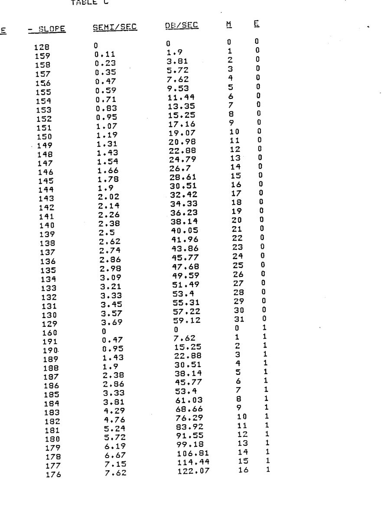

</details>

---


<!-- Technical Manual original PDF page 54/55 -->

<sub>Original PDF page 54 · [View source](AMY_tech_manual.pdf#page=54)</sub>

**Table C — OCR transcription (incomplete)** — continuation; values from unverified OCR.

| + slope (hex) | – slope (hex) | Semitones/s | dB/s | Mantissa (hex) | Exponent |
|---|---|---:|---:|---|---|
| 31 | AF | 8.1 | 129.69 | il | 1 |
| 32 | AE | 8.58 | 137,32 | 12 | 1 |
| 33 | AD | 9.05 | 144.95 | 13 | 1 |
| 34 | AC | 9.53 | 152.58 | 14 | 1 |
| 35 | AB | 10.01 | 160.21 | 15 | 1 |
| 36 | AA | 10.49 | 167.84 | 16 | 1 |
| 38 | a8 | 11.44 | 183.1 | 18 | 1 |
| 39 | a7 | 11.92 | 190,73 | 19 | 1 |
| 3A | A6 | 12.39 | 198.36 | 1a | 1 |
| 3B | A5 | 12.87 | 205.99 | 1B | 1 |
| 3c | Aa | 13,35 | 213.62 | 1c | 1 |
| 3D | A3 | 13.82 | 221,25 | 1D | 1 |
| 41 | DF | 1.9 | 30.51 | 1 | 2 |
| 42 | DE | 3.81 | 61.03 | 2 | 2 |
| 45 | DB | 9.53 | 152.58 | 5 | 2 |
| 46 | DA | 11.44 | 183.1 | 6 | 2 |
| 47 | D9 | 13.35 | 213.62 | 7 | 2 |
| 48 | D8 | 15.25 | 244.14 | 8 | 2 |
| 49 | D7 | 17.16 | 274.65 | 9 | 2 |
| 4a | D6 | 19.07 | 305.17 | A | 2 |
| 4c | D4 | 22.88 | 366.21 | c | 2 |
| 4D | D3 | 24.79 | 396.72 | D | 2 |
| 4E | D2 | 26.7 | 427.24 | E | 2 |
| 51 | cF | 32.42 | 518.79 | ul | 2 |
| 52 | cE | 34,33 | 549.31 | 12 | 2 |
| 54 | cc | 38.14 | 610.35 | 14 | 2 |
| 55 | cB | 40.05 | 640.86 | 15 | 2 |
| 56 | cA | 41.96 | 671.38 | 16 | 2 |
| 58 | ca | 45.77 | 732.42 | 18 | 2 |
| 5B | c5 | 51.49 | 823.97 | 1B | 2 |
| 5c | C4 | 53.4 | 854.49 | 1c | 2 |
| 5D | c3 | 55.31 | 885 | 1D | 2 |


> Table transcription is provisional: irregular OCR rows or misread digits require checking against the scan.

<details><summary>Full original printed table — source PDF page 54</summary>

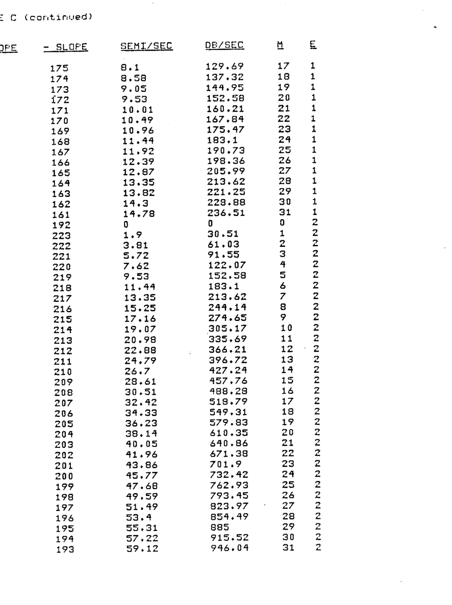

</details>

---


<!-- Technical Manual original PDF page 55/55 -->

<sub>Original PDF page 55 · [View source](AMY_tech_manual.pdf#page=55)</sub>

**Table C — OCR transcription (incomplete)** — continuation; values from unverified OCR.

| + slope (hex) | – slope (hex) | Semitones/s | dB/s | Mantissa (hex) | Exponent |
|---|---|---:|---:|---|---|
| 61 | FF | 7.62 | 122.07 | 1 | 3 |
| 62 | FE | 15.25 | 244.14 | 2 | 3 |
| 63 | FD | 22.88 | 366.21 | 3 | 3 |
| 64 | Fc | 30.51 | 488.28 | 4 | 3 |
| 65 | FB | 38.14 | 610.35 | 5 | 3 |
| 66 | FA | 45.77 | 732.42 | 6 | 3 |
| 67 | F9 | 53.4 | 854.49 | 7 | 3 |
| 69 | F7 | 68.66 | 1098.63 | 9 | 3 |
| 6A | F6 | 76.29 | 1220.7 | A | 3 |
| 6B | F5 | 83.92 | 1342.77 | B | 3 |
| 6c | F4 | 91.55 | 1464.84 | c | 3 |
| 6D | F3 | 99.18 | 1586.91 | D | 3 |
| 6E | F2 | 106.81 | 1708.98 | E | 3 |
| 72 | EE | 137.32 | 2197.26 | 12 | 3 |
| 73 | ED | 144.95 | 2319.33 | 13 | 3 |
| 74 | EC | 152.58 | 2441.4 | 14 | 3 |
| 75 | EB | 160.21 | 2563.47 | 15 | 3 |
| 76 | EA | 167.84 | 2685.54 | 16 | 3 |
| 77 | E9 | 175.47 | 2807.61 | 17 | 3 |
| 78 | E8 | 183.1 | 2929.68 | 18 | 3 |
| 79 | E7 | 190.73 | 3051.75 | 19 | 3 |
| 7A | E6 | 198.36 | 3173.82 | 1A | 3 |
| 7D | E3 | 221.25 | 3540.03 | ip | 3 |
| 7E | E2 | 228.88 | 3662.1 | 1E | 3 |


> Table transcription is provisional: irregular OCR rows or misread digits require checking against the scan.

<details><summary>Full original printed table — source PDF page 55</summary>

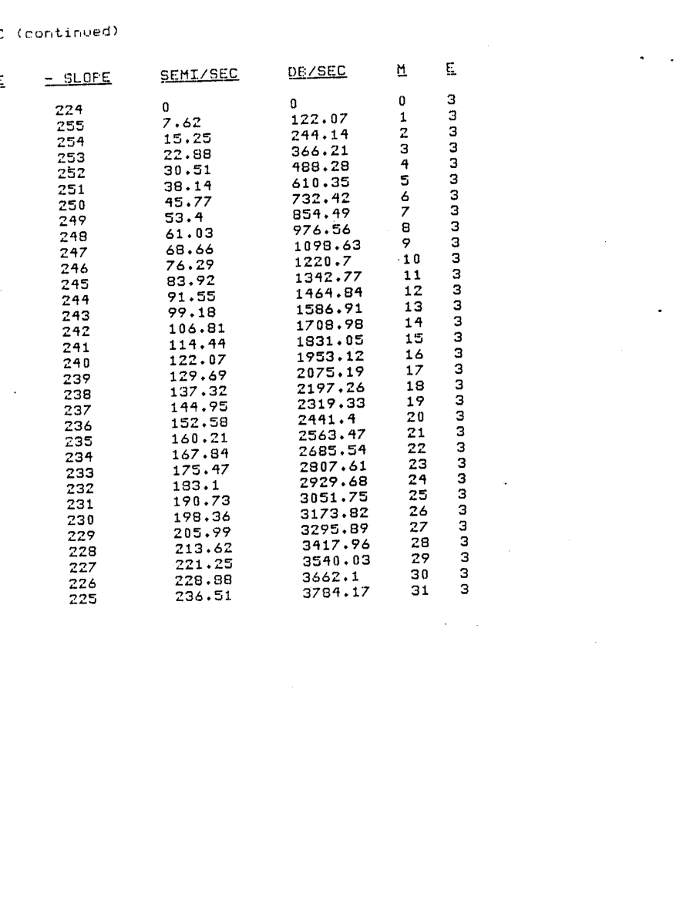

</details>

---

